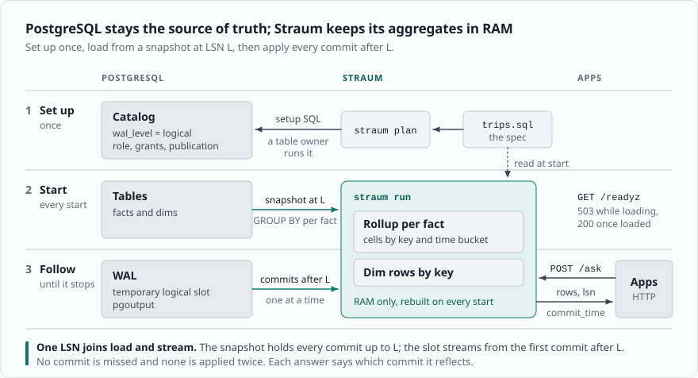

# Straum

**In-memory PostgreSQL aggregates, kept current through logical replication.**

[](https://github.com/janbjorge/straum/actions/workflows/ci.yml)

Straum keeps the aggregates a spec declares as cells in memory, loaded
from a snapshot and kept current by every commit after it, and answers
asks about them over HTTP. In the
[benchmark](https://janbjorge.github.io/straum/benchmark.html) its asks
answer in 125 to 324 µs where PostgreSQL takes 28.1 to 1,750.8 ms, from
65 MiB. PostgreSQL stays the source of truth; Straum keeps nothing on
disk.

**Not stable.** The spec, the asks and the flags may change.

## What it looks like

A spec is a view in a small subset of PostgreSQL's `CREATE VIEW`, here
over an `events` table and the `accounts` it belongs to. Straum never
creates it; PostgreSQL would give the same rows.

```sql
CREATE VIEW usage WITH (buckets = '1 hour, 1 day, 7 days') AS
SELECT date_bin('1 hour', e.at, timestamptz 'epoch') AS bucket,
       e.kind AS kind,
       e.account_id AS account_id,
       a.region AS region,
       count(*) AS events,
       sum(e.amount) AS amount,
       avg(e.amount) AS avg_amount
FROM public.events AS e
LEFT OUTER JOIN public.accounts AS a ON a.id = e.account_id
GROUP BY 1, 2, 3, 4;
```

`straum plan` prints the SQL a table owner runs once; `straum run` loads
the view and follows it. An ask is a `SELECT` over the view, every value
a parameter, here purchases by region on one day:

```sh
curl --json '{
  "query": "SELECT region, events, amount FROM usage WHERE kind = $1 AND bucket >= $2 AND bucket < $3 GROUP BY region",
  "parameters": ["purchase", "2026-11-13T00:00:00Z", "2026-11-14T00:00:00Z"]
}' http://localhost:8080/ask
```

```json
{
  "as_of": "2026-11-14T09:12:40.118204573Z",
  "rows": [
    {"region": "eu", "events": 412, "amount": 18240.50},
    {"region": "us", "events": 655, "amount": 30117.25}
  ]
}
```

Every commit made before `as_of` is in the answer. The guide's [quick
start](https://janbjorge.github.io/straum/quick-start.html) runs Straum
from the `ghcr.io/janbjorge/straum` image against PostgreSQL in Docker,
in four steps, on a month of New York taxi trips.

Straum is not a SQL engine, a replica, a cache or a durable store. It
answers only what its spec declares. It needs PostgreSQL 16 or newer as
shipped, with stock logical replication, no extension and no superuser
([setup](https://janbjorge.github.io/straum/postgresql.html)).

## How it works



One writer loads every table from one snapshot and applies every
commit after it, and asks read meanwhile. The guide's [How Straum
works](https://janbjorge.github.io/straum/how-it-works.html) is the
model; [Design](https://janbjorge.github.io/straum/design.html) is
the same model with the code's names, for contributors.

## Development

[AGENTS.md](AGENTS.md) has the commands and the rules. PostgreSQL tests
need Docker.

## Documentation

- [User guide](https://janbjorge.github.io/straum/), built from `docs/`
- [Decisions](docs/adr/)
- [Straum and PostgreSQL](research/POSTGRESQL.md)
- [Joins: history and sources](research/JOINS.md)

## License

[Apache-2.0](LICENSE-APACHE)
