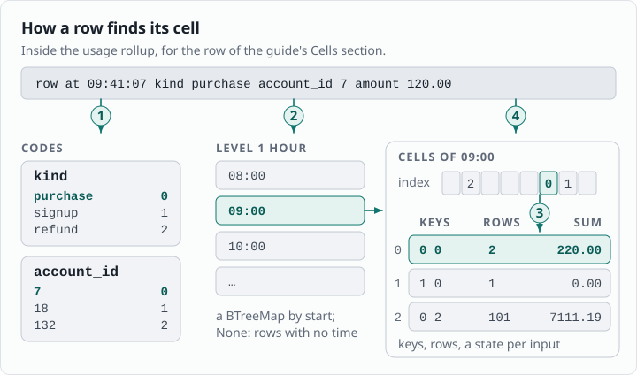

# Design

This page names the code behind [How Straum works](how-it-works.md):
who takes part, what each use case does, how the crates depend on each
other and what the code holds true. A name in code
font, such as `Writer::start`, is the type or function that holds a
rule, under `crates/`; the [glossary](glossary.md) gives each name
its type in the code.

Four participants:

- **PostgreSQL**: the source of truth. Passive: it publishes the
  stream and serves the snapshot loads. Nothing of Straum runs in it.
- **Straum** (`straum run`): active toward PostgreSQL, reactive toward
  clients. One writer thread opens the slot, loads the tables and
  applies every commit; tokio threads answer asks meanwhile.
- **Clients**: the apps that `POST /ask`. They never see a table, a
  join or a row, only the names a view gives its keys and measures.
- **People**: a table owner, who runs the setup SQL `straum plan`
  prints once, and an operator, who runs the binary and reads
  `/readyz`, `/status`, `/views` and the log. In Kubernetes the chart is the
  operator.

## Architecture

Six crates, dependencies inward only, enforced by
`scripts/check-layers.py`.

*The binary depends on the three adapters. `straum-pg` and
`straum-http` depend on the use cases in `straum-app`;
`straum-notation` needs only the domain.*

- `straum-domain` has no dependencies and no I/O. Everything an ask
  or a change needs is a plain struct, enum or function.
- `straum-app` holds the use cases and the one port, `Source`, the
  trait PostgreSQL sits behind.
- The adapters never meet: `straum-http` is handed a query reader by
  the binary (`ReadAsk` in `straum-http`), so HTTP never knows Straum
  SQL.

Data moves the other way at run time: PostgreSQL feeds `straum-pg`,
which hands commits to the writer, which applies them to the store;
apps post asks to `straum-http`, which reads the store through the app.

## Use cases

| Use case          | Actor       | Input                     | Output                 | Detail |
| ----------------- | ----------- | ------------------------- | ---------------------- | ------ |
| Set up PostgreSQL | Table owner | Spec, publication, role   | Setup SQL, run once    | [Setting up PostgreSQL](postgresql.md) |
| Run Straum        | Operator    | Spec file, DSN, flags     | A serving Straum       | [Deploying Straum](deploy.md) |
| Start             | Writer      | Spec, Source              | A store at L           | [Start](#start) |
| Follow            | Writer      | The stream                | One commit applied     | [Applying a commit](#applying-a-commit) |
| Answer an ask     | Client      | Query and parameters      | Answer with `as_of`    | [Answering an ask](#answering-an-ask) |
| Start over        | Writer      | A failure                 | A new start            | [States](deploy.md#states) |
| Stop              | Operator    | SIGTERM or SIGINT         | Exit, slots dropped    | [straum run](cli.md#straum-run) |

Run Straum is `run` in the binary: read the spec and the DSN, bind the
listener, make an **App** with an empty **Store** and the **Limits**,
make a **Writer** over a **Postgres** source, spawn the writer thread,
serve HTTP until a signal. A panic aborts the process (the hook `run`
sets), since the store may be half written. Start over is
`Writer::step` and `run_writer`: the failure is recorded and
**Following** removed, so asks answer 503; the thread sleeps the
backoff; the next step is a start, whose `open` drops the old stream
first, and PostgreSQL drops its slot as the connection closes.

## Start

`Writer::start`:

1. Drop the old store, so two stores never take memory at once.
2. `Source::open`: connect, begin a read-only repeatable-read
   transaction, create a temporary logical slot with `pgoutput` and
   `SNAPSHOT 'use'`, read L. Read the catalog and [check
   it](postgresql.md#what-straum-checks-at-start) against the spec.
3. `Source::load` each dim, then each fact: set the column types from
   the catalog, run one binary `COPY` of the columns the spec names,
   add rows by the batch (`Store::add_rows`). The snapshot
   transaction commits with the last load.
4. Read the server's WAL once; start the **Lag** from when the slot
   was opened.
5. Take the write lock, swap the store in, set **Following** at L,
   count the start. Straum is ready. The stream thread starts at the
   first `next_commit`: it reads the stream, answers the server's
   keepalives and confirms what the writer has applied, so the server
   can recycle WAL.

Any error is a **Failure**, and the next step is a start over. The
load fills a new store outside the lock, so asks never wait on
PostgreSQL; they answer 503 until step 5.

With `--wal physical`, step 2 differs (ADR-0008);
[The physical stream](how-it-works.md#the-physical-stream) says why:

1. Read the catalog on a plain connection and check it.
2. Create a temporary physical slot and wait for
   `pg_current_wal_flush_lsn()` to reach its redo point. Read each spec
   table's **Layout** (`physical::read_layouts`) after the slot, so a
   rewrite between the two is in the WAL read. Start the stream thread
   with a **Pipeline** (`wal/pipeline.rs`): `Records` cut the bytes into
   records and pass by those of other tables' pages, `Heap` keeps the
   pages, `Transactions` holds changes by
   xid, `Publisher` turns commits into pgoutput messages for the same
   `Decoder`.
3. Try `pg_log_standby_snapshot()`, then wait for the **Consistent
   point**: past the first `RUNNING_XACTS` and every transaction it
   names.
4. Begin the repeatable-read transaction, read `pg_current_snapshot()`,
   check the catalog again and hand the snapshot to the stream thread
   (`Stream::see`). A snapshot that misses a commit the stream dropped
   gets `Sight::Blind`, and Straum takes another.

The pure parts, `wal/` and the pipeline, read no socket: a layout read
again after DDL comes in through a closure, given the DDL's xid.
`physical::read_layouts_seeing` reads it in a snapshot that sees that
xid.

## The store

What the store holds, mutable, one per process, owned by **App**.

*One keyed rollup per fact, a bound rollup for a fact whose joins all
read fact columns, one projection per dim. A rollup is one level per
width; a bucket is columnar cells with one state per input.*

- A **Rollup** is every cell of one fact: one **Level** per width,
  the `date_bin` width first, and one **Codes** per rollup-key
  column. The bucket is not coded; it keys the level's map. Rows
  without a time go under `None` (`Level::bucket`).
- A **Bucket** holds its **Cells**, every bucket in memory
  (ADR-0010).
- **Cells** are columnar: keys, row counts and one **State** per
  input column, side by side (`Cells`). A column of counts or sums is
  as wide as its widest entry needs, and none at all while every
  entry is zero (`Counts`, `Sums`, ADR-0003). An **Index** finds a
  cell by its key codes: a table of positions, the keys themselves
  staying in their column. A cell goes with its last row
  (`Rollup::remove`).
  `Aggregate::state_kind` picks which **State** a measure reads, so
  measures over one column share it.
- A **Projection** maps key values to the attribute codes of every
  row under them. `Null` is code 0 in every attribute, so no row and
  a null read alike.
- **Bound** cells are a second rollup of a fact whose joins all read
  fact columns, one of them a column no key reads: keyed by the keys
  and the dim columns' values, so they are fewer than the fact's
  cells and an ask reads no projection. A fact row goes into both
  rollups; into the bound one once per way its joins resolve now
  (`Bound::rows`). A change to a dim the fact reads moves the ones
  whose join columns name the changed key (`Store::retarget`); a dim
  truncate or load makes them again from the keyed cells
  (`Store::rebuild_dim`). A dim update that reads the same changes
  nothing (`Store::update_row`).

`Rollup::add` puts a row in its cells, here the row of
[Cells](how-it-works.md#cells):

*The key values become codes, the time picks a bucket per level, and
the bucket's index finds the cell, which adds the row.*

1. Each key value gets the code of its column's first add of it
   (`Codes::code`), so a cell key is a few integers.
2. Each level floors the time to its width (`Level::bucket`) and finds
   the bucket in its `BTreeMap`, making one if there is none.
3. The bucket's **Index** hashes the codes to a home slot and walks on
   until the cell with those keys, or appends a new cell
   (`Cells::entry`).
4. The cell adds the row: one more row, and each **State** its input.

Steps 2 to 4 repeat for every level.

## Applying a commit

`Writer::apply_next`, one step:

1. If the WAL was read a second or more ago: read it on the plain
   connection, fail past `--max-retained-wal`, feed the **Lag**.
2. `Source::next_commit`, waiting at most until the next WAL reading
   is due.
3. Under the write lock, apply the commit: each change to its rollup
   or projection, tables the spec doesn't name skipped, then move
   **Following** to the commit's LSN and time.

The stream thread (`StreamThread`) reads ahead of the writer, as
[Following](how-it-works.md#following) says. The watchdog
(`watchdog.rs`) is two threads, from the slot's making to its end. Its
reader reads what the slot holds every second on a connection of its
own; past `--max-retained-wal` it shuts the stream's sockets, the
load's too, then has PostgreSQL end the slot's session each second the
slot is still there, so a writer stuck under its lock can't keep the
slot. Its clock touches no network: after 10
seconds without a reading, whatever the reader is stuck on, it shuts
the same sockets.

## Answering an ask

The HTTP handler in `straum-http` (`routes.rs`) and `App::ask`:

1. Read at most 1 MiB of body; parse the query with the parameters
   bound to `$n`; refuse a range jiff can't print.
2. On a blocking thread, take the read lock.
3. Check the ask against the spec and refuse any ask it can't answer
   exactly. An invalid ask is 400 even while loading. Once a load has
   read the column types, a filter value of another type than its
   column is refused too.
4. Without a **Following**, 503 not ready.
5. `Store::ask`: read the cells of the buckets in the range
   (`Rollup::cover`). A dim column is part of the bound cells' key
   while they hold, else read from the dim's projection through the
   join id in the cell key; a cell whose join keeps no row is passed
   over. Then add, filter and sort as
   [Answering an ask](how-it-works.md#answering-an-ask) says.
6. Answer with `as_of` from the **Lag** and the applied LSN in the
   `Straum-LSN` header, `Cache-Control: no-store`: JSON, or a table in
   plain text for an ask sent with `Accept: text/plain`.

`GET /views` takes the read lock once and reports what the store holds
(`App::held`): per view its widths, cells, range of buckets, keys with
the types the load set, and measures; per dim its rows. `straum views`
and `straum ask` print what the server wrote, as `straum status` does.

`GET /views/NAME` answers an ask the app builds (`App::rows_ask`):
every measure by the bucket and every key over the buckets the view
holds, through the same steps as any ask, written as a table of at
most 1000 rows. `GET /views/NAME/spec` replies with the view's
`CREATE VIEW` statement, which `straum run` cut from the spec's text
at start (`straum_notation::definitions`); the store never sees it.
`straum shell` is a client of these endpoints: it
reads the views as JSON to complete names, prints an answer's
`Server-Timing` under it beside the time it measured itself, and knows
no Straum SQL.

In the binary, `main.rs` reads the command line and wires the crates
together. The commands that talk to a running Straum go through
`client.rs`, one request on a plain socket, which also times an ask
and a view's rows. `complete.rs` is what Tab
offers, plain functions over a line and the views, and `shell.rs` is
the prompt around both, the only code that touches the terminal.

## Model

Arrows denote dependency, not communication flow.

### The spec: what Straum keeps

Immutable once `Spec::new` has checked it. Every node is a value
object compared by value.

*A spec is dims and facts. A fact is one view: its table, one time,
by keys, refs in join order, measures and the view's WHERE. A ref
joins through one via per key column and reads attributes.*

An **Aggregate** is count, count of a column, sum, min, max, avg,
count distinct, bool_and, bool_or or percentile_disc; all but count
name one input column (`Aggregate::input`).

- A **Spec** holds dims and facts in one namespace (`Spec::new`).
  `Spec::tables` lists each table once, dims first.
- One **Dim** per table, whatever the number of views joining it;
  `Dim::attributes` is the union of what they read.
- A **Fact** holds its refs in join order: a ref joined through
  another dim comes after it (`Via::Attribute::through` is an index
  into `Fact::refs` before it).
- A **Ref** points at a dim by name, with as many **Via** columns as
  the dim's key has (`JoinError::KeyLength`). Left and inner refs read
  at least one **Attribute**; semi and anti read none
  (`JoinError::ReadsNothing`, `JoinError::ReadsColumns`).
- Keys, attributes and measures share one namespace per view, and
  nothing may be named `bucket` (`SpecError::NamedBucket`). An ask
  reaches any of them by that name alone (`Fact::resolve`).
- **Width** divides a day; each wider width is a whole multiple of
  the one before (`SpecError::BadWidth`, `SpecError::BadBucket`).

Derived from a fact, not stored:

| Derived        | What                                      | Where         |
| -------------- | ----------------------------------------- | ------------- |
| Rollup key     | by parts, each fact-side via once, bucket | `Fact::rollup_key` |
| Row layout     | time, by columns, vias, inputs, each once | `Fact::columns` |
| Dim row layout | key columns, then attributes              | `Dim::columns` |
| Direct         | every via is a fact column, no chain      | `Fact::is_direct` |

### The ask and the answer

An **Ask** names one fact and, by name, its measures, keys and
conditions; its range is two bucket edges with `from < to`. An
**Answer** is one column per key and measure and one row per group.

- `Spec::check_ask` resolves names, refuses two time keys, a name
  asked twice, an empty range and a bound off a bucket edge. The
  store adds the type check once a load has set the types
  (`AskError::WrongType`).
- **Answered** wraps an answer with the applied LSN and `as_of`. The
  domain never knows time or LSNs beyond the bucket.

### The running system

*A writer owns the source port and an app. The app holds the limits
and a state behind a read-write lock: the store, a following while
every table is loaded, and the last failure.*

- **App** is an `Arc<RwLock<State>>` beside the limits, which never
  change; clones share it. Asks take the read lock, the writer the
  write lock only to apply a commit it has read or to swap a store in
  (`State::apply`, `Writer::start`).
- **Following** exists only while every table is loaded; a failure
  removes it (`Writer::step`). Its absence is "not ready".
- **Lag** keeps the WAL readings the slot hasn't confirmed, at most
  an hour of them, and the instant it last had; `as_of` and readiness
  derive from it.
- A **Commit** is one transaction, whole, with the end of its commit
  record as LSN. The stream delivers nothing before the commit, and
  the store sees it as one.

## Invariants

What the code holds true, and where. Planting a bug in any of these
makes a property test fail.

1. **A commit applies whole.** The decoder holds a transaction until
   its Commit message (`Decoder`), and the store takes it under
   one write lock (`State::apply`). An answer never sees half of one.
2. **No commit is missed or applied twice.** The snapshot is at the
   slot's consistent point L and the stream starts at L
   (`Postgres::open` and the first `next_commit`);
   `the_snapshot_and_the_stream_split_exactly`
   races 2,000 commits against it.
3. **Only the writer writes.** The store is reached through
   `App::read` by asks and `App::write` by the writer alone.
4. **A row removed was added.** `RowError::Missing` from a cell, a
   value count or a projection entry ends the step
   (`Rollup::remove`, `Projection::remove`), and Straum starts over.
5. **Types come from the catalog only.** The load sets them
   (`Store::set_types`); a filter value must fit its column
   (`ColumnType::fits`); a Relation message that changes them is
   `Unfit` (`Decoder`).
6. **Null joins nothing.** A dim row with a null key is never held and
   a lookup with a null finds nothing (`Projection::add`,
   `Projection::matches`).
7. **A row with no time is kept, never answered** (`Level::bucket`).
8. **Every width divides a day and nests in the next**
   (`SpecError::BadWidth`); every ask bound is on a `date_bin` edge
   (`AskError::RangeUnaligned`); an ask never reads part of a bucket.
9. **Levels agree.** Every row goes into one cell per width in the
   same add (`Rollup::add`); `Rollup::cover` reads each instant of a
   range from exactly one level.
10. **Bound cells are the keyed cells, bound as the dims are now.**
    They exist only for a fact whose joins all read fact columns, one
    of them no key: any other fact's would be as many as its keyed
    cells (`Bound::new`). A dim change moves the ones that
    name its key (`Store::retarget`) and a dim truncate or load makes
    them again (`Store::rebuild_dim`). An ask reads them whenever the
    fact keeps them (`Store::reading`).
11. **Lag never understates.** Readings merge only toward older
    (`Lag::read`); `matches_every_reading_kept` checks it against a
    reference that keeps every reading.
12. **Two stores never take memory at once.** The old store goes
    before the new load (`Writer::start`).
13. **One name, one thing, per view.** Keys, attributes and measures
    share a namespace, `bucket` is reserved, and an answer's columns
    are its names (`Spec::new`, `Spec::check_ask`).

## State machines

The running states, Loading, Ready, Lagging, Waiting and Stopping, are
drawn under [States](deploy.md#states). There is no enum: **Following**
is `None` while loading or waiting, `Failure` says which, and lag
against `--max-lag` tells Ready from Lagging (`App::status`,
`why_not` in `straum-http`). One smaller machine, the source
connection:

*`Postgres` in `straum-pg` moves Closed to Loading on `open`, Loading
to Streaming on the first `next_commit`, and back to Closed on the next
`open`.*

A `load` outside `Loading` and a `wal` while `Closed` are
`Error::Stopped`.

## Which decision shaped what

The reasoning and the tradeoffs are in the
[ADRs](https://github.com/janbjorge/straum/tree/main/docs/adr), one per
subject; their index says which record covers which part of the model.

The PostgreSQL mechanics behind the load, the apply and the slot, with
their citations, are in
[research/POSTGRESQL.md](https://github.com/janbjorge/straum/blob/main/research/POSTGRESQL.md);
what joins replaced and the sources behind them in
[research/JOINS.md](https://github.com/janbjorge/straum/blob/main/research/JOINS.md).

## Where the code and the records differ

The open names are in the glossary's [Clashes](glossary.md#clashes)
table.
