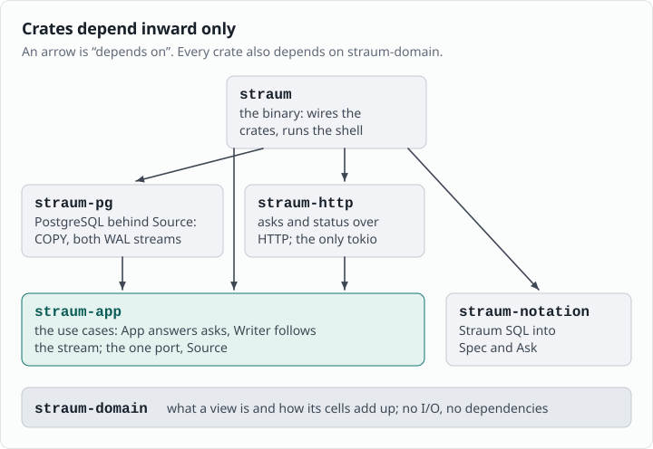
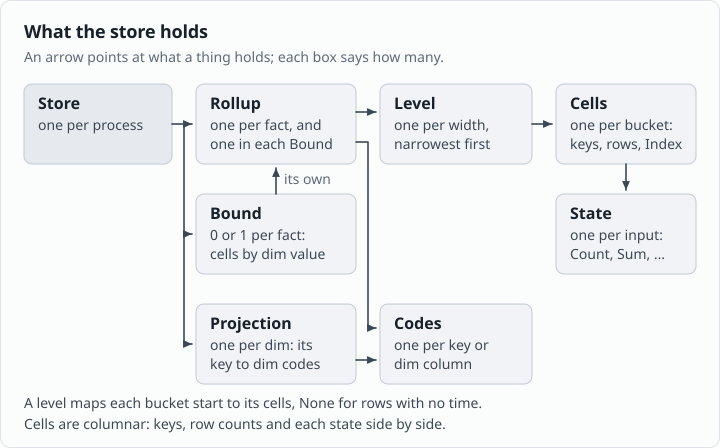
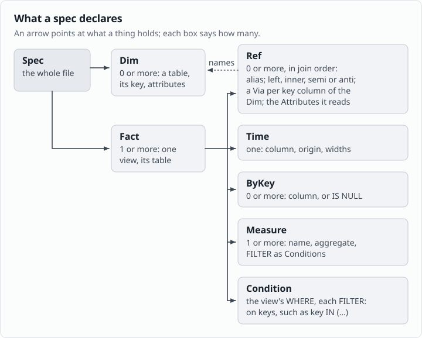
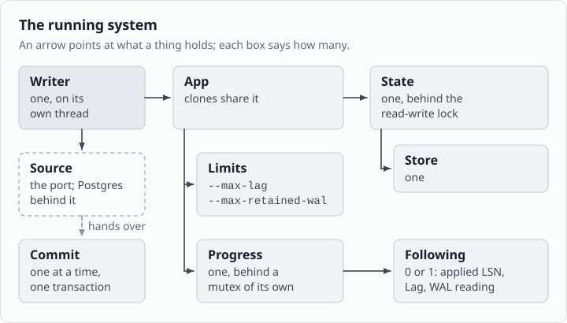
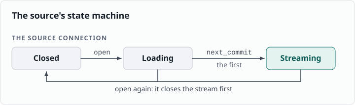

# Design

[How Straum works](how-it-works.md) says what Straum does. This page
follows the code that does it, from the process starting to an answer
leaving. The [glossary](glossary.md) gives each term its name in the
code; [Reading the code](reading-the-code.md) gives the order to read
the crates in.

Four parties meet in it. PostgreSQL is the source of truth and stays
passive: it serves the snapshot loads and publishes the stream, and
nothing of Straum runs inside it. Straum, `straum run`, acts toward
PostgreSQL and reacts toward its clients: one writer thread loads the
tables and applies every commit while tokio threads answer asks. The
clients are apps that `POST /ask`, and they see only the names a view
gives its keys and measures, never a table, a join or a row. Behind
them are people. A table owner runs, once, the setup SQL that `straum
plan` prints; an operator, or in Kubernetes the chart, runs the binary
and reads `/readyz`, `/status`, `/views` and the log.

## Architecture

The code is six crates, and every dependency points inward
(architecture decision record ADR-0002). `scripts/check-layers.py`
fails the build when one points out.

*The binary depends on every crate. The adapters, `straum-pg` and
`straum-http`, depend on the use cases in `straum-app`;
`straum-notation` needs only the domain.*

At the centre, `straum-domain` says what a view is and how its cells
add up, in plain structs, enums and functions with no dependency and no
I/O. It holds what a spec and an ask mean, never how Straum SQL writes
them. Its errors are data, and `straum-notation` words them
(`describe_ask_error`); `scripts/check-domain-syntax.py` refuses a
Straum SQL word in a domain string.

`straum-app` turns the domain into use cases: `App` answers asks, and
`Writer` keeps the store in step with PostgreSQL. It declares the one
port, `Source`, the trait PostgreSQL sits behind, so the tests run the
same writer over an in-memory fake. Like the domain, it takes no
outside crate and does no I/O; it reads only the clock.

Neither adapter depends on the other. `straum-pg` implements `Source`, and
`straum-http` serves the endpoints and is the only crate that runs
tokio. HTTP still has to read an ask and word its errors, which takes
Straum SQL, so the binary hands it both as `AskSyntax`, a reader and the
words for `AskError` from `straum-notation`. `straum-http` never depends
on the notation.

At run time data flows against the arrows. PostgreSQL feeds
`straum-pg`, which hands commits to the writer, which applies them to
the store. Apps post asks to `straum-http`, which reads the store
through the app.

## Running

`run` in the binary reads the spec and the data source name (DSN),
binds the listener and sets a panic hook that aborts the process, since
after a panic the store may be half written. It builds an `App` around
an empty `Store` and the `Limits`. It then starts the memory watch
(`memory.rs`): a thread that reads the process's resident memory every
second, from `/proc/self/status` on Linux and from `ps` where that file
is missing, as on macOS, records each reading in the app's
`MemoryReadings` for `/status`, and exits 1 past `--max-memory` when it
is set. It reads once before the thread starts: a limit it can't read
fails the start, and without a limit a system with neither runs
without the watch. Then `run` builds a `Writer` over
a `Postgres` source, spawns the writer thread and serves HTTP until
SIGTERM or SIGINT.

`run_writer` logs a failed step's error and exits 1, and PostgreSQL
drops the temporary slot as the connection closes. Straum never retries
inside the process: whatever runs it starts it again, and the new
process loads afresh ([States](deploy.md#states)).

`straum plan --copy` writes the psql scripts that copy the spec's
tables into another database (ADR-0015) and reads no database itself,
so `copy_scripts.rs` sits beside `plan.rs` in `straum-pg`, outside the
`Source` port, which only loads and streams.

## Start

`Writer::start` fills a store that is exactly current at one point in
the log, and hands over to the stream at that point.

With `--wal logical`, `Source::open` connects in replication mode and
creates a temporary logical slot with `pgoutput` and `SNAPSHOT
'export'`. When PostgreSQL makes no slot within the start's wait,
`slot_wait` names the open transactions and ends the slot's session.
The slot's start is the log sequence number (LSN) L, and it
names a snapshot that sees every commit up to L; the slot sends every
commit after it. A plain connection begins a read-only repeatable-read
transaction and takes that snapshot up (`SET TRANSACTION SNAPSHOT`).
In that snapshot Straum reads the catalog and [checks
it](postgresql.md#what-straum-checks-at-start) against the spec. It
then holds the spec tables in `ACCESS SHARE` mode (`hold_tables`),
waiting at most 5 s for each lock and naming the tables that hold one
longer. A table rewritten after the snapshot fails the start here,
since its new file reads empty in the snapshot. Only then does the
slot's connection send `START_REPLICATION` from L: PostgreSQL keeps an
exported snapshot only until the next command on the slot's
connection, so the plain connection must take it up first. The stream
thread starts there and reads beside the loads, as the physical one
does.

`Source::open` returns the start and the snapshot's time, its `now()`
(`Opened`). The writer advances the new store to that time
(`Store::advance`) before any table loads, so a row before a horizon
never makes a bucket of a width kept for a time
([Keeping a width for a time](spec.md#keeping-a-width-for-a-time)).

Before the first copy the writer asks `Source::estimate` for each
table's rows and bytes, which PostgreSQL reads in the snapshot's
transaction from `pg_class.reltuples` (-1, unknown, for a table never
analysed) and `pg_relation_size`, and logs them in one line with the
columns read. While a table loads, `/readyz` says which, its place,
the share of its estimated rows read and the bytes of commits the
stream holds: the load counts both after each batch into the
`LoadCounts` the writer passes, which the status reads without a lock.

`Source::load` reads each dim, then each fact table once for all the
views that read it (`Spec::facts_by_table`). It sets the column types
from the catalog and runs one binary `COPY` of every column those views
name, each once, handing each view its own columns of the rows in
batches of 8,192 (`Store::add_rows`); each width's level adds a batch
on a thread of its own. The snapshot transaction commits with the last
load. The writer reads the server's
write-ahead log (WAL) position once and starts the `Lag` from when the
slot was opened.

All of this fills a new store outside any lock, so asks never wait on
PostgreSQL; they answer 503 meanwhile. Only at the end does the writer
take the write lock, swap the loaded store in for the empty one and set
`Following` at L, and Straum is ready. The stream thread runs from
`open` on: it reads the stream, queues commits for the writer, answers
the server's keepalives and confirms what it has read, so the server
can recycle WAL: the commits queued wait in memory, and no slot is
streamed twice, so nothing confirmed is asked for again
(`next_report`). Apart from that it keeps what is applied for the lag:
the last commit the writer has applied, or, while no commit it has
queued waits and no transaction is open, the WAL it has read. During a
load that is the start. While the tables
load its queue has no bound in commits, only `--max-stream-memory` in
bytes; the writer's first `Stream::next` ends that, and from then 64
commits, 200,000 changes or `--max-stream-memory` bytes bound it, so
the thread reads nothing more until the writer has taken a backlog
below them. An empty queue takes one commit of any size. While the
queue is full, and while a physical stream waits after data definition
language (DDL), the thread still confirms every second, so the server
does not end the stream at its `wal_sender_timeout`. Each load checks
after every batch that the stream has not failed. Any error on the way
is a `Failure`, and Straum exits. A writer starts once; a failed one
takes no more steps.

### The physical start

`--wal physical` (ADR-0008) has no snapshot tied to a slot, so it
builds the meeting point itself. [The physical
stream](how-it-works.md#the-physical-stream) says why it keeps pages.
Straum reads the catalog on a plain connection and checks it, creates a
temporary physical slot and waits for `pg_current_wal_flush_lsn()` to
reach the slot's redo point. It reads each spec table's `Layout`
(`physical::read_layouts`) after the slot exists, so a rewrite between
the two is in the WAL it reads.

The stream thread starts at once, with a `Pipeline`
(`wal/pipeline.rs`) of four stages. `Records` cuts the bytes into
records and passes by those of other tables' pages, `Heap` keeps the
pages, `Transactions` holds changes by transaction id (xid), and
`Publisher` turns each commit into the pgoutput messages the logical
stream gets, for the same `Decoder`. The pipeline reads no socket. When
DDL changes a table, its layout comes in
again through a closure given the DDL's xid, and
`physical::read_layouts_seeing` reads it in a snapshot that sees that
xid.

Straum tries `pg_log_standby_snapshot()` to hurry the next list of
running transactions, then waits for the consistent point: past the
first `RUNNING_XACTS` record and every transaction it names. Only then
does it begin the repeatable-read transaction, read
`pg_current_snapshot()` and hand the snapshot to the stream thread
(`Stream::see`). A snapshot blind to a commit the stream has already
read gets `Sight::Blind`, and Straum takes another. Once a snapshot
sees every commit the stream will skip, Straum checks the catalog again
in it and holds the tables as the logical start does, and the load runs
as above.

## The store

The load puts rows into the store: one per process, mutable, owned by
`App`.

*One rollup per fact, a bound rollup for a fact whose joins all read
fact columns, one projection per dim.*

A `Rollup` is every cell of one fact. It keeps one `Level` per width,
the narrowest first, and one `Codes` per rollup-key column. A level
maps each bucket start to that bucket's `Cells`, every bucket in memory
(ADR-0010), with the rows that have no time under `None`
(`Level::bucket`). A level whose width is kept for a time holds only
the buckets from its horizon on: `Store::advance` drops the ones
before it, and a row before it adds to no cell of that level.

`Cells` are columnar. The key codes, the row counts and one `State` per
input sit in columns side by side, so an ask reads a column of cells in
one pass ([rows vs
columns](https://spiraldb.com/blog/rows-vs-columns)). A column of
counts is as wide as its widest entry needs and takes no memory while
every entry is zero (`Counts`); a column of sums widens from 32 to 64
to 128 bits as its values need (`Sums`, ADR-0003). An `Index` finds a
cell by its key codes. It is a table of positions only, and the keys
stay in their column. A cell goes with its last row (`Rollup::remove`).
Once a bucket's cells fill an eighth of its index, it indexes them
anew and gives back the room of the cells gone (`Cells::swap_remove`),
so a bucket holds about what its cells need, not its peak.

`Aggregate::state_kind` picks the `State` a measure reads, so measures
over one column share it. A count distinct keeps per-value counts, as a
min or max does, while its column holds only numbers. At its first
value of another type it moves to a hash map per cell
(`DistinctCells`), because the load sets the column types only after
the states exist. A map gives back its room once it holds under a
quarter of it. Beside a min, max, mode or percentile on the same
column it keeps nothing and reads their counts.

A `Projection` maps a dim's key values to the codes of the dim columns
of every row under them. `Null` is code 0 in every dim column, so a
missing row and a null read alike. As the map of a count distinct does,
the map gives back its room once it holds under a quarter of it.

`Bound` cells are the one place a cell keeps a dim value instead of the
join column ([Dims](how-it-works.md#dims)). For a fact whose joins all
read fact columns, one of them a column no key reads, the store keeps a
second rollup keyed by the keys and the dim columns' values. Its cells
are fewer than the fact's, and an ask reads no projection (ADR-0006).
The cost falls on writes: a fact row goes into both rollups, and into
the bound one once per way its joins resolve now (`Bound::rows`). A dim
change moves the bound cells whose join columns name the changed key
(`Store::retarget`), level by level from each level's own keyed cells,
since a level kept for a time no longer holds every row's time; a dim
truncate or load makes them again from the keyed cells
(`Store::rebuild_dim`); a dim update that reads the same changes nothing
(`Store::update_row`).

`Rollup::add` puts one row in its cells. Here is the row from
[Cells](how-it-works.md#cells):

*The key values become codes, the time picks a bucket per level, and
the bucket's index finds the cell, which adds the row.*

Each key value becomes its column's code for it (`Codes::code`), so a
cell key is a few integers however long the values are. Then, at every
level, the time is floored to the level's width (`Level::bucket`) and
the level finds that bucket in its `BTreeMap`, making it if it is new.
The bucket's `Index` hashes the codes to a home slot and walks on until
it meets the cell with those keys, or appends a new one
(`Cells::entry`). The cell counts one more row, and each `State` takes
its input.

A value keeps its code after its last cell or dim row goes. Once a
column holds more than 4,096 codes and its dead codes outnumber its
live ones, the end of a store change drops the dead ones and numbers
the rest again (`Store::reclaim_codes`), so a value's code can change.

## Applying a commit

Once ready, the writer loops on `Writer::apply_next`. Each turn first
asks whether a second has passed since it last read the WAL. If so, it
reads the server's position on the plain connection, feeds the `Lag`,
fails past `--max-retained-wal` and checks that each spec table is
still the one it follows (`catalog::still_followed`), trying once more
on a new connection before it gives up. The check runs under a 200 ms
`lock_timeout`, because `pg_publication_tables` locks each published
table. At that timeout, the reading skips the check and keeps the
position. Then it asks
`Source::next_commit` for a commit, waiting no longer than the next
reading is due. With one in hand, it takes the write lock and applies
it whole (`State::apply`): each change to its rollup or projection,
tables the spec doesn't name skipped. Before its changes, the store
advances to the commit's time, which moves each horizon on and drops
the buckets before it. `Following` moves to the commit's LSN and time.

Under the same lock, the writer asks `Source::next_commit` with a zero
wait, and applies each commit that is already queued. Thus a long ask
delays a batch, and not each commit. The batch stops when the queue is
empty, or when a reading of the WAL is due. The reading never runs
under the lock. The stream thread can queue more commits during a
batch, so the time to the next reading bounds a long batch. Then the
lock is let go.

The stream thread (`StreamThread`) reads ahead of the writer, as
[Following](how-it-works.md#following) says. The decoder ends the
stream on a transaction past `--max-transaction-rows`, or one whose
rows hold more than `--max-stream-memory` bytes. The physical stream
also ends past `--max-page-memory`. Either stream ends past
`--max-stream-memory` while the tables load.

A writer can get stuck, under its lock or on a socket, and a stuck
writer must not keep a slot that holds WAL back. So from when the slot
is made until it ends, the watchdog (`watchdog.rs`) runs two threads.
Its reader reads what the slot holds every second, on a connection of
its own; for a physical slot it counts from where the slot was made,
not from the redo point it keeps WAL from. Past `--max-retained-wal` it
shuts the stream's sockets and the load's, then has PostgreSQL end the
slot's session each second the slot is still there. Its clock touches
no network at all: after 10 seconds without a reading, whatever the
reader is stuck on, it shuts the same sockets.

## Answering an ask

An ask comes in through the HTTP handler in `straum-http`
(`routes.rs`). It takes a turn, of which there is one per core, or is
503 busy when none is free, and holds it until its answer is written,
so asks can't queue on the read lock without end and keep the writer
from it. On a
blocking thread, it reads at most 1 MiB of body, parses the query with
the parameters bound to `$n` and refuses a range jiff can't print.
`App::ask_window` then takes the read lock and checks the
ask against the spec, refusing any ask it can't answer exactly; an
invalid ask is 400 even while loading. Until a load is in, with no
applied LSN in the `State`, the answer is 503 not ready.

`Store::ask_window` does the rest. With the types the load set, it
refuses a filter value of another type than its column. It reads the
cells of the buckets in the range (`Rollup::cover`). A dim column comes
from the bound cells' key when the fact keeps them; otherwise it is
read from the dim's projection, through the join column in the cell
key, once per value met (`Joined`). That lookup is a list of every
value when the ask reads as many cells as there are values, and a map
of those met when it reads fewer. A cell whose join finds no row is
passed over. A view whose join finds several rows per key, or that
joins through another dim, walks each cell once per row its joins
find. The cells are then added up, filtered and sorted as [Answering an
ask](how-it-works.md#answering-an-ask) says.

An ask builds at most `--max-answer-rows` rows, 100,000 by default, and
an answer with more is 400: it is written whole in memory, so an ask over
every key of a large view could take more than the process may hold.

The answer carries `as_of` from the `Lag`, the applied LSN in the
`Straum-LSN` header and `Cache-Control: no-store`. It is JSON, or a
table in plain text for an ask sent with `Accept: text/plain`.

The other endpoints reuse these paths. `GET /views` takes the read lock
once and reports what the store holds (`App::held`): per view its
widths, cells, range of buckets at any width, each width kept for a
time with its horizon (`Store::horizons`), keys with the types the load
set, and measures; per dim its rows. `GET /views/NAME` builds an ask of
its own (`App::rows_ask`), every measure by the bucket and every key over all
the buckets the view holds, and runs it like any other
(`App::ask_window`). The store builds only the rows of the window asked
for, at most 1000, but still merges every cell into its group.
`GET /views/NAME/spec` replies with the view's `CREATE VIEW` statement,
which `straum run` cut from the spec's text at start
(`straum_notation::definitions`); the store never sees it.

On the other side of these endpoints, `main.rs` reads the command line
(`command_line.rs`) and wires the crates together. `straum views`,
`ask`, `status` and `shell` talk to a running Straum through
`client.rs`, one request on a plain socket, which also times an ask and
a view's rows. `straum shell` knows no Straum SQL. It reads the views
as JSON to complete names (`complete.rs`, plain functions over a line
and the views) and prints an answer's `Server-Timing` beside the time
it measured itself. `shell.rs` is the prompt around both, and the only
code that touches the terminal.

## Model

A few types pass between these steps. In the diagrams below, an arrow
points at what a thing holds.

### The spec: what Straum keeps

A spec never changes once `Spec::new` has checked it, and every part of
it is a value compared by value.

*A spec is dims and facts. A fact is one view: its table, one time,
by keys, refs in join order, measures and the view's WHERE. A ref
joins through one `Via` per dim key column and reads dim columns.*

`Spec` holds dims and facts in one namespace, and `Spec::tables` lists
each table once, dims first. There is one `Dim` per table however many
views join it; its `attributes` are the union of the dim columns they
read. A `Fact` keeps its refs in join order, so a ref joined through
another dim comes after it (`Via::Attribute::through` is a `RefIndex`,
a position in `Fact::refs` before it). A `Ref` points at a dim by name,
with as many `Via` columns as the dim's key has (`JoinError::KeyLength`).
A left or inner ref reads at least one dim column, an `Attribute`; a
semi or anti ref reads none (`JoinError::ReadsNothing`,
`JoinError::ReadsColumns`).

Within a view, the time, keys, dim columns and measures share one
namespace (`SpecError::Duplicate`), so an ask reaches any of them by
name alone: the time by `Time::name`, the rest through `Fact::resolve`.
The narrowest width divides a day, and each wider one is a whole
multiple of the one before, whether or not it divides a day
(`SpecError::BadWidth`, `SpecError::BadBucket`). An `Aggregate` is one
of count, count of a column, sum, min, max, avg, count distinct, sum
distinct, avg distinct, bool_and, bool_or, percentile_disc, mode,
var_samp, var_pop, stddev_samp and stddev_pop. All but count name one
input column (`Aggregate::input`).

A few shapes are derived from a fact rather than stored:

| Derived        | What                                              | Where              |
| -------------- | ------------------------------------------------- | ------------------ |
| Rollup key     | by parts, each join column once, bucket           | `Fact::rollup_key` |
| Row layout     | time, by columns, join columns, inputs, each once | `Fact::columns`    |
| Dim row layout | dim key columns, then dim columns                 | `Dim::columns`     |
| Direct         | every `Via` is a join column, no chain            | `Fact::is_direct`  |

### The ask and the answer

An `Ask` names one fact and, by name, its measures, keys, conditions
and `HAVING`. Its range has two ends on bucket edges, either of which
may be open, with `from < to` when both are set. `Spec::check_ask`
resolves the names and finds the time by its name (`Fact::time_width`).
It refuses two time keys, a `buckets` row width the view doesn't keep,
`buckets` or range bounds on a name that is not the time
(`AskError::NotTime`), the time in `WHERE`, a name asked twice, an
empty range and a bound off an edge of the row width. The store adds
the type checks when a load has set the types: a filter value of
another type (`AskError::WrongType`), and a bound with an offset on a
wall clock time (`AskError::OffsetOnWallClock`).

An `Answer` is one column per key and measure and one row per group.
`Answered` wraps it with the applied LSN and `as_of`; the domain knows
no time or LSN beyond the bucket.

### The running system

*A writer owns the source port and an app. The app holds the limits,
a state behind a read-write lock, the store, and a progress behind a
mutex: a following while every table is loaded.*

`App` is cheap to clone, and clones share everything. It holds the
store and the LSN it is applied up to in an `Arc<RwLock<State>>`, the
`Following` in an `Arc<Mutex<Progress>>`, and the spec and limits,
which never change. Asks take the read lock. The writer takes the write
lock only to apply a commit it has already read or to swap the loaded
store in (`State::apply`, `Writer::start`). The status and the writer's
WAL readings take only the progress's lock, so they never wait on an
ask, and a writer waiting for the write lock holds back no reading.
Where both are taken, the store's lock comes first.

`Following` exists only while every table is loaded; a failure removes
it (`Writer::step`), and its absence is what "not ready" means. A
writer whose step failed is done: another step panics, and Straum exits
instead (ADR-0009). The `Lag` keeps the WAL readings Straum hasn't
applied, at most an hour of them, and the last reading Straum had
applied in full; `as_of` and readiness derive from it. A `Commit` is
one transaction, whole, with the end of its commit record as its LSN.
The stream delivers nothing before the commit, and the store sees it as
one.

## Invariants

The code holds these true, and a bug planted against any of them fails
a property test.

| Invariant | Held by |
| --- | --- |
| A commit applies whole. | The decoder holds a transaction until its Commit message (`Decoder`), and the store takes it under one write lock (`State::apply`). An answer never sees half of one. |
| No commit is missed or applied twice. | The snapshot is at the slot's consistent point L, and the stream starts at L (`Source::open`). `the_snapshot_and_the_stream_split_exactly` races 2,000 commits against it. |
| Only the writer writes. | Asks reach the store through `App::read`, the writer alone through `App::write`. |
| A row removed was added. | `RowError::Missing` from a cell, a value count or a projection entry ends the step (`Rollup::remove`, `Projection::remove`), and Straum exits. |
| A row turned away changes nothing. | Each row is checked before a cell or a projection entry changes (`Rollup::check`, `Projection::check`). An update checks its new row before its old row leaves (`Store::update_row`). |
| Types come from the catalog only. | The load sets them (`Store::set_types`), a filter value must fit its column (`ColumnType::fits`), and a Relation message that changes them is `Unfit` (`Decoder`). |
| Null joins nothing. | A dim row with a null key is never held, and a lookup with a null finds nothing (`Projection::add`, `Projection::matches`). |
| A row with no time is kept, never answered. | `Level::bucket` puts it under `None`, which no ask reads. |
| An ask never reads part of a bucket. | The narrowest width divides a day and every width nests in the next (`SpecError::BadWidth`, `SpecError::BadBucket`); every bound is on an edge of a row width the view keeps (`AskError::RangeUnaligned`, `AskError::WidthNotKept`). |
| Levels agree. | Every row goes into one cell per width in the same add (`Rollup::add`), but a level kept for a time skips a row before its horizon, and `Rollup::cover` reads each instant of a range from exactly one level. |
| A dropped bucket is never read. | A horizon never moves back (`Store::advance`), and an ask that would read a level before its horizon is refused (`AskError::PastRetention`). |
| Bound cells are the keyed cells, bound as the dims are now. | They exist only for a fact whose joins all read fact columns, one of them no key; any other fact's would be as many as its keyed cells (`Bound::new`). A dim change moves the ones that name its key (`Store::retarget`): one walk for an update that keeps the key, none for a key the join columns never coded. A dim truncate or load makes them again (`Store::rebuild_dim`). An ask reads them whenever the fact keeps them (`Store::reading`). |
| Lag never understates. | Readings merge only toward older (`Lag::read`); `matches_every_reading_kept` checks it against a reference that keeps every reading. |
| A process loads once. | The writer loads one new store and swaps it in for the empty one, and a step after a failed one panics (`Writer::step`), so two loaded stores never take memory at once. A start after a failure is a new process. |
| One name, one thing, per view. | The time, keys, dim columns and measures share a namespace, and an answer's columns are its names (`Spec::new`, `Spec::check_ask`). |

## State machines

The running states, Loading, Ready, Lagging, Exited and Stopping, are
drawn under [States](deploy.md#states), and they have no enum of their
own. The writer's `Phase` (Loading, Following, Failed) says only what
its next step does. `Following` is `None` while loading, Exited is the
process gone, and lag against `--max-lag` tells Ready from Lagging
(`App::status`, `why_not` in `straum-http`). The one machine with a
state of its own is the source connection:

*`Postgres` in `straum-pg` moves Closed to Loading on `open`, and
Loading to Streaming on the first `next_commit`. A failed `load` or
`next_commit` goes back to Closed, and so does the next `open`, which
closes the stream first.*

A `load` outside Loading, and a `next_commit` or `wal` while Closed,
are `Error::Stopped`.

## Which decision shaped what

The reasoning and tradeoffs are in the
[ADRs](https://github.com/janbjorge/straum/tree/main/docs/adr), one per
subject (ADR-0001); their index says which record covers which part of
the model.

The PostgreSQL mechanics behind the load, the apply and the slot, with
their citations, are in
[research/POSTGRESQL.md](https://github.com/janbjorge/straum/blob/main/research/POSTGRESQL.md);
what joins replaced and the sources behind them in
[research/JOINS.md](https://github.com/janbjorge/straum/blob/main/research/JOINS.md).

## Where the code and the records differ

The open names are in the glossary's [Clashes](glossary.md#clashes)
table.
