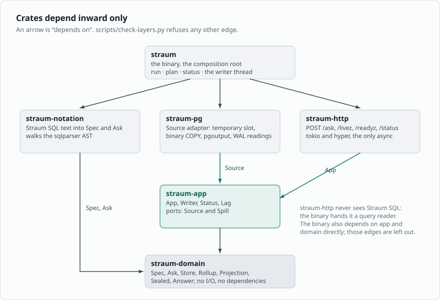
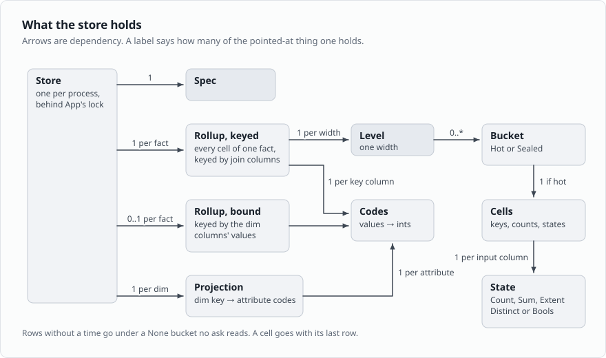
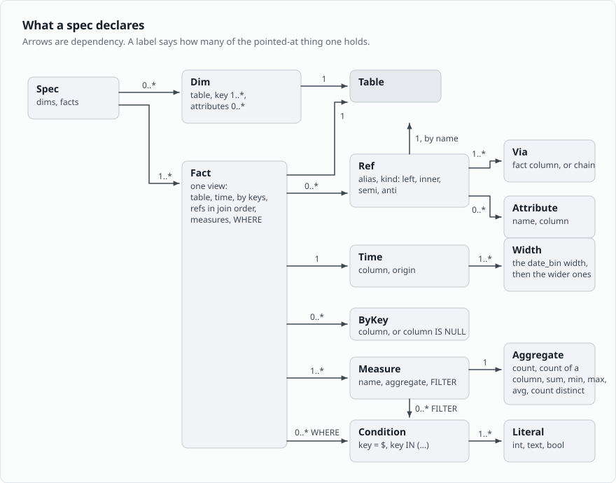
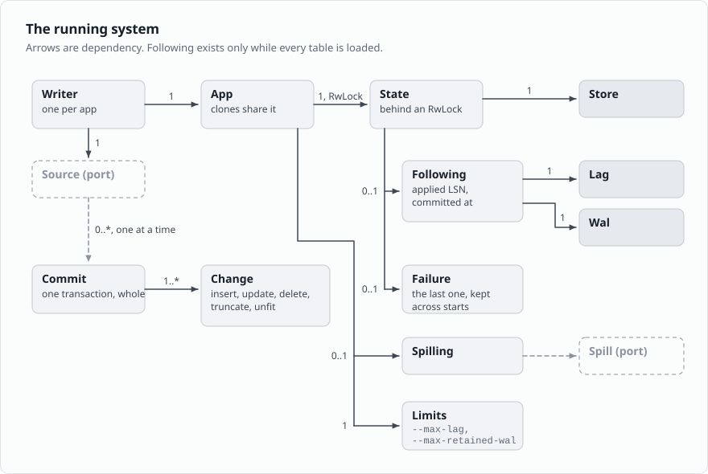
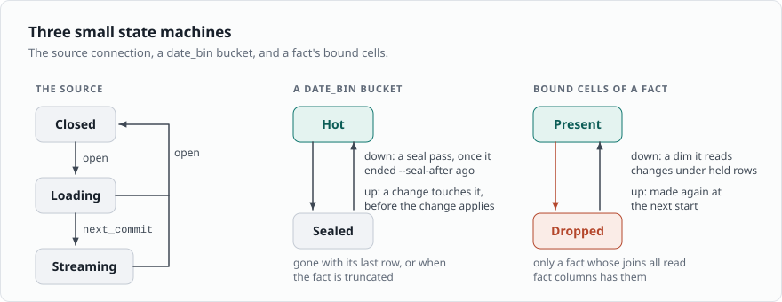

# Design

[How Straum works](how-it-works.md) is the model in the guide's
words. This page is the same model for contributors: who takes part,
what each use case does, how the crates depend on each other, what
the code holds true, and which decision shaped what. A name in code
font, such as `Writer::start`, is the type or function that holds a
rule, under `crates/`; the [glossary](glossary.md) gives each name
its type in the code.

Four participants:

- **PostgreSQL**: the source of truth. Passive: it publishes the
  stream and serves the snapshot loads. Nothing of Straum runs in it.
- **Straum** (`straum run`): active toward PostgreSQL, reactive toward
  clients. One writer thread opens the slot, loads the tables and
  applies every commit; tokio threads answer asks meanwhile.
- **Clients**: the apps that `POST /ask`. They never see a table, a
  join or a row, only the names a view gives its keys and measures.
- **People**: a table owner, who runs the setup SQL `straum plan`
  prints once, and an operator, who runs the binary and reads
  `/readyz`, `/status` and the log. In Kubernetes the chart is the
  operator.

## Architecture

Six crates, dependencies inward only, enforced by
`scripts/check-layers.py`.

*The binary depends on the three adapters, the adapters on the
use cases, everything on the domain. An arrow is "depends on".*

- `straum-domain` has no dependencies and no I/O. Everything an ask
  or a change needs is a plain struct, enum or function.
- `straum-app` holds the use cases and the two ports. `Source` is the
  one trait PostgreSQL sits behind; `Spill` is where sealed buckets
  go. No adapter for `Spill` ships; the binary passes `None`.
- The adapters never meet: `straum-http` is handed a query reader by
  the binary (`ReadAsk` in `straum-http`), so HTTP never knows Straum
  SQL.

Data moves the other way at run time: PostgreSQL feeds `straum-pg`,
which hands commits to the writer, which applies them to the store;
apps post asks to `straum-http`, which reads the store through the app.

## Use cases

| Use case          | Actor       | Input                     | Output                 | Detail |
| ----------------- | ----------- | ------------------------- | ---------------------- | ------ |
| Set up PostgreSQL | Table owner | Spec, publication, role   | Setup SQL, run once    | [Setting up PostgreSQL](postgresql.md) |
| Run Straum        | Operator    | Spec file, DSN, flags     | A serving Straum       | [Running Straum](running.md) |
| Start             | Writer      | Spec, Source              | A store at L           | [Start](#start) |
| Follow            | Writer      | The stream                | One commit applied     | [Applying a commit](#applying-a-commit) |
| Answer an ask     | Client      | Query and parameters      | Answer with `as_of`    | [Answering an ask](#answering-an-ask) |
| Start over        | Writer      | A failure                 | A new start            | [States](running.md#states) |
| Stop              | Operator    | SIGTERM or SIGINT         | Exit, slots dropped    | [straum run](running.md#straum-run) |

Run Straum is `run` in the binary: read the spec and the DSN, bind the
listener, make an **App** with an empty **Store** and the **Limits**,
make a **Writer** over a **Postgres** source, spawn the writer thread,
serve HTTP until a signal. A panic aborts the process (the hook `run`
sets), since the store may be half written. Start over is
`Writer::step` and `run_writer`: the failure is recorded and
**Following** removed, so asks answer 503; the thread sleeps the
backoff; the next step is a start, whose `open` drops the old stream
first, and PostgreSQL drops its slot as the connection closes.

## Start

`Writer::start`:

1. Drop the old store and empty the spill, so two stores never take
   memory at once.
2. `Source::open`: connect, begin a read-only repeatable-read
   transaction, create a temporary logical slot with `pgoutput` and
   `SNAPSHOT 'use'`, read L. Read the catalog and [check
   it](postgresql.md#what-straum-checks-at-start) against the spec.
3. `Source::load` each dim, then each fact: set the column types from
   the catalog, run one binary `COPY` of the columns the spec names,
   add rows by the batch (`Store::add_rows`). The snapshot
   transaction commits with the last load.
4. Read the server's WAL once; start the **Lag** from when the slot
   was opened.
5. Take the write lock, swap the store in, set **Following** at L,
   count the start. Straum is ready.
6. Run a seal pass. The stream thread starts at the first
   `next_commit`: it reads the stream, answers the server's keepalives
   and confirms what the writer has applied, so the server can
   recycle WAL.

Any error is a **Failure**, and the next step is a start over. The
load fills a new store outside the lock, so asks never wait on
PostgreSQL; they answer 503 until step 5.

## The store

What the store holds, mutable, one per process, owned by **App**.
Arrows denote dependency; a cardinality is how many of the pointed-at
thing one of the pointing thing holds.

*One keyed rollup per fact, a bound rollup for a fact whose joins all
read fact columns, one projection per dim. A rollup is one level per
width; a hot bucket is columnar cells with one state per input.*

- A **Rollup** is every cell of one fact: one **Level** per width,
  the `date_bin` width first, and one **Codes** per rollup-key
  column. The bucket is not coded; it keys the level's map. Rows
  without a time go under `None` (`Level::bucket`).
- A **Bucket** is **Hot**, holding **Cells**, or **Sealed**, holding
  only its cell count. Only `date_bin` buckets are sealed
  (`Rollup::sealable`).
- **Cells** are columnar: keys, counts and one **State** per input
  column, side by side, with an index from key codes to position
  (`Cells`). A cell goes with its last row (`Rollup::remove`).
  `Aggregate::state` picks which **State** a measure reads, so
  measures over one column share it.
- A **Projection** maps key values to the attribute codes of every
  row under them. `Null` is code 0 in every attribute, so no row and
  a null read alike.
- **Bound** cells are a second rollup of a fact whose joins all read
  fact columns: keyed by the keys and the dim columns' values, so an
  ask reads no projection. A fact row goes into both rollups; into
  the bound one once per way its joins resolve now (`Bound::rows`). A
  change to a dim the fact reads moves the ones whose join columns
  name the changed key (`Store::retarget`); a dim truncate or load
  makes them again from the keyed cells (`Store::rebuild_dim`). They
  hold the hot buckets only: a seal takes its bucket out of them and
  an unseal binds it back.

## Applying a commit

`Writer::apply_next`, one step:

1. If the WAL was read a second or more ago: read it on the plain
   connection, fail past `--max-retained-wal`, feed the **Lag**, run a
   seal pass.
2. `Source::next_commit`, waiting at most until the next WAL reading
   is due.
3. Unseal every sealed bucket a fact row of the commit falls in.
4. Under the write lock, apply the commit: each change to its rollup
   or projection, tables the spec doesn't name skipped, then move
   **Following** to the commit's LSN and time.
5. Forget the sealed buckets of a truncated fact in the spill.

A change to a dim a view reads moves its bound cells: each keyed cell
whose join columns name the changed key leaves the bound cells it was
in and goes into the ones the dim gives it now.

The stream thread reads ahead of the writer, up to 64 commits, and
answers keepalives while the writer is busy (`StreamThread`).

## Answering an ask

The HTTP handler in `straum-http` and `App::ask`:

1. Read at most 1 MiB of body; parse the query with the parameters
   bound to `$n`; refuse a range jiff can't print.
2. On a blocking thread, take the read lock.
3. Check the ask against the spec and refuse any ask it can't answer
   exactly; name the sealed buckets it reads (`Store::sealed_read`).
   An invalid ask is 400 even while loading. Once a load has read the
   column types, a filter value of another type than its column is
   refused too.
4. Without a **Following**, 503 not ready.
5. Get each sealed bucket from the spill and thaw it against the
   store; a bucket that can't be read is 500.
6. `Store::ask_with`: read the cells of the buckets in the range, the
   widest the view keeps that fit and narrower ones at the ends
   (`Rollup::cover`). A key the ask names is in the cell key or is a
   dim's column: while the view's bound cells hold, a dim column is a
   part of their key, else it is read from the dim's projection
   through the join id in the cell key, as the dim is now. Add each
   cell to its group, and to each measure whose filter holds; filters
   name only parts of the cell key, so a cell counts whole or not at
   all. Sort rows by key.
7. Answer with `as_of` from the **Lag** and the applied LSN in the
   `Straum-LSN` header, `Cache-Control: no-store`.

## Model

Arrows denote dependency, not communication flow.

### The spec: what Straum keeps

Immutable once `Spec::new` has checked it. Every node is a value
object compared by value.

*A spec is dims and facts. A fact is one view: its table, one time,
by keys, refs in join order, measures and the view's WHERE. A ref
joins through one via per key column and reads attributes.*

An **Aggregate** is count, sum, min, max, avg or count distinct; all
but count name one input column (`Aggregate::input`).

- A **Spec** holds dims and facts in one namespace (`Spec::new`).
  `Spec::tables` lists each table once, dims first.
- One **Dim** per table, whatever the number of views joining it;
  `Dim::attributes` is the union of what they read.
- A **Fact** holds its refs in join order: a ref joined through
  another dim comes after it (`Via::Attribute::through` is an index
  into `Fact::refs` before it).
- A **Ref** points at a dim by name, with as many **Via** columns as
  the dim's key has (`SpecError::KeyLength`). Left and inner refs read
  at least one **Attribute**; semi and anti read none
  (`SpecError::RefReadsNothing`, `SpecError::RefReads`).
- Keys, attributes and measures share one namespace per view, and
  nothing may be named `bucket` (`SpecError::NamedBucket`). An ask
  reaches any of them by that name alone (`Fact::resolve`).
- **Width** divides a day; each wider width is a whole multiple of
  the one before (`SpecError::BadWidth`, `SpecError::BadBucket`).

Derived from a fact, not stored:

| Derived        | What                                      | Where         |
| -------------- | ----------------------------------------- | ------------- |
| Rollup key     | by parts, each fact-side via once, bucket | `Fact::rollup_key` |
| Row layout     | time, by columns, vias, inputs, each once | `Fact::columns` |
| Dim row layout | key columns, then attributes              | `Dim::columns` |
| Direct         | every via is a fact column, no chain      | `Fact::is_direct` |

### The ask and the answer

An **Ask** names one fact and, by name, its measures, keys and
conditions; its range is two bucket edges with `from < to`. An
**Answer** is one column per key and measure and one row per group.

- `Spec::check_ask` resolves names, refuses two time keys, a name
  asked twice, an empty range and a bound off a bucket edge. The
  store adds the type check once a load has set the types
  (`AskError::WrongType`).
- **Answered** wraps an answer with the applied LSN and `as_of`. The
  domain never knows time or LSNs beyond the bucket.

### The running system

*A writer owns the source port and an app. The app is a state behind
a read-write lock: the store, a following while every table is
loaded, the limits, the last failure, and a spilling with the spill
port when one is configured.*

- **App** is an `Arc<RwLock<State>>`; clones share it. Asks take the
  read lock, the writer the write lock only to apply a commit it has
  read or to swap a store in (`State::apply`, `Writer::start`).
- **Following** exists only while every table is loaded; a failure
  removes it (`Writer::step`). Its absence is "not ready".
- **Lag** keeps the WAL readings the slot hasn't confirmed, at most
  an hour of them, and the instant it last had; `as_of` and readiness
  derive from it.
- A **Commit** is one transaction, whole, with the end of its commit
  record as LSN. The stream delivers nothing before the commit, and
  the store sees it as one.

## Invariants

What the code holds true, and where. Planting a bug in any of these
makes a property test fail.

1. **A commit applies whole.** The decoder holds a transaction until
   its Commit message (`Decoder`), and the store takes it under
   one write lock (`State::apply`). An answer never sees half of one.
2. **No commit is missed or applied twice.** The snapshot is at the
   slot's consistent point L and the stream starts at L
   (`Postgres::open` and the first `next_commit`);
   `the_snapshot_and_the_stream_split_exactly`
   races 2,000 commits against it.
3. **Only the writer writes.** Every `Spill` method takes `&self`; the
   store is reached through `App::read` by asks and `App::write` by
   the writer alone.
4. **A row removed was added.** `RowError::Missing` from a cell, a
   value count or a projection entry ends the step
   (`Rollup::remove`, `Projection::remove`), and Straum starts over.
5. **Types come from the catalog only.** The load sets them
   (`Store::set_types`); a filter value must fit its column
   (`ColumnType::fits`); a Relation message that changes them is
   `Unfit` (`Decoder`).
6. **Null joins nothing.** A dim row with a null key is never held and
   a lookup with a null finds nothing (`Projection::add`,
   `Projection::matches`).
7. **A row with no time is kept, never answered** (`Level::bucket`).
8. **Every width divides a day and nests in the next**
   (`SpecError::BadWidth`); every ask bound is on a `date_bin` edge
   (`AskError::RangeUnaligned`); an ask never reads part of a bucket.
9. **Levels agree.** Every row goes into one cell per width in the
   same add (`Rollup::add`); `Rollup::cover` reads each instant of a
   range from exactly one level.
10. **A sealed bucket takes no change.** A keyed rollup refuses a row
    into one (`RowError::Sealed`); the writer unseals before it applies
    (`Writer::unseal`). The bound cells hold nothing of a sealed bucket:
    a seal takes it out of them at every width and an unseal binds it
    again, as the dims are then (`Store::seal`, `Store::unseal`).
11. **The spill holds what the store has sealed and no more.** Put
    before seal (`Writer::seal`), removed on unseal and truncate
    (`Writer::forget`), cleared at every start (`Writer::start`).
12. **Bound cells are the hot keyed cells, bound as the dims are
    now.** They exist only for a fact whose joins all read fact
    columns (`Bound::new`). A dim change moves the ones that name its
    key (`Store::retarget`) and a dim truncate or load makes them
    again (`Store::rebuild_dim`). An ask whose range holds a sealed
    `date_bin` bucket reads the keyed cells (`Store::reading`).
13. **Lag never understates.** Readings merge only toward older
    (`Lag::read`); `matches_every_reading_kept` checks it against a
    reference that keeps every reading.
14. **Two stores never take memory at once.** The old store goes
    before the new load (`Writer::start`).
15. **One name, one thing, per view.** Keys, attributes and measures
    share a namespace, `bucket` is reserved, and an answer's columns
    are its names (`Spec::new`, `Spec::check_ask`).

## State machines

The running states, Loading, Ready, Lagging, Waiting and Stopping, are
drawn under [States](running.md#states). There is no enum: **Following**
is `None` while loading or waiting, `Failure` says which, and lag
against `--max-lag` tells Ready from Lagging (`App::status`,
`why_not` in `straum-http`). Three smaller machines:

*The source connection, a `date_bin` bucket, and a bucket's bound
cells.*

- The source: `Postgres` moves `Closed` to `Loading` on `open`,
  `Loading` to `Streaming` on the first `next_commit`, and back to
  `Closed` on the next `open` (`Postgres` in `straum-pg`). A `load`
  outside `Loading` and a `wal` while `Closed` are `Error::Stopped`.
- A bucket: only `date_bin` buckets seal. A truncate drops every
  bucket of the fact, sealed ones from the spill too.
- The bound cells of a bucket: a dim change moves them and never
  drops them
  (`a_dim_change_under_a_sealed_bucket_reaches_it_once_unsealed`); a
  dim update that reads the same changes nothing
  (`Store::update_row`).

## Which decision shaped what

The reasoning and the tradeoffs are in the
[ADRs](https://github.com/janbjorge/straum/tree/main/docs/adr); this
maps each part of the model to the records that settled it.

| Part of the model                              | ADRs                   |
| ---------------------------------------------- | ---------------------- |
| Cells only, no rows, projections beside them   | 0002, 0030             |
| Crates inward, `Source` and `Spill` as ports   | 0003, 0033             |
| Spec as a `CREATE VIEW` subset, one spelling   | 0004, 0005, 0028, 0029 |
| Ask as parameterised Straum SQL                | 0006                   |
| `Answered`: `as_of` in the body, LSN in a header | 0007, 0020           |
| One `Store` behind one `RwLock`, `App` clones  | 0009                   |
| Own replication client, temporary slot, one port for load and stream | 0010, 0012, 0022 |
| Old row on every update and delete, dims too   | 0014, 0031             |
| `Failure` and the start-over loop              | 0015                   |
| Rollup key, levels per width, `None` bucket    | 0016, 0017, 0019, 0028 |
| Refs bound at ask time, bound cells beside     | 0030, 0038             |
| Sealed buckets, `date_bin` width only          | 0033, 0034, 0035       |
| `timestamp` as wall clock, enums as labels     | 0018, 0037             |
| tokio only in `straum-http`                    | 0008                   |

The PostgreSQL mechanics behind the load, the apply and the slot, with
their citations, are in
[research/POSTGRESQL.md](https://github.com/janbjorge/straum/blob/main/research/POSTGRESQL.md);
what joins replaced and the sources behind them in
[research/JOINS.md](https://github.com/janbjorge/straum/blob/main/research/JOINS.md).

## Where the code and the records differ

[ADR-0038](https://github.com/janbjorge/straum/blob/main/docs/adr/0038-a-view-with-refs-keeps-bound-cells-beside-its-keyed-cells.md)
says a dim change moves bound cells in one pass over the keyed cells,
before the commit's next fact change and at its end. The code makes
the pass at once, one for each dim row that changes
(`Store::retarget`), so a commit that changes many dim rows walks the
hot keyed cells once a row. The answers are the same; the cost is
not. The spill flags ADR-0033 names, and the other open names,
are in the glossary's [Clashes](glossary.md#clashes) table.
