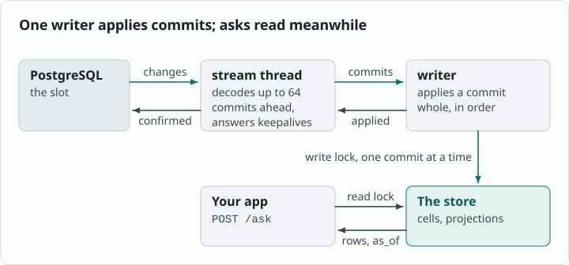

# How Straum works

How does Straum answer without reading rows? It keeps cells, not
rows, and keeps them current from PostgreSQL's replication stream.
[Design](design.md) names the code behind each step, for
contributors.

## Load once, follow every commit

`straum run` opens a temporary logical replication slot. The slot
names a point in the WAL, an LSN called L, and gives a snapshot of
the database at L. Straum loads every table the spec names from that
snapshot, then streams every commit after L through the slot. No
commit is missed between the load and the stream, and none is applied
twice.


*Every commit up to L comes in with the load, every commit after it
through the slot. None comes in both ways, and none in neither.*

A load is one binary `COPY` of the columns the spec names, grouped
into cells as the rows come, so Straum never holds a table's rows.
Nothing of Straum runs in PostgreSQL. The slot is temporary, so
PostgreSQL drops it when the connection closes, and nothing is on
disk: every start loads every table again.

## Cells

A cell is one distinct combination of a view's keys and its bucket.
For the `usage` view of the [introduction](introduction.md) that is
one cell per hour, kind and account. Each width in `WITH (buckets = ...)`
keeps cells of its own, so a view with hours and days holds every row
in two cells.


*A row's time is floored to each width the view keeps, all aligned to
1970-01-01, so it lands in one bucket per width in the same commit.*

A measure is an aggregate the view names, such as `sum(e.amount) AS
amount`. A cell holds its row count and what each measure needs, always
counts and sums, so cells merge and a row can leave one as exactly as it
came. [Aggregates 101](aggregates.md) says why each measure keeps what
it does, and how a median reads the counts `min` and `max` keep. A
`FILTER` keeps nothing of its own: it names parts of the cell key, so a
cell counts whole or not at all.


*The bucket and the keys pick the cell, and the row's count and amount
add to it. The row is not kept, so a delete subtracts the same
numbers. Each width the view keeps gets the same add.*

A row whose time is null or infinite is kept in a bucket no ask
reads. A cell goes with its last row.

Memory follows cells. Per width:

```text
cells <= min(rows, distinct key combinations x buckets)
```

Keys that are nearly unique per row keep nearly a cell per row. Fewer
keys, keys with fewer values and wider buckets collapse more rows into
each cell. The [benchmark](performance.md#memory) has what real tables
measured.

## Dims

The table in a view's `FROM` is its fact table, and a table it joins is
a dim, here `accounts`. A view that joins a dim keys its cells by the
join column, `e.account_id`, not by the dim column, `a.region`. Beside
the cells Straum holds a projection of the dim: its key and the columns
the views read, nothing else, kept current from the stream. An ask reads
`region` through each cell's `account_id`, as the account rows are now.

So a dim change moves no cell. An account moved from `eu` to `us`
moves all its events to `us` in the next answer, as
PostgreSQL's view would, and nothing starts over. It also means a
join to a dim with many rows means many cells, one per distinct join
id in the fact.

For a view whose joins all read fact columns, one of them a column
that is not a key of the view, Straum also keeps bound cells: the
same cells keyed by the dim columns' values, which are few next to
the ids, so an ask reads no projection. A dim change moves the bound
cells that name its key. A view that keeps its join columns as keys,
as `usage` does, has none: they would be as many as its
cells.

## Following

Changes arrive after their transaction commits, and Straum applies
the transaction whole, under one write lock, with nothing read from
PostgreSQL in between:

- An insert into a fact table adds the row to its cell; one into a
  dim table adds the row to the projection.
- An update takes the old row out and adds the new one. The logical
  stream has the old row because every spec table has `REPLICA
  IDENTITY FULL`. The physical stream rebuilds that row from the page,
  so it does not need `FULL`.
- A delete takes the old row out.
- A truncate empties the view's cells, or the dim's projection.



*The stream thread hands the writer whole commits and tells
PostgreSQL what the writer has applied. The writer holds the write
lock for one commit at a time; asks read under the read lock.*

Asks share the store with the writer behind a read-write lock, which
the writer takes only to apply a commit it has already read. A long
ask delays the writer, and that shows as lag. The writer's readings of
the server's WAL, and the status, keep to a lock of their own, so an
ask waits on the writer only while a commit arrives. The stream thread
reads ahead of the writer, up to 64 commits or 200,000 changes,
whichever comes first, and confirms what the writer has applied, so
PostgreSQL can recycle WAL.

A change that no longer fits makes Straum start over from a new slot:
an update without its old row, a row never added, a dim row it never
held, a value it can't read, a table whose columns now read
differently, a table renamed away or another made under its name, or a
transaction above `--max-transaction-rows`. The
last is on purpose: a transaction waits in memory until its commit,
and the new slot's snapshot is after the big commit, so its rows come
in through the bulk `COPY` instead; the
[benchmark](performance.md#transactions) sets the default. A lost
connection or WAL past `--max-retained-wal` starts Straum over too
([States](deploy.md#states)), and so does a spec table that the
publication leaves out, that is gone from under its name, or that is
another table now: each reading of the WAL, once a second, checks.

## The physical stream

With `--wal physical` there is no logical decoding to send rows
(ADR-0008). A temporary physical slot streams the server's WAL from the
last checkpoint's redo point, and Straum turns it into the same
messages the logical slot sends, so one decoder serves both:

- Records. Most name only other tables' pages. Straum reads each
  record's block headers where they lie and passes such a record by,
  not copied, checksummed or decoded; every record it reads it checks.
- Pages. The first change to a page after a checkpoint carries a full
  image of it; Straum keeps the rows of each page of the spec's tables
  from there and applies the inserts, updates, deletes, pruning and
  vacuuming that follow, as PostgreSQL's redo does. A delete names only
  a slot on a page, and an update may log only the bytes that differ
  from the old row: the page has the rest.
- Transactions. Changes wait by transaction until its commit record,
  with its subtransactions', and go in WAL order; an abort drops them.
- Rows. A row's bytes become the values the load reads from its
  binary `COPY`, then the pgoutput messages: the old row of an update
  or delete is whole, as under `REPLICA IDENTITY FULL`.
- The load. Straum waits until every transaction open when the stream
  began has ended, so each later one is whole in the WAL it reads, then
  takes the load's snapshot. Commits the snapshot saw are in the load
  and dropped; the rest stream. A commit read before that point must
  be in the load; PostgreSQL logs a commit a moment before snapshots
  see it, longer while a synchronous standby answers, so Straum takes
  the snapshot again until it does. A transaction past the row limit
  that the load saw doesn't stop the stream. The stream reads on
  during the load until 64 commits or 200,000 changes wait for the
  writer, then holds its place, answering the server. A stream that
  fails meanwhile stops the load at its next batch of rows.
- Memory. A page goes at the next checkpoint record whose redo point is
  past its last change: PostgreSQL logs it whole the next time. So
  Straum holds the pages changed in about one checkpoint cycle, not the
  tables, and starts over past `--max-page-memory`.
- DDL. A commit that changes a table's catalog entry makes Straum read
  the table's columns again, and the decoder sees what changed, as with
  pgoutput. The stream reads that commit before snapshots see it, as
  with the load, so Straum reads the columns in a snapshot that sees
  it, waiting up to 10 s, then starting over. A table rewritten or
  truncated starts Straum over.

## Answering an ask

This ask reads the purchases of two regions over the hour from 9:00
UTC:

```sql
SELECT region, events, amount FROM usage
WHERE kind = $1 AND region IN ($2, $3)
  AND bucket >= $4 AND bucket < $5
GROUP BY region
```

```text
some cells of usage at 2026-11-13T09:00:00Z, one per hour,
kind and account

  kind      account_id | events   amount
  purchase  7          |      2   220.00   account 7 is eu -> eu
  signup    7          |      1     0.00   kind is not purchase
  purchase  18         |      2    70.00   account 18 is apac, not asked for
  purchase  132        |    101  7111.19   account 132 is us -> us
  refund    132        |     45  2229.10   kind is not purchase
  purchase  138        |    172  7658.10   account 138 is us -> us

accounts, projected: 7 -> eu, 18 -> apac, 132 -> us, 138 -> us, ...

answer: eu 2 220.00, us 273 14769.29
```

An ask reads the cells of the buckets in its range, adds each to its
group and to each measure whose filter holds, keeps the groups that
meet its `HAVING`, and sorts the rows by key. It never touches PostgreSQL and never reads a row, so its cost
follows the number of cells it reads.


*Each width takes the whole buckets inside the range, and what is
left at the ends falls to the next narrower width. An ask grouped by
bucket reads the `date_bin` width only.*

Answers don't change with the widths a view keeps; only how many
cells an ask reads does.

Every answer carries `as_of`, and every commit made before it is in
the answer. Following is asynchronous, so an answer can predate a
client's own commit; [Seeing your own
write](asks.md#seeing-your-own-write) says how to wait for it.

Next: [Aggregates 101](aggregates.md), what each measure keeps in a
cell.
