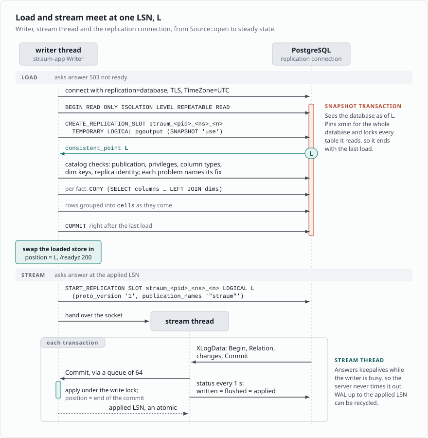
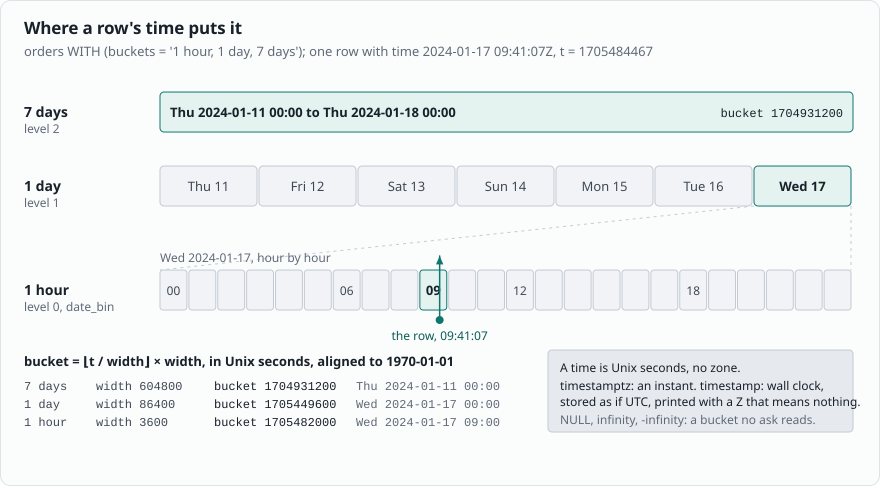
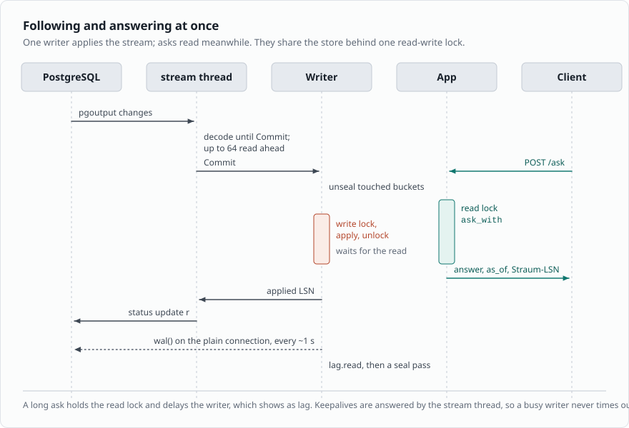
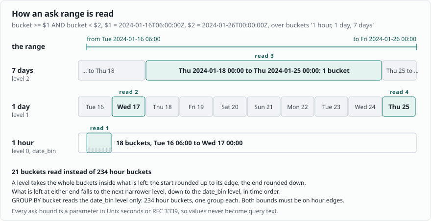

# How Straum works

Straum keeps cells, not rows. This page is the model behind every
other page: how the tables get in, what a cell is, how a dim reaches
it, how a commit moves rows between cells, and what an ask reads.
[Design](design.md) is the same model with the code's names, for
contributors.

## Load once, follow every commit

`straum run` opens a temporary logical replication slot. The slot
names a point in the WAL, an LSN called L, and gives a snapshot of
the database at L. Straum loads every table the spec names from that
snapshot, then streams every commit after L through the slot. No
commit is missed between the load and the stream, and none is applied
twice.



*The writer opens the slot, checks the catalog against the spec,
loads every table in the snapshot, then streams from L. A stream
thread hands each commit to the writer.*

A load is one binary `COPY` of the columns the spec names, grouped
into cells as the rows come, so Straum never holds a fact table.
Nothing of Straum runs in PostgreSQL. The slot is temporary, so
PostgreSQL drops it when the connection closes, and nothing is on
disk: every start loads every table again.

## Cells

A cell is one distinct combination of a view's keys and its bucket.
For the [quick start](quick-start.md) view that is one cell per hour,
payment type and pickup zone. A cell holds its row count and what each measure
needs:

- `count(c)` keeps the column's count of non-null values.
- `sum` and `avg` share the column's sum and its count of non-null
  values.
- `min` and `max` keep a count per value, so deleting the smallest
  value reveals the next one.
- `count(DISTINCT c)` keeps a count per value.
- `bool_and` and `bool_or` share the column's counts of true and of
  false, so deleting the last false turns a `bool_and` true.

[Aggregates 101](aggregates.md) says why each keeps what it does, and
why Straum has no median.

A `FILTER` keeps nothing of its own: it names parts of the cell key,
so a cell counts whole or not at all. A cell goes with its last row.

Each width in `WITH (buckets = ...)` keeps cells of its own, so a
view with hours and days holds every row in two cells.



*A row's time is floored to each width the view keeps, all aligned to
1970-01-01, so it lands in one bucket per width in the same commit.*

A row whose time is null or infinite is kept in a bucket no ask
reads.

Memory follows cells. Per width:

```text
cells <= min(rows, distinct key combinations x buckets)
```

Keys that are nearly unique per row keep nearly a cell per row. Fewer
keys, keys with fewer values and wider buckets collapse more rows into
each cell. The [benchmark](benchmark.md#memory) has what real tables
measured.

## Dims

A view that joins a dim keys its cells by the join column,
`trips.pu_location_id`, not by the dim column, `pickup.borough`.
Beside the cells Straum holds a projection of the dim: its key and
the columns the views read, nothing else, kept current from the
stream. An ask reads `borough` through each cell's `pu_location_id`,
as the zone rows are now.

So a dim change moves no cell. A zone moved from Queens to Airports
moves every trip from it to Airports in the next answer, as
PostgreSQL's view would, and nothing starts over. It also means a
join to a dim with many rows means many cells, one per distinct join
id in the fact.

For a view whose joins all read fact columns, Straum also keeps bound
cells: the same cells keyed by the dim columns' values, which are few
next to the ids, so an ask reads no projection. A dim change moves
the bound cells that name its key.

## Following

Changes arrive after their transaction commits, and Straum applies
the transaction whole, under one write lock, with nothing read from
PostgreSQL in between:

- An insert into a fact table adds the row to its cell; one into a
  dim table adds the row to the projection.
- An update takes the old row out and adds the new one. The old row
  is there because every table in the spec has `REPLICA IDENTITY
  FULL`.
- A delete takes the old row out.
- A truncate empties the view's cells, or the dim's projection.



*The stream thread decodes ahead and answers keepalives. The writer
applies under the write lock. An ask reads under the read lock
meanwhile.*

One writer applies the stream while asks read. They share the store
behind a read-write lock, which the writer takes only to apply a
commit it has already read. A long ask delays the writer, and that
shows as lag. The stream thread reads ahead of the writer, up to 64
commits, and confirms what the writer has applied, so PostgreSQL can
recycle WAL.

A change that no longer fits makes Straum start over from a new slot:
an update without its old row, a row never added, a dim row it never
held, a value it can't read, a table whose columns now read
differently, or a transaction above `--max-transaction-rows`. The
last is on purpose: a transaction waits in memory until its commit,
and the new slot's snapshot is after the big commit, so its rows come
in through the bulk `COPY` instead; the
[benchmark](benchmark.md#transactions) sets the default. A lost
connection or WAL past `--max-retained-wal` leads to the same place:
Straum closes the connection, which drops the slot, waits, and loads
every table again ([States](running.md#states)).

## Answering an ask

After step 8 of the quick start, this ask reads card trips from the
airports and Newark over the hour from noon in New York:

```sql
SELECT borough, trips, fare FROM trips
WHERE payment_type = $1 AND borough IN ($2, $3)
  AND bucket >= $4 AND bucket < $5
GROUP BY borough
```

```text
some cells of trips at 2024-01-17T17:00:00Z, one per hour,
payment type and pickup zone

  payment_type  pu_location_id | trips  fare
  1             1              |     2   220.00   zone 1 is EWR -> EWR
  3             1              |     1     1.00   payment type is not 1
  1             18             |     2    70.00   zone 18 is Bronx, not asked for
  1             132            |   101  7111.19   zone 132 is Airports -> Airports
  2             132            |    45  2229.10   payment type is not 1
  1             138            |   172  7658.10   zone 138 is Airports -> Airports

taxi_zones, projected: 1 -> EWR, 18 -> Bronx, 132 -> Airports, 138 -> Airports, ...

answer: Airports 273 14769.29, EWR 2 220.00
```

An ask reads the cells of the buckets in its range, adds each to its
group and to each measure whose filter holds, and sorts the rows by
key. It never touches PostgreSQL and never reads a row, so its cost
follows the number of cells it reads.



*Each width takes the whole buckets inside the range, and what is
left at the ends falls to the next narrower width. An ask grouped by
bucket reads the `date_bin` width only.*

A long range reads its middle from the widest buckets that fit and
its ends from narrower ones. Answers don't change; only how many
cells an ask reads does.

Every answer carries `as_of`: Straum's wall time when it last
confirmed it had applied all the WAL PostgreSQL had written. Every
commit made before it is in the answer. Following is asynchronous,
so an answer can predate a client's own commit;
[Asking](asks.md#seeing-your-own-write) says how to wait for it.
