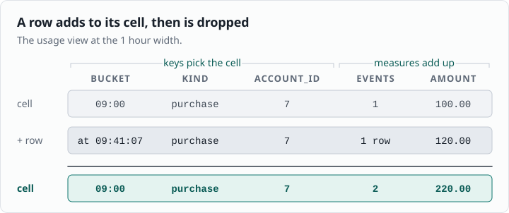
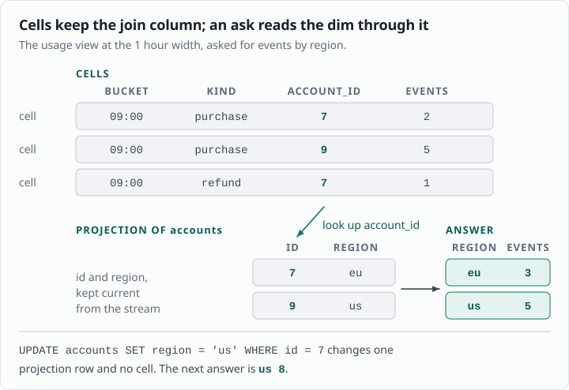
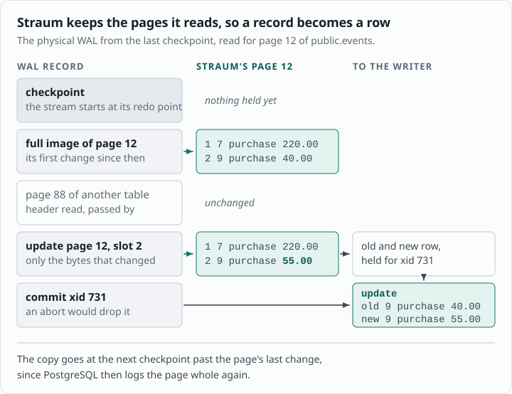

# How Straum works

Straum loads each view's rows once into cells, keeps them current from
PostgreSQL's replication stream, and answers every ask from the cells
alone. [Design](design.md) names the code behind each step.

## Load once, follow every commit

`straum run` loads each view and each dim once from a snapshot, then
streams every commit the snapshot did not see, and applies each of them
exactly once. How the two meet depends on [the logical stream](#the-logical-stream) or [the
physical stream](#the-physical-stream).

The load is one binary `COPY` per view and one per dim, grouped into
cells as rows arrive, so Straum never holds a table's rows. A table two
views read is copied once for each. It installs nothing in PostgreSQL
and writes nothing to disk. The slot is temporary, so every start loads
again.

## Cells

A cell is one distinct value of a view's cell key, which is its fact
table's keys, its join columns and its bucket. In the `usage` view of the
[introduction](introduction.md), that is one cell per hour, `kind`,
`account_id` and `has_device`. A dim column such as `region` is a key of
the view but not of the cell ([Dims](#dims)). Each width the view's
`buckets(...)` lists keeps its own cells.


*A row's time is floored to each width, aligned to 1970-01-01.*

A measure is an aggregate the view names, such as `sum(e.amount) AS amount`.
A cell keeps a row count plus the counts and sums each measure needs, so a
row can be added or removed exactly ([Aggregates 101](aggregates.md)). A
`FILTER` names parts of the cell key, so a cell counts whole
or not at all.



*A row adds to its cell. A delete subtracts the same numbers, so the row is
never kept.*

Rows with a null or infinite time go in a bucket no ask reads. A cell is
dropped with its last row.

Memory per width:

```text
cells <= min(rows, distinct key combinations x buckets)
```

Keys close to unique per row keep nearly a cell per row; the
[benchmark](performance.md#memory) has measured numbers.

A value keeps its code after its last cell or dim row goes. Once a column
holds more than 4,096 codes and its dead codes outnumber its live ones,
Straum drops the dead ones in one pass under the write lock.

## Dims

The `usage` view groups events by `region`, but `events` has no
`region`. It is a column of `accounts`, which the view joins:

```sql
FROM public.events AS e
LEFT OUTER JOIN public.accounts AS a ON a.id = e.account_id
```

The `FROM` table, `events`, is the fact table: each row is something
that happened, and the measures count and add up its rows. A joined
table, `accounts`, is a dim, short for dimension: each row describes
something the fact rows point at, here an account and its region.

A cell keeps the join column, `account_id`, not `region`. Beside the
cells, Straum keeps a projection of each dim, kept current from the
stream: its key and the columns the views read, here `id` and `region`.
An ask by region looks up each cell's `account_id` in the projection and
adds up the cells of each region:



*A dim change moves no cell. The next ask reads the new region.*

Moving account 7 from `eu` to `us` changes one projection row, and the
next answer counts its events under `us`, as PostgreSQL's view would.
Had cells kept `region`, the move would have to find every cell of
account 7, in every bucket of every width. The cost is that the join
column is in the cell key, so one with many distinct values means many
cells. [Joining a dim](spec.md#joining-a-dim) has the rules for writing
a join.

A view that selects `a.region` but not `e.account_id` would make every
ask by region add up the cells of each account. For such a view, when
its joins all read fact columns, Straum also keeps bound cells: the
same cells keyed by the dim columns' values, so an ask reads no
projection. A dim change then moves cells: it walks the fact's keyed
cells once under the write lock, and skips keys no fact row names.
`usage` selects `account_id`, so it has no bound cells.

## Following

Each transaction applies whole, under one write lock, with nothing read
from PostgreSQL in between. An insert adds its row to a cell, or to a
projection for a dim. An update removes the old row and adds the new
one. A delete removes the old row. Both streams give the whole old row.


*The stream thread hands the writer whole commits and reports what it has
applied. The writer takes the write lock per commit; asks take the read
lock.*

A long ask delays the writer, which shows as lag. The stream reads up to
64 commits or 200,000 changes ahead of the writer and confirms what has
been applied, so PostgreSQL can recycle write-ahead log (WAL).

Straum stops with exit 1 when a change does not fit what it holds, and
the next start loads from a new slot: an update or delete whose old row is
missing, a row never added, a dim row never held, a value it cannot read,
a table whose columns now read differently, a renamed label of an enum it
reads ([Enum columns](spec.md#enum-columns)), and a transaction above
`--max-transaction-rows`. Stopping keeps a large transaction from waiting
in memory; the new slot's snapshot brings its rows in through the bulk
`COPY` instead. The [benchmark](performance.md#transactions) sets
the default.

Straum also stops on a lost connection, WAL past `--max-retained-wal`
or, when set, resident memory past `--max-memory`
([States](deploy.md#states)), on a spec table that is renamed away
or replaced by another table under its name, and, on logical decoding,
on a publication altered to leave a spec table out, filter its rows or
stop sending inserts, updates, deletes or truncates. It checks for
these once a second.

## The logical stream

`--wal logical` opens a temporary logical slot at a log sequence
number (LSN), L, with a snapshot at L. Straum loads from the snapshot,
then streams every commit after L.


*Commits up to L come in with the load, later ones through the slot.*

PostgreSQL decodes the WAL itself, with its pgoutput plugin, and sends
each transaction at its commit. An `UPDATE` of `events` arrives as:

```text
Begin     the LSN of the commit
Relation  public.events and its columns, before its first change
Update    the old row and the new row, each column as text
Commit    the end of the commit and its time
```

Straum keeps no rows, so the old row is what says which cell an
update or delete leaves, and what to subtract. `REPLICA IDENTITY FULL`
logs it whole; by default, PostgreSQL logs at most the key. Straum
reads the spec's columns and skips the rest. A truncate empties the
table's cells or projection.

Straum stops when the publication drops a spec table, and on `ALTER
COLUMN .. TYPE`, for which logical decoding sends no rows. `VACUUM
FULL`, `CLUSTER`, a column `GRANT`, `SET STATISTICS`, `SET STORAGE` and
`SET DEFAULT` stop nothing.

## The physical stream

Without logical decoding, a WAL record names a page and the bytes that
changed on it; the rest of the row is on the page. So `--wal physical`
(architecture decision record ADR-0008) keeps the pages. A temporary
physical slot streams the WAL from the last checkpoint's redo point. A
page's first change after a checkpoint logs the whole page, which
gives Straum its rows, and later records apply to Straum's copy, as
PostgreSQL's own redo does.



*Straum's copy of the page holds the rest of the row.*

The stream carries every database's WAL. Straum reads checkpoints,
transaction ends, file truncations and lists of running transactions,
and heap records (insert, update, delete, bulk insert, prune, vacuum)
only for its tables' pages. It passes other records by from their
headers, and checks each one it reads against its CRC-32C checksum.

At its commit record, a transaction's changes become the messages the
logical stream gets, with the whole old row, so one decoder serves
both. An abort drops them.

The load meets the stream by transaction, not by WAL position. Straum
waits for the transactions open at start to end, takes the load's
snapshot and drops the commits it saw. PostgreSQL logs a commit before
snapshots see it, so Straum takes the snapshot again until every
commit it has read is in the load.

Straum stops past `--max-page-memory`, and on a truncate or rewrite of
a spec table, `VACUUM FULL` and `CLUSTER` included, since the pages
went with the old file. It stops on a changed row whose read value is
stored out of line, since the page holds only a pointer to it, and
says so ([Physical WAL](postgresql.md#physical-wal)). After DDL on a
spec table it reads the columns again in a snapshot that sees the
change, and stops if none does within 10 s.

## Answering an ask

This ask reads the purchases of two regions over the hour from 9:00 UTC:

```sql
SELECT region, events, amount FROM usage
WHERE kind = $1 AND region IN ($2, $3)
  AND bucket >= $4 AND bucket < $5
GROUP BY region
```

```text
some cells of usage at 2026-11-13T09:00:00Z, one per hour,
kind, account_id and has_device

  kind      account_id  has_device | events   amount
  purchase  7           true       |      2   220.00   account 7 is eu -> eu
  signup    7           false      |      1     0.00   kind is not purchase
  purchase  18          true       |      2    70.00   account 18 is apac, not asked
  purchase  132         true       |     70  5000.00   account 132 is us -> us
  purchase  132         false      |     31  2111.19   account 132 is us -> us
  refund    132         true       |     45  2229.10   kind is not purchase
  purchase  138         false      |    172  7658.10   account 138 is us -> us

accounts, projected: 7 -> eu, 18 -> apac, 132 -> us, 138 -> us, ...

answer: eu 2 220.00, us 273 14769.29
```

An ask reads the cells in its range, adds each to its group and to each
measure whose filter holds, keeps the groups that meet `HAVING`, and sorts by
key. It never touches PostgreSQL or reads a row, so its cost follows the
cells it reads.


*Each width takes the whole buckets inside the range. The ends fall to the
next narrower width.*

The widths a view keeps change its cell count, never its answers. An
ask grouped by the bucket reads no bucket wider than its rows: hours
for `bucket`, days for `buckets(bucket, '1 day')`, one stored day a
row ([Rows a day or a week apart](asks.md#rows-a-day-or-a-week-apart)).

Every answer carries `as_of` and includes every commit before it.
Following is asynchronous, so an answer can predate your own commit;
[Seeing your own write](asks.md#seeing-your-own-write) says how to wait.

Next: [Aggregates 101](aggregates.md), what each measure keeps in a cell.
