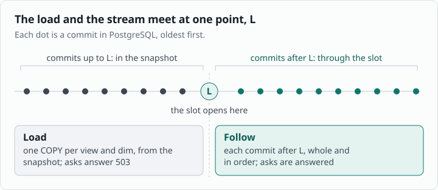
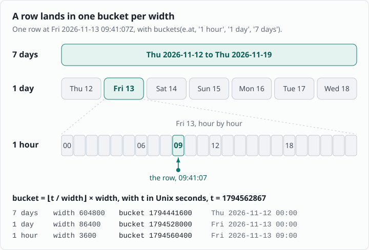
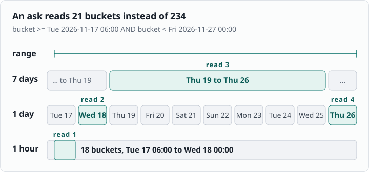

# How Straum works

What does Straum hold, and how does it stay current? It loads each table
once into cells, keeps the cells current from PostgreSQL's replication
stream, and answers every ask from the cells alone. [Design](design.md)
names the code behind each step.

## Load once, follow every commit

`straum run` opens a temporary logical replication slot
([the physical stream](#the-physical-stream) differs). The slot names a
point in the WAL, an LSN called L, and gives a snapshot at L. Straum loads
each spec table from that snapshot, then streams every commit after L. No
commit is missed or applied twice.



*Commits up to L come in with the load, later ones through the slot.*

The load is one binary `COPY` per table, grouped into cells as rows arrive,
so Straum never holds a table's rows. Straum installs nothing in
PostgreSQL and writes nothing to disk. The slot is temporary, so every
start loads again.

## Cells

A cell is one distinct value of a view's cell key, which is its fact
table's keys, its join columns and its bucket. In the `usage` view of the
[introduction](introduction.md), that is one cell per hour, `kind`,
`account_id` and `has_device`. A dim column such as `region` is a key of
the view but not of the cell ([Dims](#dims)). Each width the view's
`buckets(...)` lists keeps its own cells.



*A row's time is floored to each width, aligned to 1970-01-01.*

A measure is an aggregate the view names, such as `sum(e.amount) AS amount`.
A cell keeps a row count plus the counts and sums each measure needs, so a
row can be added or removed exactly. [Aggregates 101](aggregates.md) covers
the details. A `FILTER` names parts of the cell key, so a cell counts whole
or not at all.


*A row adds to its cell. A delete subtracts the same numbers, so the row is
never kept.*

Rows with a null or infinite time go in a bucket no ask reads. A cell is
dropped with its last row.

Memory per width:

```text
cells <= min(rows, distinct key combinations x buckets)
```

Keys close to unique per row keep nearly a cell per row. The
[benchmark](performance.md#memory) has measured numbers.

A value keeps its code after its last cell or dim row goes. Once a column
holds more than 4,096 codes and its dead codes outnumber its live ones,
Straum drops the dead ones in one pass under the write lock.

## Dims

A view's `FROM` table is its fact table. A table it joins is a dim, here
`accounts`. Cells key on the join column, `e.account_id`, not the dim column,
`a.region`. Straum keeps a projection of each dim: its key and the columns
the views read, kept current from the stream. An ask reads `region` through
each cell's `account_id`.

So a dim change moves no cell. Moving an account from `eu` to `us` changes
its events' region in the next answer, as PostgreSQL's view would. A join
column with many distinct values means many cells, one per value.

For a view whose joins all read fact columns, and at least one of which is
not a key of the view, Straum also keeps bound cells: the same cells keyed by
the dim columns' values, so an ask reads them without a projection. A dim
change walks the fact's keyed cells once under the write lock, and skips
keys no fact row names. A view whose join columns are keys, as `usage` is,
has none.

## Following

Each transaction applies whole, under one write lock, with nothing read from
PostgreSQL in between. An insert adds its row to a cell, or to a projection
for a dim. An update removes the old row and adds the new one. The logical
stream sends the old row because every spec table has `REPLICA IDENTITY
FULL`; the physical stream rebuilds it from the page. A delete removes the
old row. On the logical stream, a truncate empties the cells or the
projection; on the physical stream it stops Straum.


*The stream thread hands the writer whole commits and reports what it has
applied. The writer takes the write lock per commit; asks take the read
lock.*

Asks and the writer share the store behind a read-write lock. A long ask
delays the writer, which shows as lag. The stream reads up to 64 commits or
200,000 changes ahead of the writer and confirms what has been applied, so
PostgreSQL can recycle WAL.

Straum stops with exit 1 when a change does not fit what it holds, and the
next start loads from a new slot. That covers an update or delete whose old
row is missing, a row never added, a dim row never held, a value it cannot
read, a table whose columns now read differently, a renamed label of an
enum it reads ([Enum columns](spec.md#enum-columns)), and a transaction above
`--max-transaction-rows`. The row limit is deliberate: a large transaction
would wait in memory, while the new slot's snapshot brings its rows in
through the bulk `COPY`. The [benchmark](performance.md#transactions) sets
the default.

Straum also stops on a lost connection or WAL past `--max-retained-wal`
([States](deploy.md#states)), on a spec table that the publication drops,
that is renamed away, or that is replaced by another table under its name,
and on a column that `ALTER COLUMN .. TYPE` rewrote, since logical decoding
sends no row for it. It checks for these once a second.

On the logical stream, `VACUUM FULL`, `CLUSTER`, a `GRANT` on a column,
`SET STATISTICS`, `SET STORAGE` and `SET DEFAULT` each stop nothing on
their own. They leave the type and values as they were.

## The physical stream

`--wal physical` skips logical decoding (ADR-0008). A temporary physical slot
streams the WAL from the last checkpoint's redo point, and Straum turns it
into the same messages, so one decoder serves both.

Most records name only other tables' pages, so Straum reads their block
headers and passes them by. Each record it does read, it checks against
its CRC-32C checksum. The first change to a page after a checkpoint
carries a full image of that page. From
there Straum keeps the rows of each spec-table page and applies the inserts,
updates, deletes, pruning and vacuuming that follow, as PostgreSQL's own redo
does. A delete names only a slot on the page, and an update may log only the
bytes that changed, because the page holds the rest.

Changes wait per transaction until its commit record, then go in WAL order.
An abort drops them. Row bytes become the same values the load reads, and
the old row of an update or delete is whole, as under `REPLICA IDENTITY FULL`.

The load and the stream meet here. Straum waits until every transaction open
at start has ended, takes the load's snapshot, drops the commits that
snapshot saw, and streams the rest. PostgreSQL logs a commit before snapshots
see it, so Straum takes the snapshot again until every commit it read is in
the load. While the load runs, the stream keeps reading until 64 commits or
200,000 changes wait for the writer, then holds its place and answers the
server.

Pages are held for about one checkpoint cycle: each is dropped at the next
checkpoint record whose redo point is past its last change, since PostgreSQL
logs it whole the next time. Straum stops once the pages and the changes
waiting for their commit pass `--max-page-memory`.

A commit that changes a table's catalog entry makes Straum read the table's
columns again, in a snapshot that sees the commit. It waits up to 10 s, then
stops. A table that is truncated or rewritten, `VACUUM FULL` and `CLUSTER`
included, stops Straum, since its pages went with the old file.

## Answering an ask

This ask reads the purchases of two regions over the hour from 9:00 UTC:

```sql
SELECT region, events, amount FROM usage
WHERE kind = $1 AND region IN ($2, $3)
  AND bucket >= $4 AND bucket < $5
GROUP BY region
```

```text
some cells of usage at 2026-11-13T09:00:00Z, one per hour,
kind, account_id and has_device

  kind      account_id  has_device | events   amount
  purchase  7           true       |      2   220.00   account 7 is eu -> eu
  signup    7           false      |      1     0.00   kind is not purchase
  purchase  18          true       |      2    70.00   account 18 is apac, not asked
  purchase  132         true       |     70  5000.00   account 132 is us -> us
  purchase  132         false      |     31  2111.19   account 132 is us -> us
  refund    132         true       |     45  2229.10   kind is not purchase
  purchase  138         false      |    172  7658.10   account 138 is us -> us

accounts, projected: 7 -> eu, 18 -> apac, 132 -> us, 138 -> us, ...

answer: eu 2 220.00, us 273 14769.29
```

An ask reads the cells in its range, adds each to its group and to each
measure whose filter holds, keeps the groups that meet `HAVING`, and sorts by
key. It never touches PostgreSQL or reads a row, so its cost follows the
cells it reads.



*Each width takes the whole buckets inside the range. The ends fall to the
next narrower width.*

The widths a view keeps change its cell count, never its answers. An ask grouped by the bucket reads no bucket wider than its rows: hours
for `bucket`, days for `buckets(bucket, '1 day')`, one stored day a
row ([Rows a day or a week apart](asks.md#rows-a-day-or-a-week-apart)).

Every answer carries `as_of` and includes every commit before it. Following
is asynchronous, so an answer can predate your own commit.
[Seeing your own write](asks.md#seeing-your-own-write) explains how to wait.

Next: [Aggregates 101](aggregates.md), what each measure keeps in a cell.
