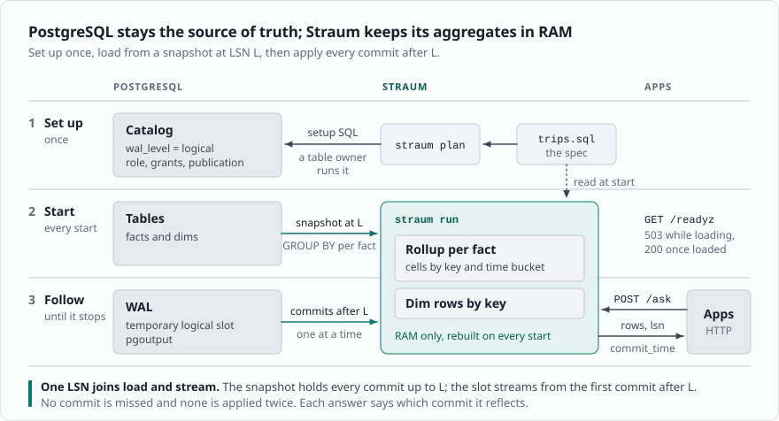

# Straum

Straum keeps aggregates of PostgreSQL tables in memory and answers
asks about them over HTTP in microseconds.

A dashboard runs the same `GROUP BY` over the same tables all day, and
PostgreSQL reads the rows again each time. Straum reads them once,
keeps each group as a cell in memory, and follows every commit through
logical replication. You declare what to keep as a view, in a small
subset of PostgreSQL's `CREATE VIEW`, here over an `events` table and
the `accounts` it belongs to:

```sql
CREATE VIEW usage WITH (buckets = '1 hour, 1 day, 7 days') AS
SELECT date_bin('1 hour', e.at, timestamptz 'epoch') AS bucket,
       e.kind AS kind,
       e.account_id AS account_id,
       a.region AS region,
       count(*) AS events,
       sum(e.amount) AS amount,
       avg(e.amount) AS avg_amount
FROM public.events AS e
LEFT OUTER JOIN public.accounts AS a ON a.id = e.account_id
GROUP BY 1, 2, 3, 4;
```

An ask is a `SELECT` over that view, with every value as a parameter.
This one asks for purchases by region on one day:

```sh
curl --json '{
  "query": "SELECT region, events, amount FROM usage WHERE kind = $1 AND bucket >= $2 AND bucket < $3 GROUP BY region",
  "parameters": ["purchase", "2026-11-13T00:00:00Z", "2026-11-14T00:00:00Z"]
}' http://localhost:8080/ask
```

```json
{
  "as_of": "2026-11-14T09:12:40.118204573Z",
  "rows": [
    {"region": "eu", "events": 412, "amount": 18240.50},
    {"region": "us", "events": 655, "amount": 30117.25}
  ]
}
```

Every commit made before `as_of` is in the answer, and an ask never
touches PostgreSQL. The [benchmark](benchmark.md) answers in 125 to
324 µs where PostgreSQL takes 28.1 to 1,750.8 ms, from 65 MiB of
memory.



*A table owner runs the SQL `straum plan` prints, once. `straum run`
loads the tables and follows them. Apps ask over HTTP.*

## What it is good for

A question asked often, about tables that keep changing, whose answer
is counts, sums, averages, minima or maxima by a few keys over time:

- Dashboard tiles and charts: events per hour, amounts by region, the
  same `GROUP BY` on every page load.
- Numbers an app shows its own users, such as usage this month or
  orders today. Make the tenant a key and each ask filters on it.
- A summary you maintain by hand today: a materialized view refreshed
  on a schedule, or a rollup table kept by triggers. Straum follows
  inserts, updates and deletes itself, and every answer is exact.

## What it is not

Straum is not a SQL engine, a replica, a cache or a durable store. It
answers only what its spec declares, so it has no ad hoc queries, no
rows and [no median](aggregates.md#median-and-percentiles). It keeps
nothing on disk: every start loads every table again, and a crash
leaves no slot behind holding WAL. PostgreSQL stays the source of
truth.

Straum supports PostgreSQL 16 and newer as shipped, with no extension
and no superuser, so managed services work. The name is Nynorsk for a
stream or current: Straum's input is PostgreSQL's replication stream.

> [!WARNING]
> Straum is not stable yet. The spec, the asks and the flags may change.

The [quick start](quick-start.md) runs Straum in Docker in four steps,
on a month of New York taxi trips. After it, a [spec](spec.md) and an
[ask](asks.md) are the two things you write.
