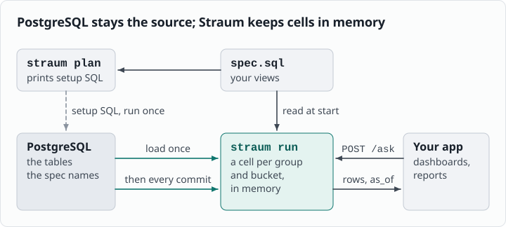

# Straum

Straum keeps aggregates of PostgreSQL tables in memory and answers
asks about them over HTTP. Counts and sums come back in microseconds.

A dashboard runs the same `GROUP BY` over the same tables all day, and
PostgreSQL reads the rows again each time. Straum reads them once,
keeps each group as a cell in memory, and follows every commit. You
declare what to keep as a view, in a small subset of PostgreSQL's
`CREATE VIEW`. A file of views is a spec. This one is over an `events`
table and the `accounts` it belongs to:

```sql
CREATE VIEW usage AS
SELECT buckets(e.at, '1 hour', '1 day', '7 days') AS bucket,
       e.kind AS kind,
       e.account_id AS account_id,
       a.region AS region,
       (e.device_id IS NOT NULL) AS has_device,
       count(*) AS events,
       sum(e.amount) AS amount,
       avg(e.amount) AS avg_amount,
       max(e.amount) AS top_amount,
       percentile_disc(0.5) WITHIN GROUP (ORDER BY e.amount) AS median_amount,
       percentile_disc(0.99) WITHIN GROUP (ORDER BY e.amount) AS p99_amount,
       count(*) FILTER (WHERE e.kind = 'purchase') AS purchases,
       count(*) FILTER (WHERE e.device_id IS NOT NULL) AS from_devices
FROM public.events AS e
LEFT OUTER JOIN public.accounts AS a ON a.id = e.account_id
GROUP BY 1, 2, 3, 4, 5;
```

An ask is a `SELECT` over that view, with every value as a parameter.
This one asks for purchases by region on one day:

```sh
curl --json '{
  "query": "SELECT region, events, amount FROM usage WHERE kind = $1 AND bucket >= $2 AND bucket < $3 GROUP BY region",
  "parameters": ["purchase", "2026-11-13T00:00:00Z", "2026-11-14T00:00:00Z"]
}' http://localhost:8080/ask
```

```json
{
  "as_of": "2026-11-14T09:12:40.118204573Z",
  "rows": [
    {"region": "eu", "events": 412, "amount": 18240.50},
    {"region": "us", "events": 655, "amount": 30117.25}
  ]
}
```

Every commit made before `as_of` is in the answer, and an ask never
touches PostgreSQL. [Performance](performance.md) times the same asks
against PostgreSQL.



*A table owner runs the SQL `straum plan` prints, once. `straum run`
loads the tables and follows them. Apps ask over HTTP.*

## What it is good for

Straum suits a question asked often, about tables that keep changing,
whose answer is counts, sums, averages, minima, maxima or percentiles
by a few keys over time ([Measures](spec.md#measures)). Dashboard
tiles and charts fit well: events per hour, amounts by region, the
same `GROUP BY` on every page load.

Numbers an app shows its own users fit too, such as usage this month or
orders today. Make the account a key, and your app's backend puts the
signed-in user's account in each ask. Straum checks no one: anyone who
reaches it can ask for any account
([Who can ask](deploy.md#who-can-ask)).

Straum also suits a summary you maintain by hand today, such as a
materialized view refreshed on a schedule or a rollup table kept by
triggers. It follows inserts, updates and deletes itself, and every
answer is exact.

## What it is not

Straum is not a SQL engine, a replica, a cache or a durable store. It
answers only what its spec declares, so it has no ad hoc queries,
keeps no table rows and uses
[no sketch](aggregates.md#median-and-percentiles). It keeps nothing on
disk: every start loads every table again, and a crash leaves no slot
behind holding WAL. PostgreSQL stays the source of truth.

Straum supports PostgreSQL 17 and newer as shipped. It needs no
extension, and connects as a role that is not a superuser, so managed
services work. It reads a publication, or with `--wal physical` the
WAL the server already writes ([setup](postgresql.md)). The name is
Nynorsk for a stream or current: Straum's input is PostgreSQL's
replication stream.

> [!WARNING]
> Straum is not stable yet. The spec, the asks and the flags may change.

[llms.txt](llms.txt) lists these pages for an agent.

The [quick start](quick-start.md) runs Straum in Docker with one
command, on a month of New York taxi trips, and leaves you in the
shell. After it, a [spec](spec.md) and an [ask](asks.md) are the two
things you write.
