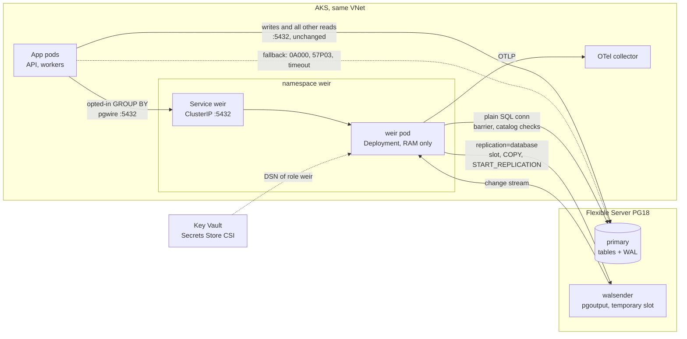
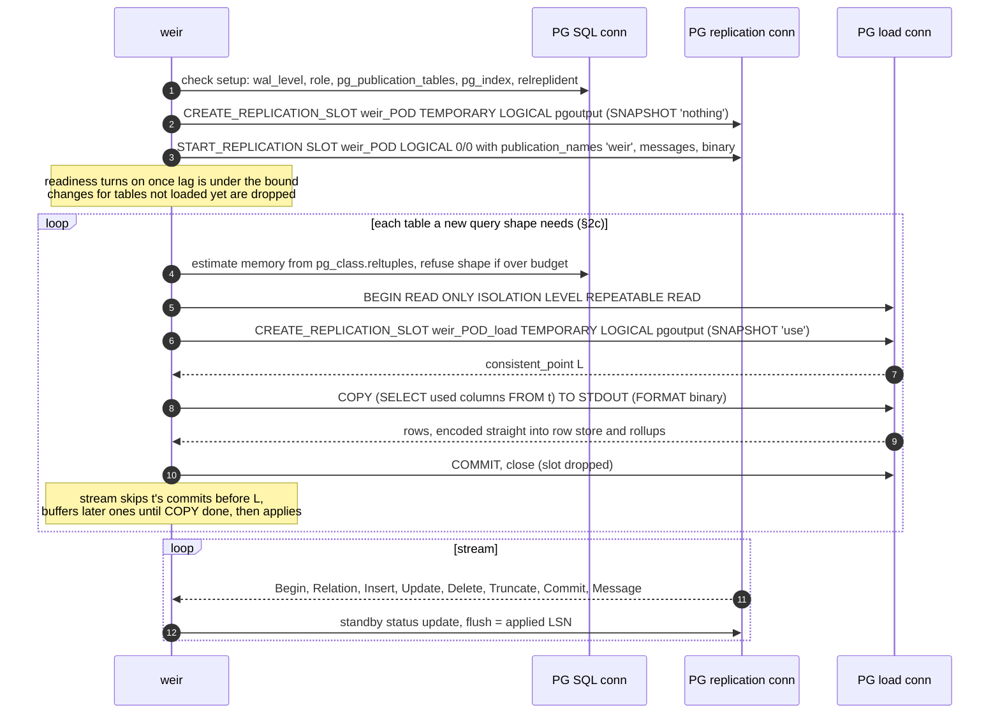
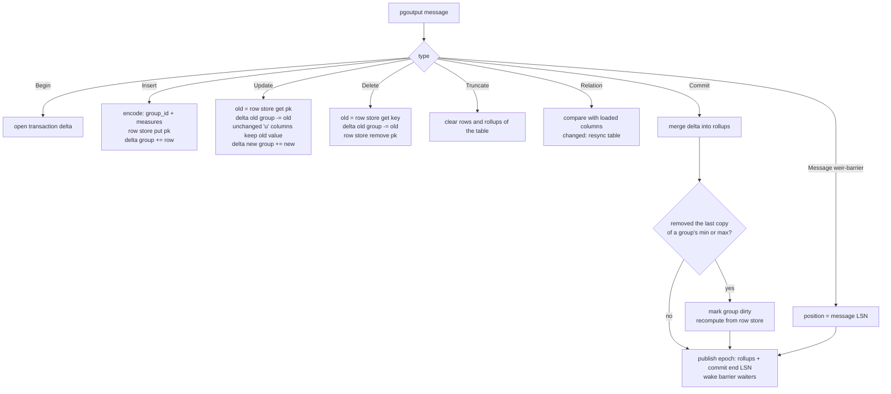
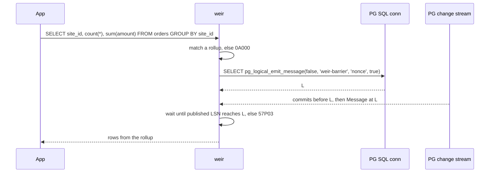
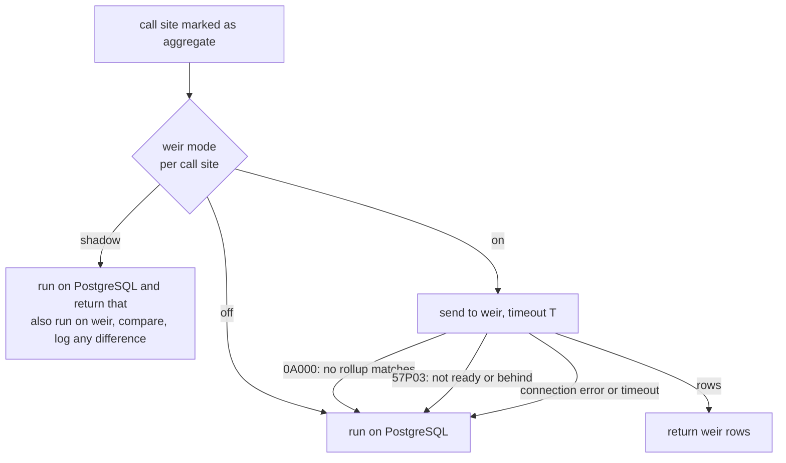
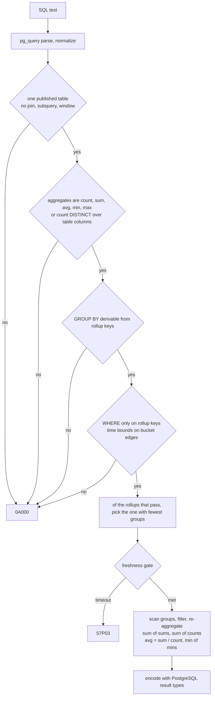
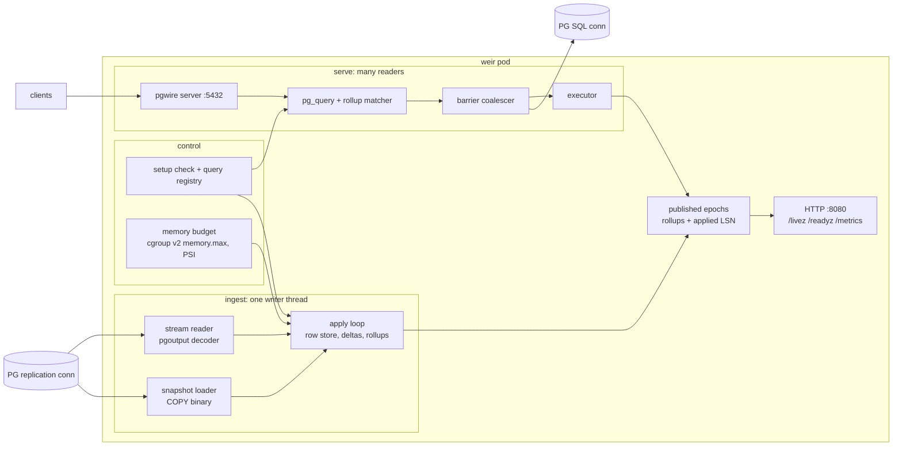
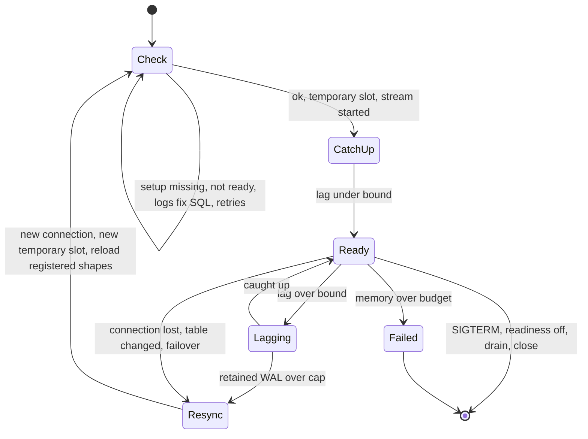
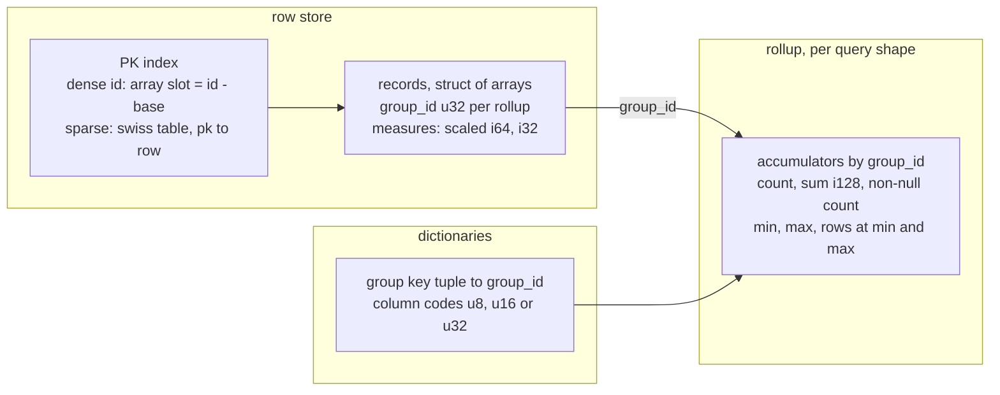

# weir architecture (draft, 2026-11-08)

Design for first target: AKS cluster next to Azure Database for PostgreSQL Flexible Server 18 (AKS.md). Constraints = managed ones: no custom extension, no superuser, logical replication allowed. Tags as in README.md (R, U, I). PostgreSQL paths relative to `~/src/postgres`.

## Verdict: is there a clear path?

Yes, for defined query class. All weir needs from PostgreSQL ships in stock PostgreSQL 18, works on Azure: pgoutput, publication column lists, temporary logical slots, `pg_logical_emit_message`, SQL on replication connection.

In class (weir answers):
- One published table, GROUP BY on rollup keys, `count`, `sum`, `avg`, `min`, `max`, and `count(DISTINCT x)` (§7).
- WHERE only on rollup keys; time bounds on bucket edges.
- Autocommit reads. App opts in per call site.

Out of class (always PostgreSQL):
- Joins, subqueries, window functions, percentiles.
- Filters on non-rollup-key columns.
- Reads inside explicit transaction needing own snapshot.

Gates before code:
1. Top aggregate queries from `pg_stat_statements` fit class.
2. Row counts of those tables × bytes per row (§6) fit pod memory.
3. `pg_ivm` on test system not already solving it (AKS.md, baseline).
4. Restart window for `wal_level = logical` (PostgreSQL 18).

## Decisions this draft makes

| Decision | Choice | Why |
|---|---|---|
| Durable state | None. RAM only | PostgreSQL = source of truth; weir rebuilds from it (§5) |
| Slot | `TEMPORARY`, one per pod | Dropped at session end, dead weir holds no WAL (§5) |
| Change source | pgoutput only. PostgreSQL 18 needs `wal_level = logical`; 19+ works with `logical` or `replica` | One code path (§8) |
| Replica identity | Default (PK); weir keeps compact PK-keyed row store | FULL forbids column lists, adds WAL to every UPDATE/DELETE on primary (§2a) |
| Large transactions | `streaming` off in v1 | Changes arrive only after commit; no abort handling in weir |
| Freshness | Barrier per query, coalesced; max-lag mode as cheap option | Read-your-writes without touching primary's commit path |
| Routing | Direct: app sends same SQL to weir over pgwire, opt-in per call site, falls back to PostgreSQL. No proxy, no extension | Nothing hidden; works on any managed PostgreSQL without network changes (§2b) |
| Setup | `weir plan <tables>` checks tables, prints role, grants, publication SQL; admin runs it once. Whole tables, no column lists | Only table owner can publish; setup lives in catalog, survives restarts (§2c) |
| What weir serves | Rollups derived from SQL apps prepare. No spec file | Query list = SQL already in app code (§2c) |
| Packaging | One static binary, distroless image, Helm chart rendering to plain manifests | Teams without Helm apply rendered YAML (AKS.md) |
| Kubernetes object | Deployment, not StatefulSet; no PVC | Nothing to persist |

## 1. Wire diagram



| From | To | Protocol | Purpose | New network path? |
|---|---|---|---|---|
| App | PostgreSQL | pgwire, TLS | Everything as today, plus fallback | No |
| App | weir Service | pgwire | Opted-in aggregate queries | No, in-cluster |
| weir | PostgreSQL | pgwire, `replication=database`, TLS | Temporary slot, snapshot COPY, change stream | No, same path as apps |
| weir | PostgreSQL | pgwire, TLS | Barrier `pg_logical_emit_message`, catalog validation | No |
| weir | OTel collector | OTLP | Metrics, traces | No, in-cluster |
| PostgreSQL | weir | postgres_fdw | Later, optional | Yes: internal LB, `azure.extensions`, route table (U) |

## 2. How weir uses PostgreSQL

### 2a. Logical replication

Startup and streaming, one replication connection:



What each step leans on:
- **SQL and replication commands on one connection.** "In logical replication walsender mode, the replication commands shown below as well as normal SQL commands can be issued" (`doc/src/sgml/protocol.sgml:2186-2190`, R). Simple query protocol only (`:2193-2194`, R).
- **`SNAPSHOT 'use'`** must run first in REPEATABLE READ, read-only transaction (`src/backend/replication/walsender.c:1342-1364`, R). COPY sees exact state at `consistent_point` L; main stream applies table's commits after L. Built-in tablesync uses same idea (POSTGRES-REPLICATION.md §4, §2c here).
- **`SNAPSHOT 'nothing'`** on main slot: no snapshot needed, every table loads through own load slot (`protocol.sgml:2411`, R).
- **`TEMPORARY`**: "Temporary slots are not saved to disk and are automatically dropped on error or when the session has finished" (`protocol.sgml:2371-2374`, R).
- **No column lists** (§2c): walsender sends whole rows of published tables, weir keeps only columns registered queries use. Primary decodes full WAL either way (POSTGRES-REPLICATION.md §9).
- **`messages`** delivers barrier marker. Not filtered by publication (POSTGRES-REPLICATION.md §8c).
- **`binary`** sends types in send/recv format: numerics as base-10000 digits, timestamps as int64. Type without `typsend` falls back to text (POSTGRES-REPLICATION.md §1).
- **Flush feedback = applied LSN, immediately.** RAM-only weir never replays, never needs applied WAL. Slot retains only unprocessed WAL.

Why default replica identity + row store, not REPLICA IDENTITY FULL:
- Default replica identity: UPDATE of non-key columns carries no old values, DELETE carries only PK (POSTGRES-REPLICATION.md §3, R). To subtract old contribution, weir must remember each row's group and measures, keyed by PK.
- FULL would ship old row. But "With REPLICA IDENTITY FULL, no column list is allowed" (`src/backend/commands/publicationcmds.c:402-405`, R): every column on wire. Also writes full old row to WAL on every UPDATE/DELETE on primary.
- Insert-only tables skip row store (`append_only` in overrides, §2c). UPDATE or DELETE on such table → weir drops its rollups, resyncs with row store.

Apply loop, single writer:



- `streaming` off → only committed transactions arrive, row store changes immediately. Rollups change only at Commit, so query never sees half a transaction.
- `streaming` off → transaction larger than `logical_decoding_work_mem` spills to `pg_replslot/<slot>/` on primary disk (POSTGRES-REPLICATION.md §6, R). On Azure = server storage. `streaming = on` later needs per-transaction deltas + undo path in weir.
- min/max not invertible. Each group keeps current min and max + count of rows holding them; count hits zero → recompute group from row store. Alternative, per-group `BTreeMap<value, count>`, costs memory per distinct value (RUST.md §7).

Freshness barrier:



- Barrier emitted after query arrives, so every transaction app committed before asking is in WAL before L; commits arrive in commit-LSN order (POSTGRES-REPLICATION.md §8a, §8c).
- Coalescing: one barrier in flight at a time. Queries arriving mid-flight wait for next; barrier emitted before arrival proves nothing for them. Cost: one WAL record + flush per round trip on primary, not per query.
- `max_lag` mode skips barrier: weir answers when last keepalive showed it within `maxLagMs` of server WAL end. No per-query primary load.
- Barrier runs over weir's own SQL connection. Whether Azure revokes `EXECUTE` on `pg_logical_emit_message` from ordinary roles untested (AKS.md open point 5).

### 2b. How a query reaches weir, and which rollup answers it

PostgreSQL can't hand query to weir alone without custom extension, and no managed provider allows one that can (MANAGED-POSTGRES.md, verdict). App asks weir directly (jb, 2026-11-08). Sends same SQL text it would send PostgreSQL, so fallback and shadow comparison need no translation. Small app helper does it:



- weir decides eligibility; app doesn't duplicate rules. App only picks which call sites try weir.
- Shadow mode = rollout tool: proves weir returns same rows, types, NULLs as PostgreSQL on real traffic before any call site switches to `on`.
- No pod ready → Service has no endpoints, connect fails fast, helper falls back.

Inside weir, matcher picks rollup:



Rules keeping answers identical to PostgreSQL (I):
- **Derivable GROUP BY**: query keys ⊆ rollup keys; coarser `date_bin` stride OK if multiple of rollup stride, same origin.
- **Bucket edges**: `created_at >= '2026-11-01'` answerable from hourly rollup only if bound on hour edge. Else edge bucket mixes in/out-of-range rows: reject.
- **Result types** as PostgreSQL returns: `count` int8, `sum(int4)` int8, `sum(int8)` and `sum(numeric)` numeric, `avg` of integers numeric. NULL for `sum` over no rows. `avg` numeric display scale must match.
- **Time zones**: `date_trunc` on timestamptz depends on session TimeZone (RUST.md, item 9). v1 supports `date_bin`, immutable.

Later phases, same binary:
- **postgres_fdw**: foreign tables on Flexible Server pointing at weir, optional door for SQL/BI users inside PostgreSQL. Not transparent, needs network work from wire diagram. postgres_fdw pushes GROUP BY to weir only when whole aggregate over weir's foreign table; else asks raw rows, which weir refuses.
- **Join after aggregate**: small dimension tables (e.g. `sites`) replicated fully, joined on group key after aggregation.

Not planned: wire proxy. Would put weir in front of all traffic on pool, hide which server answered (jb, 2026-11-08: no hacks or hidden routing).

### 2c. Setup and query registration

jb, 2026-11-08: admin runs setup once from `weir plan`; weir learns rollups from SQL apps send. No spec file.

Setup, once per database:
1. Admin runs `weir plan orders customers sites`. weir connects read-only, checks each table: PK or usable replica identity, not on deny list. Any check fails → names table and reason, prints nothing to run.
2. weir prints exact SQL: `wal_level = logical` (PostgreSQL 18 only, restart), `CREATE ROLE weir LOGIN REPLICATION`, `GRANT SELECT`, `CREATE PUBLICATION weir FOR TABLE ...` or `ALTER PUBLICATION weir ADD TABLE ...`. Table owner runs it, or puts it in app's migrations.
3. Setup = catalog rows: survives weir restarts, PostgreSQL restarts, HA failover. Lost only if someone drops publication or role, or drops and recreates table.

Why admin step: adding table to publication needs table ownership (`src/backend/commands/publicationcmds.c:2051-2054`, R); member of owner role counts (`src/backend/catalog/aclchk.c:4186`, R). Schema-wide and all-tables publications need superuser (`publicationcmds.c:1508-1516`, R). Lock taken is `ShareUpdateExclusiveLock` (`publicationcmds.c:1865`, R), doesn't block app reads or writes.

Whole tables, no column lists (I):
- New query on published table needs no admin step; only new table does.
- Every column of published table leaves database. Column privileges and RLS don't apply to replication stream. PII tables belong on deny list.

Queries (I):
- App helper prepares (pgwire Parse) each weir-enabled statement on connect. weir derives rollup from SQL on Parse: tables, columns, group keys, aggregates. Nothing executed.
- New shape: weir checks class (§2b), memory budget, publication. Fails → shape unsupported, reason in log and metric; calls get 0A000.
- Passes → weir loads shape's tables while stream runs (§2a load loop): own temporary slot for snapshot + exact LSN L, COPY, slot dropped. Main stream skips table's commits before L, buffers later ones until COPY done. Built-in tablesync does same with second stream per table (`src/backend/replication/logical/tablesync.c:1418-1431`, R); weir needs no second stream.
- Calls before load done get 57P03; helper falls back.
- weir restart: RAM empty, registry gone. App connections drop, helper reconnects, prepares again, weir reloads. Fallback meanwhile.
- Every start: weir rechecks setup (`wal_level`, role REPLICATION, publication, tables in it with PK). Missing → not ready, logs fix SQL as `weir plan` prints it.

Later, not v1: weir publishes tables itself, via owner DSN or `SECURITY DEFINER` function `weir.publish(regclass)` owned by table owner. Common case: app connects as role owning its tables, so owner DSN often exists (I).

## 3. Overall architecture



- **One writer, many readers.** Apply loop owns row store + write copy of rollups. Each commit publishes epoch: immutable rollup view tagged with commit end LSN. Readers never take lock writer waits on. Candidates: `left-right` (two rollup copies, wait-free reads) or `arc-swap` over copy-on-write group shards (U, not evaluated). Rollups small (§6), two copies cheap; row store never read by queries, not copied.
- **Tasks.** tokio for sockets (pgwire clients, two PostgreSQL connections, HTTP). Apply loop on own thread so decoding never waits behind query work.
- **Crates** (RUST.md, Recommended stack): `pgwire` for server, `pg_query` for parsing, `supabase/etl` or `pg_walstream` for decoding. DataFusion not needed for rollup queries; stays option for ad hoc queries over row store later.

Lifecycle:



- `/readyz` true only in Ready. `/livez` checks process only; lag never fails liveness.
- Resync closes replication connection first, so PostgreSQL drops old temporary slot before new one exists.
- Each query shape has own state: Loading, Serving, or Unsupported with reason (§2c). `/readyz` covers the stream, not shapes.
- New query shape loads while running, no rollout. Overrides change (ConfigMap) rolls Deployment via checksum annotation; new pod builds from scratch.

## 4. Building blocks: Docker-native, modern Linux

| Area | Choice | Note |
|---|---|---|
| Binary | Rust, one static binary (musl, or glibc static-pie) | No runtime deps; image = binary + CA certs |
| Allocator | mimalloc or jemalloc | RAM-only state with churn needs fragmentation control; pick by measurement (U) |
| Image | `FROM scratch` or distroless `static:nonroot`; amd64 and arm64 via `docker buildx` | No shell, no package manager |
| Supply chain | SBOM + provenance attestations from buildx; signed image | Cosign, or Notation for ACR (U) |
| Pod security | `runAsNonRoot`, uid 1001, drop ALL, `readOnlyRootFilesystem`, seccomp `RuntimeDefault`, no volumes | Restricted pod defaults (AKS.md) |
| Memory | Read cgroup v2 `memory.max` as budget; watch `memory.pressure` (PSI) and `memory.events` | Fail with clear error before kernel OOM-kill. AKS nodes run cgroup v2 on current images (U) |
| QoS | Memory request = limit (Guaranteed) | Evicted last under node pressure |
| Huge pages | Transparent huge pages via `madvise` for large arrays | Fewer TLB misses on group scans; optional, measure |
| I/O | tokio on epoll | Few sockets, no disk; io_uring buys nothing, default seccomp profiles increasingly block it (U) |
| TLS | rustls to PostgreSQL | Azure requires TLS by default (U) |
| Config | Overrides from ConfigMap (deny list, `append_only` tables, memory budget), DSN from env var or CSI-mounted secret. No spec file (§2c) | Checksum annotation rolls pod on overrides change |
| Telemetry | OTLP to collector; Prometheus `/metrics` | Applied LSN, lag, retained WAL, rows, groups, bytes, barrier wait, fallback count |
| Shutdown | SIGTERM: readiness off, drain queries, close connections | PostgreSQL drops temporary slot at session end |
| Kubernetes | Deployment, `RollingUpdate` with `maxSurge: 1`, `maxUnavailable: 0`; Service; ConfigMap; PodDisruptionBudget only with 2+ replicas | New pod syncs before old goes, no deploy gap |
| Local dev | `docker compose`: `postgres:18` with `wal_level=logical`, plus weir | Same image as prod |

## 5. RAM only

Yes; simplifies ops more than it costs. Temporary slot is key: crashed, OOM-killed or deleted weir pod leaves no slot, can't fill server disk. Removes WAL-growth risk in AKS.md.

Costs:
- **Every start = full rebuild**: snapshot + COPY of used columns, per table as apps register queries (§2c). Sequential read of each table on primary, plus time before ready. Measure on test.
- **Copy pins xmin.** Snapshot transaction holds back vacuum for whole database during COPY (POSTGRES-REPLICATION.md §4: `need_full_snapshot` pins data xmin). Keep copy short: projected columns only, binary format.
- **No slot failover.** "cannot enable failover for a temporary replication slot" (`src/backend/replication/slot.c:411-420`, R). Azure HA failover drops connection, weir resyncs. In exchange, `sync_replication_slots` and `hot_standby_feedback` not needed.
- **Lag still holds WAL while connected.** Azure `max_slot_wal_keep_size` is `-1` (MANAGED-POSTGRES.md). weir watches own retained WAL, resyncs past cap, dropping slot.
- **Each replica = slot + walsender**, each walsender decodes all WAL (POSTGRES-REPLICATION.md §9). Default 1 replica; 2 for availability if primary has CPU.
- **Memory must hold row store** for tables with UPDATE or DELETE (§6).

Not in v1: warm start from snapshot file. Needs persistent slot to resume from, brings WAL risk back.

## 6. Dense footprint

weir stores what it needs to maintain rollups, not rows:



Encoding rules (I):
- **Project**: only derived values of columns registered queries use kept. Whole rows cross wire (no column lists, §2c).
- **Quantize at ingest**: keep bucket (`date_bin` result at finest stride any rollup uses) as u32, not 8-byte timestamp.
- **Intern group keys**: each distinct key tuple → `group_id`; low-cardinality columns → dictionary codes.
- **Fixed-point measures**: `numeric(p, s)` → i64 scaled by 10^s, summed in i128. `numeric` without typmod has no fixed scale; v1 doesn't serve those queries.
- **Narrow widths**: u16 group ids, narrower measures when data allows.
- **Size up front**: reserve arrays from `pg_class.reltuples` before COPY, so doubling growth doesn't waste memory.
- **Dense PKs**: bigint identity column → array index; no hash table.

Bytes per row for rollup like `GROUP BY site_id, status, hour` with `count`, `sum(amount)`, `min(amount)`, `max(amount)` (computed with `python3`; one u32 group id + one i64 measure per row; hash table load 7/16 to 7/8):

| Layout | Bytes per row | 10M rows | 100M rows | 1B rows |
|---|---|---|---|---|
| Append-only table, rollups only | 0 | 0 | 0 | 0 |
| Row store, dense bigint PK | 12.125 | 0.11 GiB | 1.13 GiB | 11.29 GiB |
| Row store, sparse PK (hashed) | 25.71 to 31.43 | 0.24 to 0.29 GiB | 2.39 to 2.93 GiB | 23.95 to 29.27 GiB |

- Rollup state: 56 bytes per group → 0.53 MiB for 10,000 groups, 53.41 MiB for 1,000,000 groups.
- 6 GiB budget holds ~531M rows dense PK, or 205M to 251M rows hashed PK.
- Comparison: PostgreSQL spends 28 bytes per row before column data: 23-byte tuple header aligned to 24 (`src/include/access/htup_details.h:185`, R) + 4-byte line pointer (`src/include/storage/itemid.h:27-29`, R). Indexes on top.
- Estimates only. Measure on test with real tables, compare against `pg_total_relation_size`.

## 7. count(DISTINCT x)

jb, 2026-11-08: required. Exact, matching PostgreSQL. Cost = memory per distinct (group, x) pair, not per group.

Distinct counts don't add: customer seen Monday and Tuesday counts once for week, not twice. So weir keeps the set, not a number.

```sql
SELECT site_id, date_bin('1 day', created_at, '2000-01-01') AS day,
       count(*), sum(amount), count(DISTINCT customer_id)
FROM orders
GROUP BY 1, 2
```

State (I):
- **Dictionary** per declared column: value → u32 code, normalized to PostgreSQL equality first (below).
- **Per rollup group**: roaring bitmap of present codes + small map for pairs held by 2+ rows.
  - Insert: bit clear → set; bit set → add 1 in map (start at 2).
  - Delete: map count 3+ → subtract 1; count 2 → remove map entry; no map entry → clear bit.
  - Exact under UPDATE and DELETE; most pairs never enter map.
- **Row store**: one more u32 code per row → 16.125 B per row with dense PK. DELETE needs old value, which default replica identity doesn't send.

Queries:
- Rollup's own grain: cardinality of one bitmap.
- Coarser (per site per year, from site x day): OR bitmaps, take cardinality.
- Time range off bucket edges: OR whole buckets, add codes from edge blocks' rows.
- x itself a rollup key: count non-empty groups after re-aggregation. No extra state.
- Long ranges: optional coarser levels (day, month, year), so year ORs handful of bitmaps not 365. Each level costs own pairs.

Memory example, computed with `python3`: 100 sites x 365 days = 36,500 groups, 2,000 distinct customers per site-day, 73,000,000 pairs. 30% share of pairs with 2+ rows is assumption.

| Layout | Memory |
|---|---|
| Plain refcount hash map, (group, code) → count | 1.01 to 2.02 GiB |
| Roaring bitmaps (~2 B per pair, sparse) + map for repeated pairs | 139 + 310 = 450 MiB |
| Dictionary | 27.4 B per distinct value; 26.2 MiB for 1M customers |

On registration weir estimates pairs from `pg_stats.n_distinct` and group count, refuses shape over memory budget. Column nearly unique per row (order id) costs about as much as rows.

Matching PostgreSQL:
- NULL not counted.
- Equality is type's, not bytes': `numeric` 1.0 and 1.00 one value, so normalize scale before encoding. PostgreSQL "treats NaN values as equal" (`doc/src/sgml/datatype.sgml:891-896`, R); -0 and +0 equal too.
- Text: deterministic collation equal "only if they consist of the same byte sequence" (`doc/src/sgml/charset.sgml:1183-1187`, R), so bytes work. Nondeterministic collations (case- or accent-insensitive) rejected in v1.
- `count(DISTINCT (a, b))` uses dictionary of tuples.

Approximate (HyperLogLog) only as explicit opt-in under own name, for columns too large to keep exact. PostgreSQL has no such function, so no fallback.

## 8. Source modes: wal_level logical and replica

jb, 2026-11-08: support both settings, PostgreSQL 18 floor. Nothing for older.

| Server | `wal_level` | weir |
|---|---|---|
| PostgreSQL 18 | `logical` | pgoutput, temporary slot |
| PostgreSQL 18 | `replica` | Refuses to start, says fix: set `wal_level = logical`, restart. Logical slot fails with "logical decoding requires \"wal_level\" >= \"logical\"" (`src/backend/replication/logical/logical.c:121-123` as of `67c20979ce7^`, R) |
| PostgreSQL 19+ | `logical` or `replica` | pgoutput. Under `replica`, PostgreSQL enables logical decoding while logical slot exists, disables lazily after last goes (`67c20979ce7`, `logical/logicalctl.c:5-38`, R) |

One code path covers both. Azure Flexible Server 18 defaults to `replica` (U): needs one restart with `wal_level = logical`, or upgrade to 19. Azure offering 19 yet unverified.

Considered, dropped: trigger change log for PostgreSQL 18 under `replica`. Polling no general option either: tables often lack an indexed `updated_at`, and `xmin` polling reads whole tables (I). Trigger design also writes every changed row twice.

## Open points

1. Which queries, from `pg_stat_statements` (gate 1).
2. Row counts of candidate tables, whether they get UPDATE or DELETE, to pick row store or append-only per table.
3. How long snapshot COPY of those columns takes on test, how long it pins xmin.
4. `pg_logical_emit_message` EXECUTE for role weir on Azure.
5. App helper: where it lives in app, which call sites start in shadow mode.
