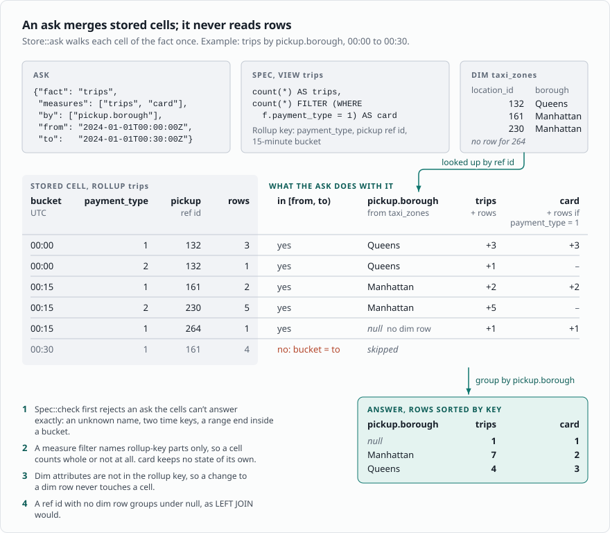
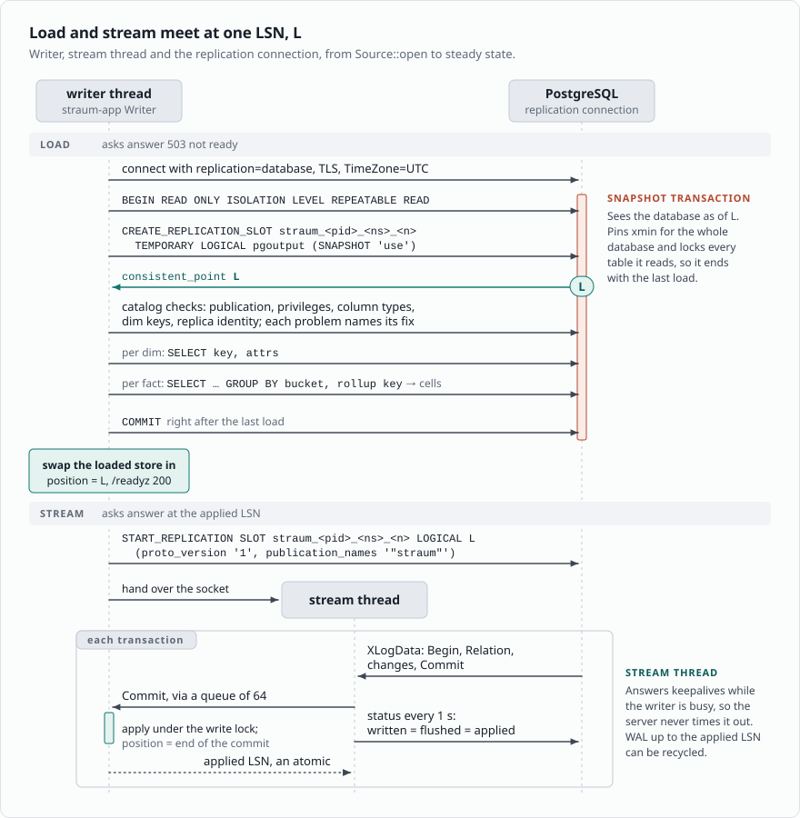

# Straum architecture (2026-11-08)

How Straum works since aggregates are declared in Straum SQL, a PostgreSQL
`CREATE VIEW` subset made only for Straum specs. PLAN.md tracks the build and holds the dated decisions this follows.
First target: AKS next to Azure Database for PostgreSQL Flexible Server 18
(AKS.md). The constraints are the managed ones: no custom extension, no
superuser, logical replication allowed. Tags as in README.md (R, U, I).
PostgreSQL paths are relative to the root of [upstream PostgreSQL](https://github.com/postgres/postgres/tree/0f3b42ce806).

## In short

- A spec file declares facts, the dims they point at, and named measures.
  Straum reads it at start.
- Straum follows the fact and dim tables over logical replication and keeps one
  rollup per fact in RAM.
- Clients send asks over HTTP/JSON: measures, keys to group by, filters, a time
  zone and a time range. Straum answers from the rollup, and every answer carries
  the LSN and commit time it reflects.
- PostgreSQL stays the source of truth. Straum keeps nothing on disk and rebuilds
  from PostgreSQL on every start.
- Everything Straum needs ships in stock PostgreSQL 18 and works on Azure:
  pgoutput, temporary logical slots, exported snapshots, SQL on a replication
  connection.

## 1. The spec

Straum SQL is not a SQL engine and not a query surface. It is a small subset of
PostgreSQL `CREATE VIEW` syntax, made only for Straum specs. `sqlparser`
parses it and `straum-notation` walks the AST; anything outside the subset is
an error that names it. The taxi example (`crates/straum-notation/tests/taxi.sql`):

```sql
CREATE VIEW trips WITH (key = id, append = true) AS
SELECT date_bin('15 minutes', f.pickup_at, timestamptz 'epoch') AS bucket,
       f.payment_type,
       f.vendor_id,
       f.pu_location_id,
       f.do_location_id,
       pickup.borough,
       pickup.zone,
       pickup.service_zone,
       count(*) AS trips,
       sum(f.fare_amount) AS fare,
       max(f.tip_amount) AS tip_max,
       avg(f.trip_distance) AS distance,
       count(*) FILTER (WHERE f.payment_type = 1) AS card,
       count(*) FILTER (WHERE pickup.borough = 'Manhattan') AS manhattan_pickups
FROM public.yellow_trips f
LEFT JOIN public.taxi_zones pickup ON pickup.location_id = f.pu_location_id
LEFT JOIN public.taxi_zones dropoff ON dropoff.location_id = f.do_location_id
GROUP BY 1, 2, 3, 4, 5, 6, 7, 8;
```

- `CREATE VIEW NAME`: one fact, aggregated into one rollup.
- `WITH (key = COLUMN, append = true)`: the fact table's primary key, and
  whether rows are only inserted (§4b). PostgreSQL rejects these options, so
  Straum only ever sends the `SELECT` to PostgreSQL. The `SELECT` runs there as
  is, which makes it the initial load query and the reference for tests.
- `FROM SCHEMA.TABLE ALIAS`: the fact table.
- `LEFT JOIN SCHEMA.TABLE ALIAS ON ALIAS.KEY = FACT.COLUMN`: a ref named
  `ALIAS`, an N:1 pointer from a fact column to a dim key. It is the only way
  a fact reaches another table, so a spec can't declare a fan-out. LEFT,
  because a fact row with no dim row keeps null attributes. The fact column
  must be selected.
- `date_bin('<n> <unit>', FACT.COLUMN, timestamptz 'epoch')`: the time column
  and the bucket width. The width divides a day; units are seconds, minutes,
  hours and days. The fixed origin puts buckets on UTC midnight.
- Other fact columns are `by` columns, in the rollup key.
- Dim columns are attributes. A dim is its table: views that join it share it
  and must join on the same key, and its attributes are every column any
  view reads.
- Measures: `count(*)`, `count(DISTINCT c)`, `sum`, `min`, `max` and `avg`,
  each `AS` a name and with an optional `FILTER (WHERE ...)` of `=` or `IN`
  on by columns, refs or ref attributes, joined by `AND`.
- GROUP BY names exactly the selected columns and the bucket, by expression or
  position, so the view groups like the rollup.
- Every column is qualified with its table alias; identifiers are unquoted.

The rollup key is the by columns, then the ref ids, then the time bucket
(`Fact::rollup_key`). Dim attributes are never part of it. Straum maps a ref id
to its attributes after aggregation, as Kylin does with derived dimensions
([Kylin cube design](https://kylin.apache.org/docs/3.1.3/howto/howto_optimize_cubes/)).
A change to a dim row therefore never touches a rollup. M1 checked this on one
month of NYC taxi trips: seven ask shapes gave the same rows from the rollup
as from the raw join in PostgreSQL (PLAN.md, M1).

`Spec::new` checks the declarations against each other and reports every
problem at once: duplicate names, a grain that doesn't divide a day, a column
used twice among time, by and ref, the fact's key in the rollup key, unknown
dims, and filters on anything outside the rollup key. Column types and keys are
checked against the catalog at start (M5).

There are no expressions and no joins beyond refs. An aggregate Straum SQL
can't declare stays a query against PostgreSQL.

## 2. Asks

An ask names one fact and gives:

- measures, by name;
- keys to group by: by columns, refs, ref attributes such as `pickup.borough`,
  and at most one time key, the UTC bucket;
- filters, `=` or `in` on the same keys;
- a half-open range `[from, to)` in Unix seconds, both ends on bucket edges.

`Spec::check` rejects asks the rollup can't answer exactly: unknown names, two
time keys and a range end inside a bucket.

`Store::ask` answers from the cells:



- Filtered measures keep no state. Their conditions name rollup-key parts only,
  so a cell counts in whole or not at all.
- A ref id with no dim row maps to null attributes, as a left join would. This
  is an open question in PLAN.md.
- An ask without keys answers one row even when nothing matches, as SQL does
  without GROUP BY.
- sum, min and max come back in the column's scale. avg comes back as sum and
  count, so the caller picks the rounding.

Over HTTP (`crates/straum-http`), `POST /ask` takes the ask as JSON:

```json
{
  "fact": "trips",
  "measures": ["trips", "fare", "distance"],
  "by": ["payment_type", "pickup.borough"],
  "time": "bucket",
  "filter": {"pickup.borough": ["Manhattan", "Queens"], "vendor_id": 2},
  "from": "2024-01-01T00:00:00+01:00",
  "to": 1706742000
}
```

- `fact`, `measures`, `from` and `to` are required.
- The time key is a field of its own, so it can't clash with a column named
  `bucket`, and it groups before `by`. Time keys print as UTC RFC 3339.
- `from` and `to` are RFC 3339 or Unix seconds, in whole seconds.
- A field Straum doesn't know, a key given twice and a value of the wrong type
  are errors that name the field, never ignored. All of them come back at
  once, as `{"errors": [...]}` with status 400.

The answer:

```json
{
  "lsn": "16/B374D848",
  "commit_time": "2024-01-31T22:59:59.123456Z",
  "columns": ["day", "payment_type", "pickup.borough", "trips", "fare", "distance"],
  "rows": [["2024-01-01T00:00:00+01:00", 1, "Bronx", 412, 6234.50,
            {"sum": 1203.11, "count": 412}]]
}
```

- Time keys are RFC 3339 at the zone's offset.
- Numeric values are exact decimals in their column's scale. The load sets
  each column's scale from the catalog (`Rollup::set_scales`), and answers
  carry them (`Answer::scales`).
- Status 503 while a table the ask reads isn't ready.

## 3. Rollups in memory

A rollup has one cell per rollup key. A cell holds its row count and one state
per input column, shared by the measures that read that column
(`crates/straum-domain/src/rollup.rs`):

- sum and avg share the column's sum (`i128`) and count of non-null values;
- min and max share a count per value, so deleting the current extreme reveals
  the next one;
- count distinct keeps a count per value.

Rows are added and removed, and a cell goes with its last row. Removing a row
that was never added is an error; Straum then starts over.

sum, avg, min and max read integers: integer columns, and numeric columns as
scaled `i64` (checked against the catalog in M5). An `i128` sum of `i64` values
can't overflow below 2^64 rows. Float columns are an open question.

Dims are kept as rows by key and read at ask time.

Memory follows cells, not rows, as long as rows collapse into far fewer cells.
They don't always. On the taxi spec M1 measured 2,964,624 trips in 2,322,783
cells at 15m, 1.3x, because pickup and dropoff zone together are nearly unique
per trip. 1h gave 1.8x, 1d 5.7x, and 15m without the dropoff ref 5.2x. Whether
`straum plan` should measure collapse before a load is open (PLAN.md).

count distinct costs one entry per distinct (cell, value) pair, so a column
that is nearly unique per row costs about as much as the rows. Roaring bitmaps
over a value dictionary are the likely way to shrink it (I, not built).

## 4. How Straum uses PostgreSQL

### 4a. Start and initial load

The spec is known at start, so one slot and one snapshot serve every table:



- The load reads cells, not rows. Per fact, one `GROUP BY` on the bucket
  (`extract(epoch FROM date_bin(...))`, as `bench/rollup.sql` buckets), the
  rollup key and the min, max and count distinct columns, which need a count
  per value. Each group returns `count(*)` and sum and count per other sum
  input (`Rollup::grouped`, `Rollup::summed`, `crates/straum-pg/src/load.rs`) and
  adds to its cell whole (`Rollup::add_group`). Where those value columns are
  nearly unique, groups approach rows; a `GROUPING SETS` query per column
  would avoid the cross product (I, not built).
- SQL and replication commands share one connection in logical walsender mode
  (`doc/src/sgml/protocol.sgml:2186-2190`, R), simple query protocol only
  (`:2193-2194`, R), so values come back as text. Straum sets `DateStyle = ISO`
  and `TimeZone = UTC` at startup and reads that text
  (`crates/straum-pg/src/value.rs`).
- The catalog checks run after the slot exists, so they see the tables as the
  load does. Each problem found names its fix (`crates/straum-pg/src/catalog.rs`).
- `SNAPSHOT 'use'` must run first in a REPEATABLE READ, read-only transaction
  (`src/backend/replication/walsender.c:1342-1364`, R). The load sees the state
  at L, and the stream starts with the first commit after L.
- `TEMPORARY`: "Temporary slots are not saved to disk and are automatically
  dropped on error or when the session has finished"
  (`protocol.sgml:2371-2374`, R).
- The snapshot transaction pins xmin while the load runs and holds back vacuum
  for the whole database (POSTGRES-REPLICATION.md §4). It also holds a lock on
  every table it read, which blocks `ALTER TABLE`. Straum commits it right after
  the last load, not at the first stream read (M5; a test's `ALTER TABLE`
  waited on it before). Reading cells keeps it short: the taxi month, 2,964,624
  trips, loads in 4.4 s (PLAN.md, M5).

### 4b. Apply


Old values: by default pgoutput sends only the key on DELETE and no old values
on an UPDATE that leaves the key alone. Only REPLICA IDENTITY FULL sends the
whole old row (POSTGRES-REPLICATION.md §3, R). So:

- `append` facts need inserts only, so they need no FULL. An UPDATE or
  DELETE that comes without the old row reads the fact again.
- Mutable facts need the old row to take it out of its cell. Either the table
  gets REPLICA IDENTITY FULL, which writes the old row to WAL on every UPDATE
  and DELETE on the primary, or Straum keeps a key-to-row store of each row's
  rollup key and inputs. Open question (PLAN.md).
- Dims need only the key: upsert on insert and update, delete by key.
- Truncate empties the table in place. Changes before it in the transaction
  are gone, changes after it apply.

Reading one table again: a change Straum can't apply (no old row, a row that
doesn't fit the rollup, a changed Relation) reads that table again while the
others keep streaming (`crates/straum-app/src/app.rs`):

- The table is emptied and loaded from a new snapshot at LSN `at`. On
  PostgreSQL that is a second replication connection with its own temporary
  slot, `at` its consistent point (`crates/straum-pg/src/source.rs`). A new slot
  reserves WAL from the current insert position, so `at` is at or past what
  the stream has sent (`src/backend/replication/slot.c:1759-1788`, R).
  Creating it waits for the transactions open at that moment
  (`src/backend/replication/logical/snapbuild.c:98-107`, R).
- The stream is behind `at`. Commits up to `at` are already in the load, so
  they skip the table; later ones apply.
- Asks that read the table, or a dim it refs, answer not ready until the
  stream passes `at`. Asks on other facts answer at the stream's LSN.

A commit's LSN is the end of its commit record, so "up to `at`" means the
commits that end at or before it. A transaction is decoded only if its commit
record starts at or past the start point
(`src/backend/replication/logical/snapbuild.c:305-311`, R), and pgoutput's
Commit carries the record's start, then its end
(`src/backend/replication/logical/proto.c:89-90`, R). M5 tested it: 2,000
single-row commits racing the slot's creation, three times, and no commit
lost or applied twice (`the_snapshot_and_the_stream_split_exactly`).

Schema drift: pgoutput resets `schema_sent` when a table's relcache entry is
invalidated (`src/backend/replication/pgoutput/pgoutput.c:2122-2128`, R), so it
sends a Relation message before the next change to an altered table. Straum
compares the columns it reads with those it loaded: a column that reads
differently, such as `numeric(10, 2)` turned `numeric(12, 3)`, reads that
table again. A column dropped, or turned to a type Straum doesn't read, stops
the stream, and the setup check on the next start names it. A table that is
altered but not written to goes unnoticed until its next change (I).

An update that leaves a TOASTed value alone doesn't send it. Straum takes it
from the old row when one came; without one, it reads the table again.

`streaming` is off in v1, so changes arrive after commit. A transaction larger
than `logical_decoding_work_mem` spills to the primary's disk
(POSTGRES-REPLICATION.md §6, R). Rollups change at Commit, so an ask never sees
half a transaction.

### 4c. Freshness

v1 has no barrier. Every answer carries the LSN and commit time it reflects,
and the client decides whether that is fresh enough. The commit time is the
timestamp of pgoutput's Commit message, by the server's clock. It is null when
the LSN is where the stream started and no commit has come since. On a quiet
database it ages while the answer stays current; keepalives could give an
"as of" time instead (open point). A per-ask barrier stays
possible: Straum calls `pg_logical_emit_message(..., flush => true)` on a SQL
connection and answers once the stream passes the returned LSN
(POSTGRES-REPLICATION.md §8, R).

### 4d. Setup

`straum plan` reads the spec and prints the SQL an admin runs once
(`straum plan --spec FILE`, from `straum_pg::plan`):
`wal_level = logical` (PostgreSQL 18, needs a restart), `CREATE ROLE Straum LOGIN
REPLICATION`, `GRANT SELECT` on the spec's tables, `CREATE PUBLICATION Straum
FOR TABLE` with the fact and dim tables, and `REPLICA IDENTITY FULL` for facts
that aren't append-only. A dim needs its key as replica identity, which only
the schema can give, so the SQL says so in a comment.

- Adding a table to a publication needs ownership of it
  (`src/backend/commands/publicationcmds.c:2051-2054`, R); `FOR ALL TABLES`
  needs superuser (`publicationcmds.c:1508-1516`, R).
- Setup lives in the catalog and survives Straum restarts, PostgreSQL restarts
  and failover. Straum rechecks it on every start; if something is missing it
  stays not ready and logs the SQL `straum plan` would print.
- The spec names every column Straum reads, so the publication could list only
  those columns. A column list must cover the replica identity, and REPLICA
  IDENTITY FULL allows none (`publicationcmds.c:404`, R). Without a list every
  column leaves the database, and column privileges and RLS don't apply to the
  stream. Open point.

## 5. Wire diagram


Every path already exists in the cluster: Straum reaches PostgreSQL the way the
apps do, and apps reach Straum in-cluster.

## 6. Code

Clean architecture as Cargo crates:

- `straum-domain`: spec, asks, rollups and the store. No I/O, no dependencies.
- `straum-notation`: walks the `sqlparser` AST of a Straum SQL spec into a `Spec`.
- `straum-app` (M3, M6): the use cases behind one port, `Source`: setup
  check, snapshot loads and the commit stream. One port, because the first
  load reads the snapshot of the slot the stream comes from, on the same
  connection. `App` is the store and how far it has followed the source;
  clones share it. `Writer::step` is the loop that does the I/O: it loads
  every table or applies a commit, and starts over when a change no longer
  fits. `App::ask` answers with the LSN and commit time.
- `straum-pg` (M5): our own replication client on `postgres-protocol`. Catalog
  checks, the grouped load in the slot's snapshot, pgoutput v1 decoding,
  and a thread that owns the stream: it
  answers keepalives and reports the applied LSN while the writer is busy.
  Synchronous, plain TCP (TLS in M7).
- `straum-http` (M6): hyper 1 on tokio, no framework. JSON asks read by a
  walker over `serde_json` values, without derive macros; `/livez` and
  `/readyz`. Asks run on tokio's
  blocking threads, since a big one reads every cell of a fact.
- `straum` (M6): the binary. `straum run` and `straum plan`, arguments read by
  hand. One thread runs the writer and starts over after a failure, waiting
  1 s, then twice as long each time up to 60 s. A panic aborts the process,
  since the store may be half written.

The per-row path stays concrete; traits only at the ports. One writer applies
the stream while asks read. They share one store behind an `RwLock`
(PLAN.md, 2026-11-09). The writer takes the write lock only to apply a commit
it has read or to swap a loaded store in. A start fills a new store outside
the lock, so asks never wait on PostgreSQL; they answer not ready until it
is swapped in. A long ask delays the writer,
which shows as lag. Copy-on-write shards (`arc-swap`) or `left-right` stay
open if that lag matters.

## 7. Lifecycle


- `/readyz` is true only in Ready; otherwise it answers 503 with the last
  failure, or that it is loading. `/livez` checks the process only; lag
  never fails liveness. Until M7 measures lag, Ready means every table is
  loaded; Lagging needs the server's WAL
  position.
- Resync closes the replication connection first, so PostgreSQL drops the old
  temporary slot before the new one exists.
- A spec change rolls the Deployment through a checksum annotation on the
  ConfigMap. The new pod loads from scratch.
- Any failure means Resync: a source error, an altered table, or a change
  that doesn't fit. Truncate empties a table in place.
- SIGTERM or SIGINT: Straum stops accepting, finishes the asks in flight and
  exits. PostgreSQL drops the temporary slots as the connections close.

## 8. RAM only

Nothing to persist, and the temporary slot is what makes that safe: a crashed,
OOM-killed or deleted pod leaves no slot behind, so it can't fill the server's
disk. The costs:

- **Every start is a full load**, one `GROUP BY` per fact under one snapshot.
- **The load pins xmin** for the whole database while it runs (§4a).
- **No slot failover.** "cannot enable failover for a temporary replication
  slot" (`src/backend/replication/slot.c:411-420`, R). Azure HA failover drops
  the connection and Straum resyncs. In exchange, `sync_replication_slots` and
  `hot_standby_feedback` aren't needed.
- **Lag still holds WAL while connected.** Azure fixes `max_slot_wal_keep_size`
  at `-1` (MANAGED-POSTGRES.md). Straum watches its retained WAL and resyncs past
  a cap.
- **Each replica is a slot plus a walsender**, and each walsender decodes all
  WAL (POSTGRES-REPLICATION.md §9). Default is one replica.

Not in v1: a warm start from a snapshot file. It needs a persistent slot to
resume from, which brings the WAL risk back.

## 9. Source modes: `wal_level`

PostgreSQL 18 is the floor; nothing older.

- PostgreSQL 18 with `wal_level = logical`: pgoutput and a temporary slot.
- PostgreSQL 18 with `replica`: Straum refuses to start and says to set
  `wal_level = logical` and restart. A logical slot fails with "logical decoding
  requires \"wal_level\" >= \"logical\""
  (`src/backend/replication/logical/logical.c:121-123` as of `67c20979ce7^`, R).
- PostgreSQL 19 and later, `logical` or `replica`: under `replica`, PostgreSQL
  turns logical decoding on while a logical slot exists and off lazily after the
  last one goes (`67c20979ce7`, `logical/logicalctl.c:5-38`, R).

One code path covers all three. Azure Flexible Server 18 defaults to `replica`
(U), so it needs one restart with `wal_level = logical`.

## 10. Building blocks

- One static Rust binary (musl, or glibc static-pie) in a distroless
  `static:nonroot` image, amd64 and arm64 via `docker buildx`, with SBOM and
  provenance attestations.
- Pod: `runAsNonRoot`, uid 1001, drop ALL capabilities,
  `readOnlyRootFilesystem`, seccomp `RuntimeDefault`, no volumes.
- Memory: the cgroup v2 `memory.max` is the budget; Straum watches
  `memory.pressure` and fails with a clear error before the kernel OOM-kills it.
  Memory request equals limit (Guaranteed QoS).
- straum-pg is synchronous: plain sockets and one stream thread. tokio only in
  straum-http. TLS to PostgreSQL with rustls comes in M7.
- Spec from a ConfigMap, DSN from `STRAUM_DSN` or a CSI-mounted secret
  (`--dsn-file`), never from the command line.
- Metrics: none yet. M7 adds OTLP to the cluster's collector, with lag and
  retained WAL, which need the server's WAL position, and memory in bytes.
- SIGTERM: readiness off, drain asks, close connections; PostgreSQL drops the
  temporary slot when the session ends.
- Local development: `docker compose` with `postgres:18` and `wal_level =
  logical`, plus straum. `bench/run.sh` already runs `postgres:18` in Docker.

## Open points

1. Which aggregates the apps need, and whether a spec can declare them.
2. Mutable facts: REPLICA IDENTITY FULL or a row store in Straum (§4b).
3. Publication column lists from the spec (§4d).
4. How long the load pins xmin on real tables (§4a).
5. Low collapse: warn in `straum plan`, or leave it to the spec author (§3).
6. What clients do while Straum is not ready: retry, or ask PostgreSQL.
7. An "as of" time from keepalives, so answers on a quiet database don't
   look stale (§4c).
8. Long asks delay the writer while they hold the read lock (§6).
