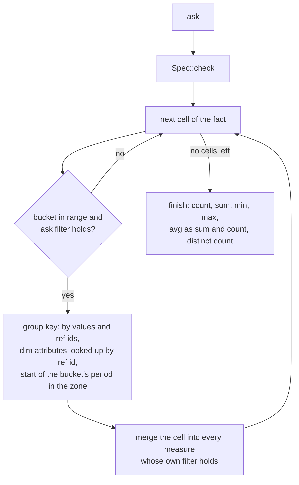
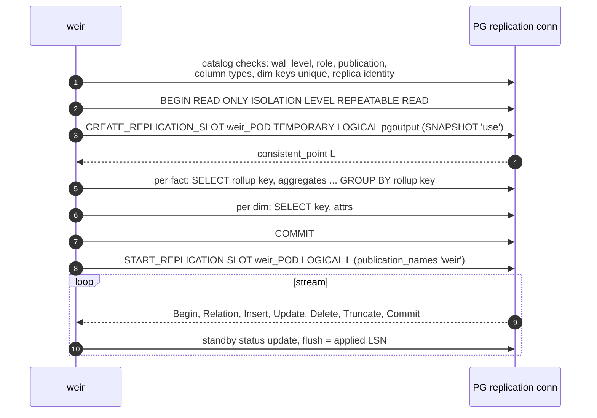
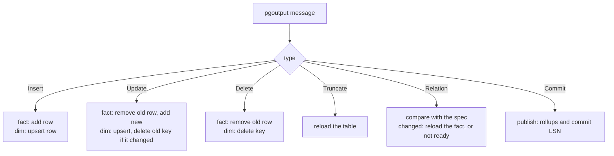
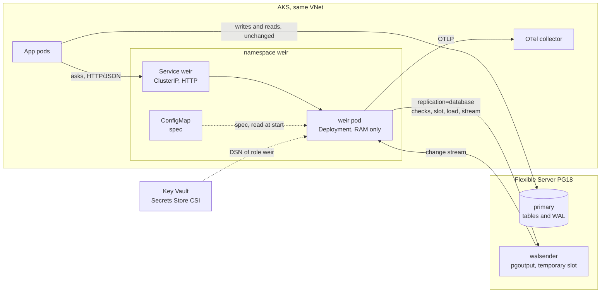
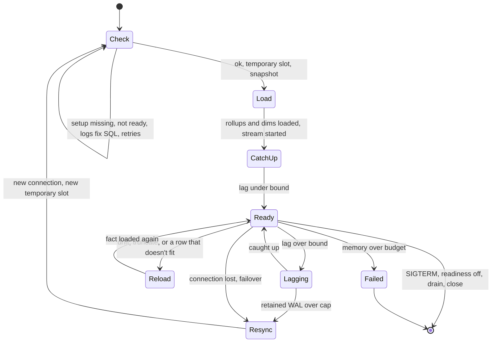

# weir architecture (2026-11-08)

How weir works since aggregates moved out of SQL and into weir's own
notation. PLAN.md tracks the build and holds the dated decisions this follows.
First target: AKS next to Azure Database for PostgreSQL Flexible Server 18
(AKS.md). The constraints are the managed ones: no custom extension, no
superuser, logical replication allowed. Tags as in README.md (R, U, I).
PostgreSQL paths are relative to `~/src/postgres`.

## In short

- A spec file declares facts, the dims they point at, and named measures.
  weir reads it at start.
- weir follows the fact and dim tables over logical replication and keeps one
  rollup per fact in RAM.
- Clients send asks over HTTP/JSON: measures, keys to group by, filters, a time
  zone and a time range. weir answers from the rollup, and every answer carries
  the LSN it reflects.
- PostgreSQL stays the source of truth. weir keeps nothing on disk and rebuilds
  from PostgreSQL on every start.
- Everything weir needs ships in stock PostgreSQL 18 and works on Azure:
  pgoutput, temporary logical slots, exported snapshots, SQL on a replication
  connection.

## 1. The spec

The taxi example (`crates/weir-notation/tests/taxi.weir`):

```text
dim zones = public.taxi_zones key location_id
  attrs borough, zone, service_zone

fact trips = public.yellow_trips key id
  time pickup_at / 15m
  ref pickup -> zones via pu_location_id
  ref dropoff -> zones via do_location_id
  by payment_type, vendor_id
  append
  trips count
  fare sum fare_amount
  tip_max max tip_amount
  distance avg trip_distance
  card count where payment_type = 1
  manhattan_pickups count where pickup.borough = 'Manhattan'
```

- `fact NAME = SCHEMA.TABLE key COLUMN`: a table aggregated into one rollup,
  and its primary key.
- `time COLUMN / GRAIN`: the time column and the bucket width. The grain
  divides a day; units are s, m, h and d.
- `ref NAME -> DIM via COLUMN`: an N:1 pointer from a fact column to a dim
  key. It is the only way a fact reaches another table, so a spec can't
  declare a fan-out.
- `by`: fact columns in the rollup key.
- `append`: rows are only inserted (§4b).
- Measures: `count`, `sum`, `min`, `max`, `avg` and `count_distinct`, each with
  an optional `where` of `=` or `in` on by columns, refs or ref attributes.
- `dim NAME = SCHEMA.TABLE key COLUMN` with `attrs`: a lookup table.

The rollup key is the by columns, then the ref ids, then the time bucket
(`Fact::rollup_key`). Dim attributes are never part of it. weir maps a ref id
to its attributes after aggregation, as Kylin does with derived dimensions
([Kylin cube design](https://kylin.apache.org/docs/3.1.3/howto/howto_optimize_cubes/)).
A change to a dim row therefore never touches a rollup. M1 checked this on one
month of NYC taxi trips: seven ask shapes gave the same rows from the rollup
as from the raw join in PostgreSQL (PLAN.md, M1).

`Spec::new` checks the declarations against each other and reports every
problem at once: duplicate names, a grain that doesn't divide a day, a column
used twice among time, by and ref, the fact's key in the rollup key, unknown
dims, and filters on anything outside the rollup key. Column types and keys are
checked against the catalog at start (M4).

There are no expressions, no joins and no SQL. An aggregate a spec can't
declare stays a query against PostgreSQL.

## 2. Asks

An ask names one fact and gives:

- measures, by name;
- keys to group by: by columns, refs, ref attributes such as `pickup.borough`,
  and at most one time key out of bucket, hour, day, week and month;
- filters, `=` or `in` on the same keys;
- a time zone;
- a half-open range `[from, to)` in Unix seconds, both ends on bucket edges.

`Spec::check` rejects asks the rollup can't answer exactly: unknown names, two
time keys, a time key the grain doesn't split (hour on a 2h grain), a range end
inside a bucket, and a zone whose offsets fall inside a bucket.

`Store::ask` answers from the cells:



- Filtered measures keep no state. Their conditions name rollup-key parts only,
  so a cell counts in whole or not at all.
- A ref id with no dim row maps to null attributes, as a left join would. This
  is an open question in PLAN.md.
- An ask without keys answers one row even when nothing matches, as SQL does
  without GROUP BY.
- sum, min and max come back in the column's scale. avg comes back as sum and
  count, so the caller picks the rounding.

Time zones: the HTTP adapter (M5) turns a zone name such as `Europe/Oslo` into
the zone's UTC offsets over the ask's range, so the domain carries no zone
data. Buckets stay UTC. Hours follow the instant, so an hour the clock repeats
stays two hours. Days, weeks (from Monday) and months follow the wall clock: a
repeated midnight counts from the first one, a skipped one from the jump. For
any time key but bucket, a zone whose offsets or changes fall inside a bucket
is rejected.

## 3. Rollups in memory

A rollup has one cell per rollup key. A cell holds its row count and one state
per input column, shared by the measures that read that column
(`crates/weir-domain/src/rollup.rs`):

- sum and avg share the column's sum (`i128`) and count of non-null values;
- min and max share a count per value, so deleting the current extreme reveals
  the next one;
- count distinct keeps a count per value.

Rows are added and removed, and a cell goes with its last row. Removing a row
that was never added is an error; the fact then reloads.

sum, avg, min and max read integers: integer columns, and numeric columns as
scaled `i64` (checked against the catalog in M4). An `i128` sum of `i64` values
can't overflow below 2^64 rows. Float columns are an open question.

Dims are kept as rows by key and read at ask time.

Memory follows cells, not rows, as long as rows collapse into far fewer cells.
They don't always. On the taxi spec M1 measured 2,964,624 trips in 2,322,783
cells at 15m, 1.3x, because pickup and dropoff zone together are nearly unique
per trip. 1h gave 1.8x, 1d 5.7x, and 15m without the dropoff ref 5.2x. Whether
`weir plan` should measure collapse before a load is open (PLAN.md).

count distinct costs one entry per distinct (cell, value) pair, so a column
that is nearly unique per row costs about as much as the rows. Roaring bitmaps
over a value dictionary are the likely way to shrink it (I, not built).

## 4. How weir uses PostgreSQL

### 4a. Start and initial load

The spec is known at start, so one slot and one snapshot serve every table:



- The load reads rollups, not rows. The `GROUP BY` computes the bucket in SQL
  (`date_bin`, as `bench/rollup.sql` does) and returns the row count, plus sum
  and count per sum input. min, max and count distinct need a count per value,
  so they group by the rollup key and the column; one query with `GROUPING
  SETS` can carry all of them (I).
- SQL and replication commands share one connection in logical walsender mode
  (`doc/src/sgml/protocol.sgml:2186-2190`, R), simple query protocol only
  (`:2193-2194`, R). weir needs no second connection until a barrier (§4c).
- `SNAPSHOT 'use'` must run first in a REPEATABLE READ, read-only transaction
  (`src/backend/replication/walsender.c:1342-1364`, R). The load sees the state
  at L, and the stream starts with the first commit after L.
- `TEMPORARY`: "Temporary slots are not saved to disk and are automatically
  dropped on error or when the session has finished"
  (`protocol.sgml:2371-2374`, R).
- The snapshot transaction pins xmin while the load runs and holds back vacuum
  for the whole database (POSTGRES-REPLICATION.md §4). Reading rollups keeps it
  short; how short is measured in M4.

### 4b. Apply



Old values: by default pgoutput sends only the key on DELETE and no old values
on an UPDATE that leaves the key alone. Only REPLICA IDENTITY FULL sends the
whole old row (POSTGRES-REPLICATION.md §3, R). So:

- `append` facts need inserts only. An UPDATE or DELETE on one reloads the
  fact.
- Mutable facts need the old row to take it out of its cell. Either the table
  gets REPLICA IDENTITY FULL, which writes the old row to WAL on every UPDATE
  and DELETE on the primary, or weir keeps a key-to-row store of each row's
  rollup key and inputs. Open question (PLAN.md).
- Dims need only the key: upsert on insert and update, delete by key.

Schema drift: pgoutput resets `schema_sent` when a table's relcache entry is
invalidated (`src/backend/replication/pgoutput/pgoutput.c:2122-2128`, R), so it
sends a Relation message before the next change to an altered table. weir
compares it with the spec and reloads the fact, or turns not ready if the spec
no longer fits. A table that is altered but not written to goes unnoticed until
its next change (I).

`streaming` is off in v1, so changes arrive after commit. A transaction larger
than `logical_decoding_work_mem` spills to the primary's disk
(POSTGRES-REPLICATION.md §6, R). Rollups change at Commit, so an ask never sees
half a transaction.

### 4c. Freshness

v1 has no barrier. Every answer carries the LSN and commit time it reflects,
and the client decides whether that is fresh enough. A per-ask barrier stays
possible: weir calls `pg_logical_emit_message(..., flush => true)` on a SQL
connection and answers once the stream passes the returned LSN
(POSTGRES-REPLICATION.md §8, R).

### 4d. Setup

`weir plan` (M4) reads the spec and prints the SQL an admin runs once:
`wal_level = logical` (PostgreSQL 18, needs a restart), `CREATE ROLE weir LOGIN
REPLICATION`, `GRANT SELECT` on the spec's tables, and `CREATE PUBLICATION weir
FOR TABLE` with the fact and dim tables.

- Adding a table to a publication needs ownership of it
  (`src/backend/commands/publicationcmds.c:2051-2054`, R); `FOR ALL TABLES`
  needs superuser (`publicationcmds.c:1508-1516`, R).
- Setup lives in the catalog and survives weir restarts, PostgreSQL restarts
  and failover. weir rechecks it on every start; if something is missing it
  stays not ready and logs the SQL `weir plan` would print.
- The spec names every column weir reads, so the publication could list only
  those columns. A column list must cover the replica identity, and REPLICA
  IDENTITY FULL allows none (`publicationcmds.c:404`, R). Without a list every
  column leaves the database, and column privileges and RLS don't apply to the
  stream. Open point.

## 5. Wire diagram



Every path already exists in the cluster: weir reaches PostgreSQL the way the
apps do, and apps reach weir in-cluster.

## 6. Code

Clean architecture as Cargo crates:

- `weir-domain`: spec, asks, rollups and the store. No I/O, no dependencies.
- `weir-notation`: parses spec text into a `Spec`.
- `weir-app` (M3): use cases (load fact, apply commit, answer ask, reload fact)
  behind ports (change source, loader, catalog).
- `weir-pg` (M4): catalog checks, snapshot load, pgoutput decoding.
- `weir-http` (M5): JSON asks, zone lookup, health and metrics.
- `weir`: the binary that wires them together.

The per-row path stays concrete; traits only at the ports. One writer applies
the stream and asks read published state. How readers and the writer share it
(`left-right`, or `arc-swap` over copy-on-write shards) is not chosen yet (U).

## 7. Lifecycle



- `/readyz` is true only in Ready. `/livez` checks the process only; lag never
  fails liveness.
- Resync closes the replication connection first, so PostgreSQL drops the old
  temporary slot before the new one exists.
- A spec change rolls the Deployment through a checksum annotation on the
  ConfigMap. The new pod loads from scratch.
- How one fact reloads while the others keep streaming is worked out in M3 and
  M4 (I).

## 8. RAM only

Nothing to persist, and the temporary slot is what makes that safe: a crashed,
OOM-killed or deleted pod leaves no slot behind, so it can't fill the server's
disk. The costs:

- **Every start is a full load**, one `GROUP BY` per fact under one snapshot.
- **The load pins xmin** for the whole database while it runs (§4a).
- **No slot failover.** "cannot enable failover for a temporary replication
  slot" (`src/backend/replication/slot.c:411-420`, R). Azure HA failover drops
  the connection and weir resyncs. In exchange, `sync_replication_slots` and
  `hot_standby_feedback` aren't needed.
- **Lag still holds WAL while connected.** Azure fixes `max_slot_wal_keep_size`
  at `-1` (MANAGED-POSTGRES.md). weir watches its retained WAL and resyncs past
  a cap.
- **Each replica is a slot plus a walsender**, and each walsender decodes all
  WAL (POSTGRES-REPLICATION.md §9). Default is one replica.

Not in v1: a warm start from a snapshot file. It needs a persistent slot to
resume from, which brings the WAL risk back.

## 9. Source modes: `wal_level`

PostgreSQL 18 is the floor; nothing older.

- PostgreSQL 18 with `wal_level = logical`: pgoutput and a temporary slot.
- PostgreSQL 18 with `replica`: weir refuses to start and says to set
  `wal_level = logical` and restart. A logical slot fails with "logical decoding
  requires \"wal_level\" >= \"logical\""
  (`src/backend/replication/logical/logical.c:121-123` as of `67c20979ce7^`, R).
- PostgreSQL 19 and later, `logical` or `replica`: under `replica`, PostgreSQL
  turns logical decoding on while a logical slot exists and off lazily after the
  last one goes (`67c20979ce7`, `logical/logicalctl.c:5-38`, R).

One code path covers all three. Azure Flexible Server 18 defaults to `replica`
(U), so it needs one restart with `wal_level = logical`.

## 10. Building blocks

- One static Rust binary (musl, or glibc static-pie) in a distroless
  `static:nonroot` image, amd64 and arm64 via `docker buildx`, with SBOM and
  provenance attestations.
- Pod: `runAsNonRoot`, uid 1001, drop ALL capabilities,
  `readOnlyRootFilesystem`, seccomp `RuntimeDefault`, no volumes.
- Memory: the cgroup v2 `memory.max` is the budget; weir watches
  `memory.pressure` and fails with a clear error before the kernel OOM-kills it.
  Memory request equals limit (Guaranteed QoS).
- tokio on epoll for the few sockets; rustls to PostgreSQL.
- Spec from a ConfigMap, DSN from an env var or a CSI-mounted secret.
- OTLP to the cluster's collector and Prometheus `/metrics`: applied LSN, lag,
  retained WAL, cells, bytes, ask latency.
- SIGTERM: readiness off, drain asks, close connections; PostgreSQL drops the
  temporary slot when the session ends.
- Local development: `docker compose` with `postgres:18` and `wal_level =
  logical`, plus weir. `bench/run.sh` already runs `postgres:18` in Docker.

## Open points

1. Which aggregates the apps need, and whether a spec can declare them.
2. Mutable facts: REPLICA IDENTITY FULL or a row store in weir (§4b).
3. Publication column lists from the spec (§4d).
4. How long the load pins xmin on real tables (§4a).
5. Low collapse: warn in `weir plan`, or leave it to the spec author (§3).
6. What clients do while weir is not ready: retry, or ask PostgreSQL.
