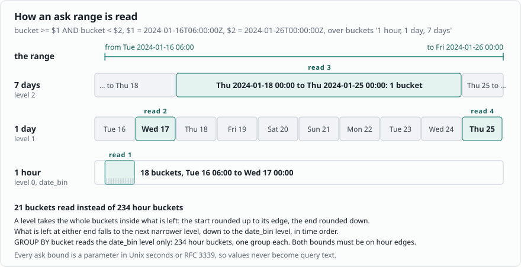
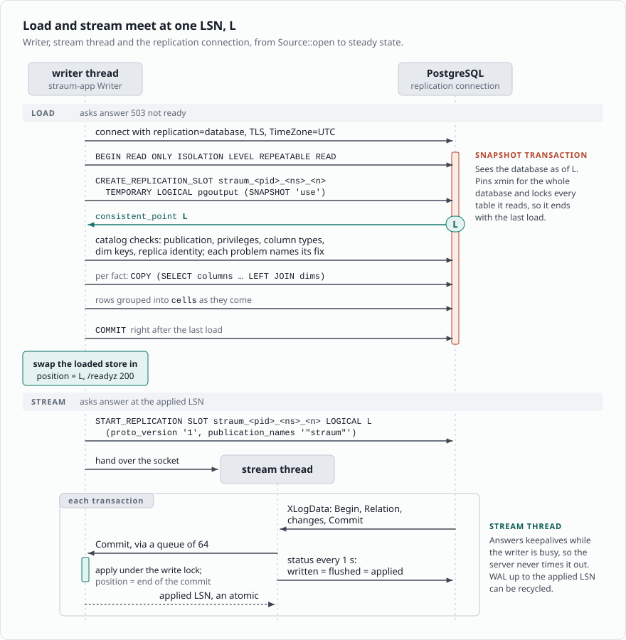
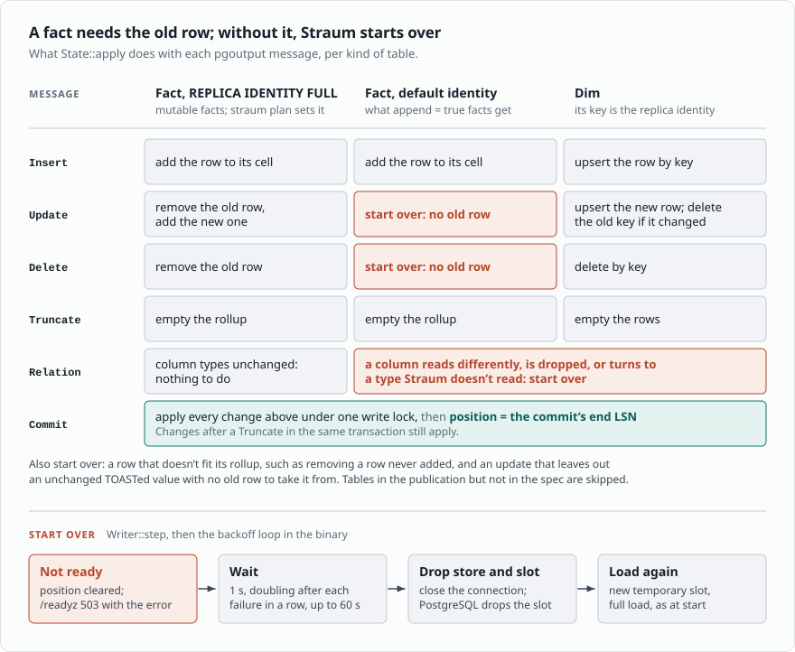
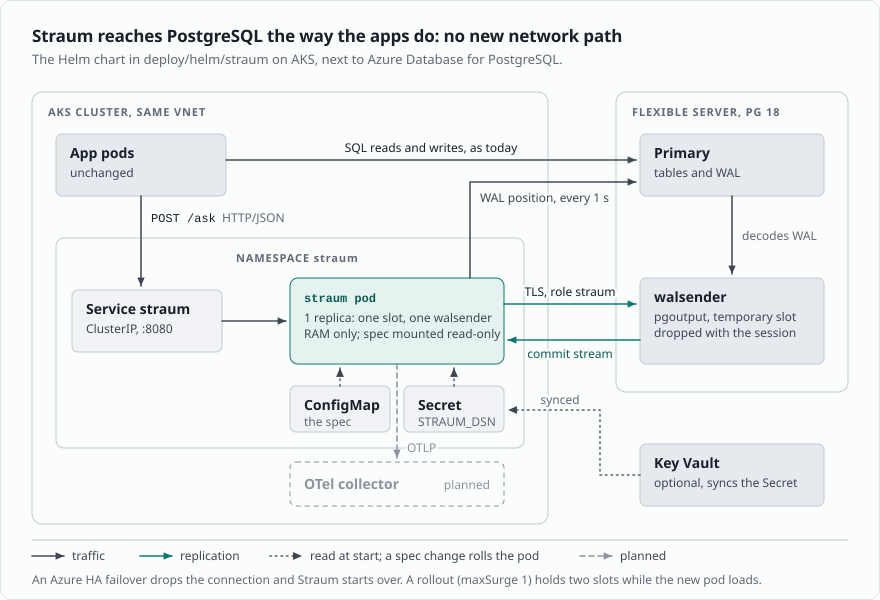
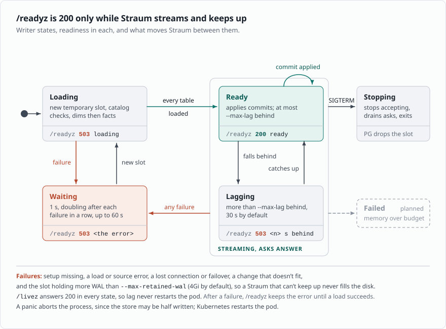

# Straum architecture (2026-11-10)

How Straum works since aggregates are declared in Straum SQL, a PostgreSQL
`CREATE VIEW` subset made only for Straum specs. `docs/adr/` holds the
decisions this follows; the user guide (`docs/`) says
how to use and run it.
First target: AKS next to Azure Database for PostgreSQL Flexible Server 18
(AKS.md). The constraints are the managed ones: no custom extension, no
superuser, logical replication allowed. Tags as in README.md (R, U, I).
PostgreSQL paths are relative to the root of [upstream PostgreSQL](https://github.com/postgres/postgres/tree/0f3b42ce806).

## In short

- A spec file declares facts, the dims they point at, and named measures.
  Straum reads it at start.
- Straum follows every spec table over logical replication and keeps one
  rollup per fact and one projection per dim in RAM, nothing else; an ask
  joins them as the dims are now (JOINS.md, ADR-0030).
- Clients send asks over HTTP/JSON: measures, keys to group by, filters and a
  time range, in UTC. Straum answers from the rollup, and every answer says
  how fresh it is.
- PostgreSQL stays the source of truth. Straum keeps nothing on disk and rebuilds
  from PostgreSQL on every start.
- Everything Straum needs ships in stock PostgreSQL 17 and newer and works on
  Azure: pgoutput, temporary logical slots, exported snapshots, SQL on a
  replication connection.

## 1. The spec

Straum SQL is not a SQL engine and not a query surface. It is a small subset of
PostgreSQL `CREATE VIEW` syntax, made only for Straum specs. `sqlparser`
parses it and `straum-notation` walks the AST; anything outside the subset is
an error that names it. The taxi example (`crates/straum-notation/tests/taxi.sql`):

```sql
CREATE VIEW trips WITH (buckets = '15 minutes, 1 day, 7 days') AS
SELECT date_bin('15 minutes', f.pickup_at, timestamptz 'epoch') AS bucket,
       f.payment_type AS payment_type,
       f.vendor_id AS vendor_id,
       f.pu_location_id AS pu_location_id,
       f.do_location_id AS do_location_id,
       pickup.borough AS borough,
       pickup.zone AS zone,
       pickup.service_zone AS service_zone,
       count(*) AS trips,
       sum(f.fare_amount) AS fare,
       max(f.tip_amount) AS tip_max,
       avg(f.trip_distance) AS distance,
       count(*) FILTER (WHERE f.payment_type = 1) AS card,
       count(*) FILTER (WHERE pickup.borough = 'Manhattan') AS manhattan_pickups
FROM public.yellow_trips AS f
LEFT OUTER JOIN public.taxi_zones AS pickup ON pickup.location_id = f.pu_location_id
GROUP BY 1, 2, 3, 4, 5, 6, 7, 8;
```

- `CREATE VIEW NAME`: one fact, aggregated into one rollup.
- `WITH (buckets = '15 minutes, 1 day, 7 days')` (required, ADR-0028):
  every bucket width Straum keeps, the `date_bin` width first, so an ask
  reads a long range from few cells (§3). Each wider width is a whole
  multiple of the width before it and, like `date_bin`'s, starts at the
  epoch, so 7-day buckets start on Thursdays. Answers don't change. PostgreSQL rejects view options, but
  Straum sends PostgreSQL neither the view nor its body. The `SELECT` alone
  runs in PostgreSQL as is, which makes it the reference for tests. The
  fact table needs no primary key: `REPLICA IDENTITY FULL` gives Straum the
  old row of every update and delete.
- `FROM SCHEMA.TABLE AS ALIAS`: the fact table.
- `INNER JOIN` or `LEFT OUTER JOIN SCHEMA.TABLE AS ALIAS ON ALIAS.KEY =
  NEAR.COLUMN`, with more equalities joined by `AND` for a key of several
  columns: a ref named `ALIAS` from columns of the fact, or of a dim joined
  before it, to a dim key. `WHERE EXISTS (SELECT 1 FROM SCHEMA.TABLE AS
  ALIAS WHERE ALIAS.KEY = NEAR.COLUMN)` and `NOT EXISTS` are the semi and
  anti joins. Any number of dim rows may match. A fact column joined on
  may be selected as a `by` column or left out; either way it keys the
  cells (ADR-0030).
- `date_bin('<n> <unit>', FACT.COLUMN, timestamptz 'epoch')`: the time column
  and the bucket width. The width divides a day; units are seconds, minutes,
  hours and days. The fixed origin puts buckets on midnight. A `timestamp`
  column, which has no zone, takes `timestamp 'epoch'` and is read as wall
  clock (M9).
- Other fact columns are `by` columns, in the rollup key. `(FACT.COLUMN IS
  NULL) AS NAME`, or `IS NOT NULL`, is a boolean `by` key: whether the
  column is null, which a nullable `completed` means something by (M9).
- The dim columns a view selects are the ref's attributes: keys like by
  columns, read through the cell's join columns at ask time, as the dim
  is now (JOINS.md). A left or inner join must select one; a semi or anti
  join selects none. A dim is its table: views that join it share it and
  must join on the same key, and its projection carries every column any
  view reads, chain links included.
- Measures: `count(*)`, `count(DISTINCT c)`, `sum`, `min`, `max` and `avg`,
  each `AS` a name and with an optional `FILTER (WHERE ...)` of `=` or `IN`
  on by columns or attributes the view selects, or `IS NULL` and `IS NOT
  NULL` on a column with a null-ness key, joined by `AND`.
- The view's `WHERE` holds conditions like a `FILTER`'s, plus the `EXISTS`
  forms; it drops rows from every ask.
- GROUP BY lists the positions of the keys in SELECT, so the view groups
  like the rollup (ADR-0029).
- Every column is `alias.column` and every select item has `AS name`;
  identifiers are unquoted.

The rollup key is the by keys, then each fact-side join column once, then
the time bucket (`Fact::rollup_key`). Straum holds each dim projected to
its key and the columns the views read (`Projection`), fed from the
stream like a fact, and an ask maps a cell's join columns through the
projections as they are at that commit (JOINS.md §1, §3d). So a dim
change is one projection entry and the next answer sees it; the trade is
cells: the rollup is keyed by the join column's many values, not the
attribute's few. Earlier designs bound the attributes at ingest, in
memory (M11) or in PostgreSQL (M12, ADR-0013), and a dim change was
invisible until Straum started over; JOINS.md §4 says why that went.
M1 checked the rollup against the raw join on one month of NYC taxi
trips; the PostgreSQL tests check every join kind on every change.

`Spec::new` checks the declarations against each other and reports every
problem at once: duplicate names, a grain that doesn't divide a day, the time
column as a key, a left or inner ref that reads nothing, a semi or anti
ref that reads anything, a chain through a later ref, a key of the wrong
width, unknown dims, and filters on anything the view doesn't select.
Column types, keys and chain links are checked against the catalog at
start (M5).

There are no expressions and no joins beyond refs. An aggregate Straum SQL
can't declare stays a query against PostgreSQL.

## 2. Asks

An ask names one fact and gives:

- measures, by name;
- keys to group by: the view's select names, such as `borough` for
  `pickup.borough AS borough`, and at most one time key, the UTC bucket;
- filters, `=` or `in` on the same keys;
- a half-open range `[from, to)` in Unix seconds, both ends on bucket edges.

`Spec::check_ask` refuses asks the rollup can't answer exactly: unknown
names, two time keys and a bound inside a bucket.

`Store::ask` answers from the cells:



- It reads only the buckets that cover the range: the widest the view keeps
  that fit, `date_bin` buckets at the ends, or only `date_bin` buckets when
  the ask groups by the bucket (§3).
- Filtered measures keep no state. Their conditions name rollup-key parts only,
  so a cell counts in whole or not at all.
- A cell whose dim row does not exist now reads null attributes under a
  left join, and is dropped under an inner or semi join (ADR-0030).
- An ask without keys answers one row even when nothing matches, as SQL does
  without GROUP BY.
- sum, min and max come back in the column's scale. avg keeps sum and count;
  HTTP rounds it half to even at four places past the scale.

Over HTTP (`crates/straum-http`), `POST /ask` takes a query in Straum SQL
and its parameters as JSON:

```json
{
  "query": "SELECT bucket, payment_type, borough, trips, fare, distance FROM trips WHERE borough IN ($1, $2) AND vendor_id = $3 AND bucket >= $4 AND bucket < $5 GROUP BY bucket, payment_type, borough",
  "parameters": ["Manhattan", "Queens", 2, "2024-01-01T00:00:00Z", 1706745600]
}
```

- The query is one `SELECT` over a view (`crates/straum-notation/src/sql/ask.rs`):
  keys then measures, `=` and `IN` joined by `AND`, and `bucket >= $n AND
  bucket < $m`. `bucket` is the time bucket, and a spec can't name anything
  else `bucket`. Time keys print as UTC RFC 3339.
- Every value is a `$n` parameter; a value written into the query is an
  error, so values never become query text. The bucket bounds are RFC 3339
  or Unix seconds, in whole seconds.
- A field Straum doesn't know, a key given twice, a parameter that isn't
  an integer, string or boolean, a parameter of another type than its
  column, and a construct outside the subset are errors that name it, never
  ignored. They come back together, as `{"errors": [...]}` with status
  400; type errors only once the rest pass, since they need the column.

The answer, with made-up values:

```json
{
  "as_of": "2024-01-31T22:59:59.123456Z",
  "rows": [{"bucket": "2024-01-01T00:00:00Z", "payment_type": 1,
            "borough": "Bronx", "trips": 412, "fare": 6234.50,
            "distance": 2.92017}]
}
```

The LSN goes in a `Straum-LSN` header.

- A bucket prints as its start, RFC 3339 in UTC.
- Numeric values are exact decimals in their column's scale. The load sets
  each column's type from the catalog (`Rollup::set_types`), answers carry
  the scales (`Answer::columns`), and a filter value of another type is an
  error (`AskError::WrongType`).
- Status 503 while a table the ask reads isn't ready.

## 3. Rollups in memory

A rollup has one cell per rollup key. A cell holds its row count and one state
per input column, shared by the measures that read that column
(`crates/straum-domain/src/rollup.rs`). Cells are kept per bucket, side by
side, so an ask reads only the buckets in its range. Each input's states sit
in flat columns of their own, so an ask merges a measure in one loop over a
column (PLAN.md 2026-11-09). Each rollup-key column
keeps its values once, under small codes, and a cell key is those codes.
With `buckets`, every wider width keeps its own cells too, and each row goes
into one cell per width. An ask reads its range from the widest buckets that
fit and narrower ones at the ends, or only `date_bin` buckets when it groups
by the bucket. Levels cost memory: on the taxi month, day and week levels
add 719,124 cells to the 2,322,783 at 15 minutes, 31% more
(`docs/src/benchmark.md`).

- sum and avg share the column's sum (`i128`) and count of non-null values;
- min and max share a count per value, so deleting the current extreme reveals
  the next one, and the current extremes beside it, so an ask reads no tree;
- count distinct keeps a count per value.

Rows are added and removed, and a cell goes with its last row. Removing a row
that was never added is an error; Straum then starts over.

sum, avg, min and max read integers: integer columns, and numeric columns as
scaled `i64` (checked against the catalog in M5). An `i128` sum of `i64` values
can't overflow below 2^64 rows. Float columns are an open question.

Beside the rollups, one projection per dim: a multimap from key to the
coded attributes of each row under it. An ask maps a cell's join codes to
attribute codes through it, memoised per distinct join tuple, so a group
by an attribute hashes no values and asks PostgreSQL nothing (ADR-0030,
JOINS.md).

Memory follows cells, not rows, as long as rows collapse into far fewer cells.
They don't always. On the taxi spec M1 measured 2,964,624 trips in 2,322,783
cells at 15m, 1.3x, because pickup and dropoff zone together are nearly unique
per trip. 1h gave 1.8x, 1d 5.7x, and 15m without the dropoff ref 5.2x. Whether
`straum plan` should measure collapse before a load is open (PLAN.md).

count distinct costs one entry per distinct (cell, value) pair, so a column
that is nearly unique per row costs about as much as the rows. Roaring bitmaps
over a value dictionary are the likely way to shrink it (I, not built).

## 4. How Straum uses PostgreSQL

### 4a. Start and initial load

The spec is known at start, so one slot and one snapshot serve every table:



- Each table, dim first, loads with one `COPY (SELECT <columns> FROM
  <table>) TO STDOUT (FORMAT binary)` (`load::copy_sql`), and Straum
  groups the fact rows and projects the dim rows itself
  (`crates/straum-pg/src/load.rs`, `Rollup::add_rows`,
  `Projection::add_rows`). No output functions run, and nothing from the
  spec runs there. A reader thread decodes batches of 8192 rows, four in
  flight, so a load holds about 1.2 MB per column besides the store
  (PLAN.md, 2026-11-09).
- SQL and replication commands share one connection in logical walsender mode
  (`doc/src/sgml/protocol.sgml:2186-2190`, R), simple query protocol only
  (`:2193-2194`, R). Loads come back as binary `COPY`; pgoutput v1 sends the
  stream's values as text, which Straum reads under the `DateStyle = ISO` and
  `TimeZone = UTC` it sets at startup (`crates/straum-pg/src/value.rs`).
- The catalog checks run before the slot, since below PostgreSQL 19 a server
  at `wal_level = replica` can't make one and PostgreSQL's error names no
  fix, and again in the slot's snapshot, so they see the tables as the load
  does. Each problem found names its fix (`crates/straum-pg/src/catalog.rs`).
- `SNAPSHOT 'use'` must run first in a REPEATABLE READ, read-only transaction
  (`src/backend/replication/walsender.c:1342-1364`, R). The load sees the state
  at L, and the stream starts with the first commit after L.
- `TEMPORARY`: "Temporary slots are not saved to disk and are automatically
  dropped on error or when the session has finished"
  (`protocol.sgml:2371-2374`, R).
- The snapshot transaction pins xmin while the load runs and holds back vacuum
  for the whole database (POSTGRES-REPLICATION.md §4). It also holds a lock on
  every table it read, which blocks `ALTER TABLE`. Straum commits it right after
  the last load, not at the first stream read (M5; a test's `ALTER TABLE`
  waited on it before). Reading only the spec's columns, in binary, keeps it
  short: the taxi month, 2,964,624 trips, loads in 2.0 s (PLAN.md, M5).

### 4b. Apply



Old values: by default pgoutput sends only the key on DELETE and no old values
on an UPDATE that leaves the key alone. Only REPLICA IDENTITY FULL sends the
whole old row (POSTGRES-REPLICATION.md §3, R). So:

- Facts need the old row to take it out of its cell, so every fact table
  has REPLICA IDENTITY FULL; Straum checks it at every start. FULL writes the
  old row to WAL on UPDATE and DELETE only, so a table that only gets inserts
  pays nothing for it. An UPDATE or DELETE that still comes without the old
  row, as after the identity is changed back, starts Straum over, and that
  start reports the missing FULL.
- Dims are in the stream like facts, with FULL (ADR-0031). A dim row's
  insert, update, delete or truncate applies to its projection in the
  same commit as the fact rows beside it; a dim row not held starts
  Straum over, as a fact row that doesn't fit does (JOINS.md §3c).
- Truncate empties the table in place. Changes before it in the transaction
  are gone, changes after it apply.

Starting over: a change Straum can't apply (no old row, a row that doesn't
fit the rollup, a changed Relation) is a failure like a lost connection
(`Writer::step`, `crates/straum-app/src/app.rs`; PLAN.md, MVP cuts,
2026-11-09). Reading one table again on a second connection was cut:

- Straum closes the stream, so PostgreSQL drops its temporary slot, waits,
  and loads every table from a new slot and its snapshot. A new slot
  reserves WAL from the current insert position
  (`src/backend/replication/slot.c:1759-1788`, R), and creating it waits for
  the transactions open at that moment
  (`src/backend/replication/logical/snapbuild.c:98-107`, R).
- Asks answer not ready until the new store is swapped in.

A commit's LSN is the end of its commit record, so "up to `at`" means the
commits that end at or before it. A transaction is decoded only if its commit
record starts at or past the start point
(`src/backend/replication/logical/snapbuild.c:305-311`, R), and pgoutput's
Commit carries the record's start, then its end
(`src/backend/replication/logical/proto.c:89-90`, R). M5 tested it: 2,000
single-row commits racing the slot's creation, three times, and no commit
lost or applied twice (`the_snapshot_and_the_stream_split_exactly`).

Schema drift: pgoutput resets `schema_sent` when a table's relcache entry is
invalidated (`src/backend/replication/pgoutput/pgoutput.c:2122-2128`, R), so it
sends a Relation message before the next change to an altered table. Straum
compares the columns it reads with those it loaded: a column that reads
differently, such as `numeric(10, 2)` turned `numeric(12, 3)`, starts Straum
over. A column dropped, or turned to a type Straum doesn't read, stops
the stream, and the setup check on the next start names it. A table that is
altered but not written to goes unnoticed until its next change (I).

An update that leaves a TOASTed value alone doesn't send it. Straum takes it
from the old row when one came; without one, it starts over.

`streaming` is off in v1, so changes arrive after commit. A transaction larger
than `logical_decoding_work_mem` spills to the primary's disk
(POSTGRES-REPLICATION.md §6, R). Rollups change at Commit, so an ask never sees
half a transaction.

### 4c. Freshness

v1 has no barrier. Every answer carries `as_of`, and the client decides
whether that is fresh enough: every commit made before it, by Straum's
clock, is in the answer. It is when the slot was last known to have
confirmed all the WAL the server had written (`Lag::caught_up`), so on a
quiet database it keeps moving. The LSN goes in a `Straum-LSN` header, for
debugging. A per-ask barrier stays
possible: Straum calls `pg_logical_emit_message(..., flush => true)` on a SQL
connection and answers once the stream passes the returned LSN
(POSTGRES-REPLICATION.md §8, R).

### 4d. Setup

`straum plan` reads the spec and prints the SQL an admin runs once
(`straum plan --spec FILE`, from `straum_pg::plan`): `wal_level = logical`
(needs a restart; 19 can stay at `replica`), `CREATE ROLE straum LOGIN
REPLICATION`, `GRANT SELECT` on the spec's tables, `CREATE PUBLICATION straum
FOR TABLE` with every table, and `REPLICA IDENTITY FULL` for each, dims
included (ADR-0031). A dim needs no index.

- Adding a table to a publication needs ownership of it
  (`src/backend/commands/publicationcmds.c:2051-2054`, R); `FOR ALL TABLES`
  needs superuser (`publicationcmds.c:1508-1516`, R).
- Setup lives in the catalog and survives Straum restarts, PostgreSQL restarts
  and failover. Straum rechecks it on every start; if something is missing it
  stays not ready and names each fix in its log, `/readyz` and
  `straum status`.
- The spec names every column Straum reads, so the publication could list only
  those columns. A column list must cover the replica identity, and REPLICA
  IDENTITY FULL allows none (`publicationcmds.c:404`, R). Without a list every
  column leaves the database, and column privileges and RLS don't apply to the
  stream. Open point.

## 5. Wire diagram



Every path already exists in the cluster: Straum reaches PostgreSQL the way the
apps do, and apps reach Straum in-cluster.

## 6. Code

Clean architecture as Cargo crates:

- `straum-domain`: spec, asks, rollups and the store. No I/O, no dependencies.
- `straum-notation`: walks the `sqlparser` AST of a Straum SQL spec into a `Spec`.
- `straum-app` (M3, M6): the use cases behind one port, `Source`: setup
  check, snapshot loads and the commit stream. One port, because the first
  load reads the snapshot of the slot the stream comes from, on the same
  connection. `App` is the store and how far it has followed the source;
  clones share it. `Writer::step` is the loop that does the I/O: it loads
  every fact or applies a commit, and starts over when a change no longer
  fits. `App::ask` answers with the LSN and `as_of`. About once a
  second the writer reads the server's WAL position for the lag and the
  WAL held for its slot (`crates/straum-app/src/lag.rs`, M7).
- `straum-pg` (M5, M7, M12): our own replication client on
  `postgres-protocol`. Catalog checks, binary `COPY` loads of each table
  in the slot's snapshot, pgoutput v1 decoding of facts and dims, the WAL
  readings on a plain side connection, and a thread that owns the stream:
  it answers keepalives and reports the applied LSN while the writer is
  busy.
  Synchronous; TLS is `rustls` on `rustls-graviola`
  (`crates/straum-pg/src/tls.rs`).
- `straum-http` (M6): hyper 1 on tokio, no framework; `/ask`, `/livez`,
  `/readyz` and `/status`. It reads the JSON around an ask, its query and
  parameters, by a walker over `serde_json` values without derive macros;
  the binary hands `serve` the query reader, `straum_notation::parse_ask`.
  `serve` itself checks that a range is one jiff can print, so no
  reader can make writing an answer panic. Asks run on tokio's blocking
  threads, since a big one reads every cell of a fact.
- `straum` (M6, M7): the binary. `straum run`, `straum plan` and
  `straum status`, arguments read by hand. One thread runs the writer and
  starts over after a failure, waiting 1 s, then twice as long each time up
  to 60 s. A panic aborts the process,
  since the store may be half written.

The per-row path stays concrete; traits only at the ports. One writer applies
the stream while asks read. They share one store behind an `RwLock`
(PLAN.md, 2026-11-09). The writer takes the write lock only to apply a commit
it has read or to swap a loaded store in. A start fills a new store outside
the lock, so asks never wait on PostgreSQL; they answer not ready until it
is swapped in. A long ask delays the writer,
which shows as lag. Copy-on-write shards (`arc-swap`) or `left-right` stay
open if that lag matters.

## 7. Lifecycle



- `/readyz` is true only in Ready; otherwise it answers 503 with the last
  failure, that it is loading, or how far behind it is. Ready means every
  table is loaded and the lag is within `--max-lag`; past it Straum is
  Lagging, and asks still answer, each with its LSN. `/livez` checks the
  process only; lag never fails liveness.
- Starting over closes the replication connection first, so PostgreSQL drops
  the old temporary slot before the new one exists.
- A spec change rolls the Deployment through a checksum annotation on the
  ConfigMap. The new pod loads from scratch.
- Any failure leads to Waiting, then Loading from a new slot: a source
  error, an altered table, a change that doesn't fit, or more than
  `--max-retained-wal` held for the slot. The wait starts at 1 s and doubles
  up to 60 s. Truncate empties a table in place.
- SIGTERM or SIGINT: Straum stops accepting, finishes the asks in flight and
  exits. PostgreSQL drops the temporary slots as the connections close.

## 8. RAM only

Nothing to persist, and the temporary slot is what makes that safe: a crashed,
OOM-killed or deleted pod leaves no slot behind, so it can't fill the server's
disk. The costs:

- **Every start is a full load**, one binary `COPY` per table under one
  snapshot.
- **The load pins xmin** for the whole database while it runs (§4a).
- **No slot failover.** "cannot enable failover for a temporary replication
  slot" (`src/backend/replication/slot.c:411-420`, R). Azure HA failover drops
  the connection and Straum starts over. In exchange,
  `sync_replication_slots` and `hot_standby_feedback` aren't needed.
- **Lag still holds WAL while connected.** Azure fixes `max_slot_wal_keep_size`
  at `-1` (MANAGED-POSTGRES.md). Straum reads the WAL held for its slot every
  second and starts over past `--max-retained-wal` (4Gi).
- **Each replica is a slot plus a walsender**, and each walsender decodes all
  WAL (POSTGRES-REPLICATION.md §9). Default is one replica.

Not in v1: a warm start from a snapshot file. It needs a persistent slot to
resume from, which brings the WAL risk back.

## 9. Source modes: `wal_level`

PostgreSQL 17 is the floor (jb, 2026-11-09). CI tests 17, 18 and 19rc1.

- PostgreSQL 17 and 18 with `wal_level = logical`: pgoutput and a temporary
  slot.
- PostgreSQL 17 and 18 with `replica`: Straum refuses to start and says to set
  `wal_level = logical` and restart. It checks before it makes the slot,
  since a logical slot fails with "logical decoding requires \"wal_level\" >=
  \"logical\"" (`src/backend/replication/logical/logical.c:121-123` as of
  `67c20979ce7^`, R), which names no fix.
- PostgreSQL 19 and later, `logical` or `replica`: under `replica`, PostgreSQL
  turns logical decoding on while a logical slot exists and off lazily after the
  last one goes (`67c20979ce7`, `logical/logicalctl.c:5-38`, R). The start check
  reads `server_version_num` to tell. On 19rc1 a temporary slot with an exported
  snapshot works under `replica`, and `effective_wal_level` reads `logical`
  while it exists.

One code path covers all of them. Azure Flexible Server 18 defaults to
`replica` (U), so it needs one restart with `wal_level = logical`.

## 10. Building blocks

- One static musl binary, built in `rust:1.99.1-alpine` and copied into
  `gcr.io/distroless/static-debian13:nonroot`, both pinned by digest
  (`Dockerfile`). CI builds it with one `docker build`; a multi-arch build,
  SBOM and provenance are not set up.
- Pod: `runAsNonRoot`, uid 65532, drop ALL capabilities,
  `readOnlyRootFilesystem`, seccomp `RuntimeDefault`; its only volume is the
  spec's ConfigMap, read-only.
- Memory: the pod's limit is the budget, and the chart sets the request
  equal to it (Guaranteed QoS). Straum doesn't watch it; a store that
  outgrows it is OOM-killed, and the next pod loads again.
- straum-pg is synchronous: sockets and one stream thread. tokio only in
  straum-http. TLS to PostgreSQL is `rustls` 0.23 on `rustls-graviola`, with
  Mozilla's roots or the PEM file `sslrootcert` names.
- Spec from a ConfigMap; DSN from `STRAUM_DSN`, which the chart reads from an
  existing Secret, or a file (`--dsn-file`), never from the command line.
- Telemetry: none yet; `GET /status` and `straum status` show `as of`, lag,
  WAL held, starts and failures. Telemetry is planned (ADR-0023).
- SIGTERM: readiness off, drain asks, close connections; PostgreSQL drops the
  temporary slot when the session ends.
- Local development: the guide's quick start runs `postgres:18` in Docker.
  Tests and `bench/bench.py` start their own PostgreSQL with
  testcontainers.

## Open points

1. Which aggregates the apps need, and whether a spec can declare them.
2. Publication column lists from the spec (§4d).
3. How long the load pins xmin on real tables (§4a).
4. Low collapse: warn in `straum plan`, or leave it to the spec author (§3).
5. What clients do while Straum is not ready: retry, or ask PostgreSQL.
6. An "as of" time from keepalives, so answers on a quiet database don't
   look stale (§4c).
7. Long asks delay the writer while they hold the read lock (§6).

Settled: every spec table takes REPLICA IDENTITY FULL, with no row store
in Straum (ADR-0031). Refs are bound at ask time against dim projections
held beside the cells, every join kind (ADR-0030; JOINS.md).
