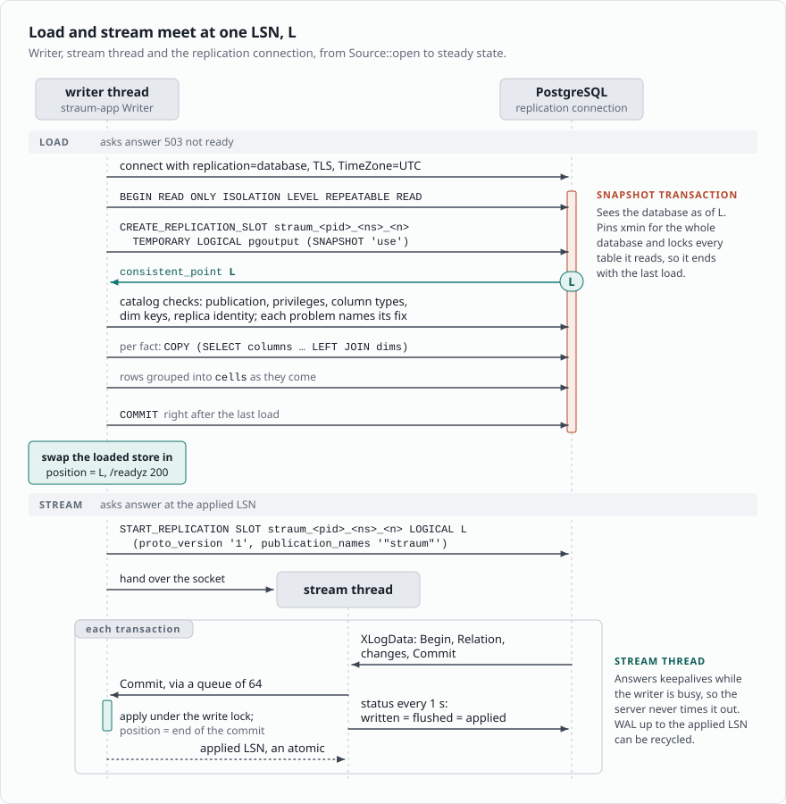
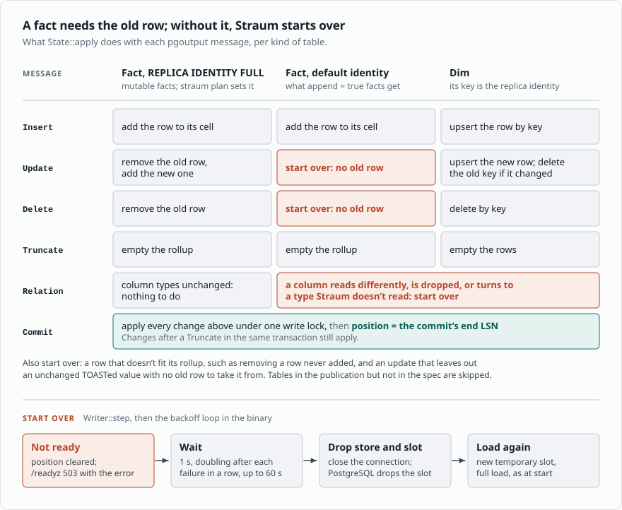
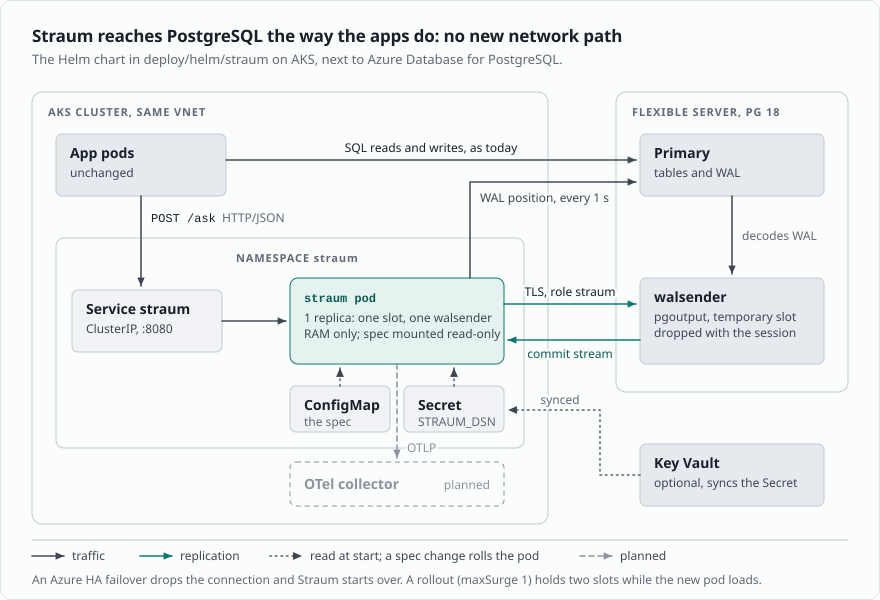

# Straum and PostgreSQL (2026-11-12)

How Straum uses PostgreSQL, what PostgreSQL guarantees it, what managed
services allow, and the first target, AKS next to Azure Database for
PostgreSQL Flexible Server 18. The design itself is
`docs/src/how-it-works.md`; `docs/adr/` holds the decisions this
follows; the guide says how to set PostgreSQL up and run Straum. Tags
as in README.md (R, U, I). PostgreSQL paths are relative to the root
of [upstream PostgreSQL](https://github.com/postgres/postgres/tree/0f3b42ce806),
`src/backend` unless stated; the replication tree was read on
2026-11-08 and the load-bearing citations re-read by hand that day.

Everything Straum needs ships in stock PostgreSQL 17 and newer and
works on Azure: pgoutput, temporary logical slots, exported snapshots,
SQL on a replication connection.

## 1. Start and initial load

The spec is known at start, so one slot and one snapshot serve every
table:

- Each table, dim first, loads with one `COPY (SELECT <columns> FROM
  <table>) TO STDOUT (FORMAT binary)` (`load::copy_sql`), and Straum
  groups the fact rows and projects the dim rows itself
  (`crates/straum-pg/src/load.rs`). No output functions run, and
  nothing from the spec runs there. A reader thread decodes batches of
  8192 rows, four in flight, so a load holds about 1.2 MB per column
  besides the store. This is the built-in tablesync's pattern
  (`replication/logical/tablesync.c:1413-1486`, R), one slot for every
  table instead of one per table.
- SQL and replication commands share one connection in logical
  walsender mode (`doc/src/sgml/protocol.sgml:2186-2190`, R), simple
  query protocol only (`:2193-2194`, R). Loads come back as binary
  `COPY`; pgoutput v1 sends the stream's values as text, which Straum
  reads under the `DateStyle = ISO` and `TimeZone = UTC` it sets at
  startup (`crates/straum-pg/src/value.rs`).
- The catalog checks run before the slot, since below PostgreSQL 19 a
  server at `wal_level = replica` can't make one and PostgreSQL's error
  names no fix, and again in the slot's snapshot, so they see the
  tables as the load does (`crates/straum-pg/src/catalog.rs`).
- `SNAPSHOT 'use'` must run first in a REPEATABLE READ, read-only
  transaction (`replication/walsender.c:1332-1373`, R). Creating the
  slot waits for the transactions open at that moment
  (`replication/logical/snapbuild.c:479-510`, R). The load sees the
  state at L, and the stream starts with the first commit after L.
- `TEMPORARY`: "Temporary slots are not saved to disk and are
  automatically dropped on error or when the session has finished"
  (`protocol.sgml:2371-2374`, R).
- The snapshot transaction pins xmin, data and catalog, while the load
  runs (`replication/logical/logical.c:491-511`, R), which holds back
  vacuum for the whole database, and it holds a lock on every table it
  read, which blocks `ALTER TABLE`. Straum commits it right after the
  last load. Reading only the spec's columns, in binary, keeps it
  short: the taxi month, 2,964,624 trips, loads in 2.0 s.

## 2. Apply

Old values (`access/heap/heapam.c:9357-9443`, R): under the default
identity an UPDATE carries old values only when a key column changed,
and then only the key columns; a DELETE carries only the key. Only
REPLICA IDENTITY FULL sends the whole old row, toasted values inlined,
as an `O` tuple (`replication/logical/proto.c:468-476`, `:546-551`,
R). So:

- Facts need the old row to take it out of its cell, so every fact
  table has REPLICA IDENTITY FULL; Straum checks it at every start.
  FULL writes the old row to WAL on UPDATE and DELETE only, so a table
  that only gets inserts pays nothing for it. An UPDATE or DELETE that
  still comes without the old row, as after the identity is changed
  back, starts Straum over, and that start reports the missing FULL.
- Dims are in the stream like facts, with FULL (ADR-0031). A dim row's
  change applies to its projection in the same commit as the fact rows
  beside it; a dim row not held starts Straum over, as a fact row that
  doesn't fit does.
- An unchanged TOASTed value is sent as `u`, not its bytes
  (`proto.c:815-823`, R); the old `O` tuple always has it. Straum takes
  it from the old row; without one, it starts over.
- Truncate has its own message (`protocol.sgml:7195-7248`, R). It
  empties the table in place: changes before it in the transaction are
  gone, changes after it apply.

Commit boundaries. A commit's LSN is the end of its commit record, so
"up to `at`" means the commits that end at or before it. A transaction
is decoded only if its commit record starts at or past the start point
(`snapbuild.c:305-311`, R), and pgoutput's Commit carries the record's
start, then its end (`proto.c:78-92`, R). Empty transactions emit
nothing (`replication/pgoutput/pgoutput.c:1593-1601`, R). Tested: 2,000
single-row commits racing the slot's creation, three times, and no
commit lost or applied twice
(`the_snapshot_and_the_stream_split_exactly`).

Starting over (ADR-0015): Straum closes the stream, so PostgreSQL drops
its temporary slot, waits, and loads every table from a new slot and
its snapshot. A new slot reserves WAL from the current insert position
(`replication/slot.c:1759-1788`, R). Asks answer not ready until the
new store is swapped in.

Schema drift. DDL is not replicated
(`doc/src/sgml/logical-replication.sgml:2351-2361`, R). pgoutput
resets `schema_sent` when a table's relcache entry is invalidated
(`pgoutput.c:2122-2128`, R), so it sends a Relation message before the
next change to an altered table. Straum compares the columns it reads
with those it loaded: a column that reads differently, such as
`numeric(10, 2)` turned `numeric(12, 3)`, starts Straum over. A column
dropped, or turned to a type Straum doesn't read, stops the stream,
and the setup check on the next start names it. A table that is
altered but not written to goes unnoticed until its next change (I).
Table rewrites are not decoded as DML (`access/heap/rewriteheap.c:628`,
`replication/logical/decode.c:936-938`, R).

Large transactions. `streaming` is off, so changes arrive after commit;
a transaction over `logical_decoding_work_mem` (64 MB) spills to the
primary's disk (`replication/logical/reorderbuffer.c:4033-4107`, R),
and decoding is one sequential loop (`walsender.c:3729-3745`, R), so a
big commit delays every later commit on the slot (I). Rollups change
at Commit, so an ask never sees half a transaction.

Keepalives and acks. The stream thread answers keepalives
(`protocol.sgml:2729-2768`, R) with a standby status update whose
flush position moves the slot (`walsender.c:2652-2658`, R);
`confirmed_flush` only moves forward (`logical.c:1930-1931`, R). WAL
release is not tied to it directly: `restart_lsn` follows the oldest
transaction still open in the reorder buffer (`logical.c:1956-1965`,
`snapbuild.c:1252-1269`, R), so one long-open transaction anywhere in
the database pins WAL however current the acks are (I).

## 3. Freshness

Straum reports `as_of` and the applied LSN (ADR-0007). Commit order is
not visibility order: the commit record is inserted before the
transaction leaves the procarray, with no lock spanning both
(`access/transam/xact.c:1488`, `:2446`; `storage/ipc/procarray.c:680-686`;
`snapbuild.c:478-484`, R). So a stream prefix up to L need not equal
any primary snapshot, but every transaction visible to a snapshot has
its commit record before any WAL written after the snapshot (I).

Ways to a barrier, none built:

- `pg_logical_emit_message(false, prefix, nonce, flush => true)`
  returns an LSN and forces a flush (`replication/logical/message.c:78-79`,
  R); it is callable by any role (`logicalfuncs.c:371-382`, R). Straum
  waits until it has applied past that LSN, then answers. Everything
  visible to the caller's snapshot is applied; the caller's own open
  transaction and older REPEATABLE READ snapshots are not covered (I).
- `WAIT FOR LSN` (PostgreSQL 19) is woken only by the walreceiver and
  local flushes, never by a walsender (`commands/wait.c:77-84`;
  `walsender.c` has no waker, R), so it can't track a logical consumer.
- Straum as a synchronous standby with `remote_apply`
  (`logical-replication.sgml:242-246`; `walsender.c:1604`, R) would
  make every visible transaction queryable, at the cost of commit
  latency, a stall per big transaction, and a Straum outage blocking
  writes unless `synchronous_standby_names` uses an ANY quorum. Managed
  services don't let a customer set it (§7).

## 4. Setup

`straum plan` prints the SQL a table owner runs once
(`docs/src/postgresql.md`). Why it is shaped so:

- `CREATE PUBLICATION` needs CREATE on the database
  (`commands/publicationcmds.c:856`, R); `FOR TABLE` needs ownership of
  each table (`:2051-2054`, R); `FOR ALL TABLES` and `FOR TABLES IN
  SCHEMA` need superuser (`:1508-1516`, `:963-966`, R), which no managed
  service gives. Replication slots need the REPLICATION attribute
  (`replication/slot.c:1700-1707`, R).
- The replica identity is checked when an UPDATE or DELETE runs on the
  primary, not at `CREATE PUBLICATION` (`executor/execReplication.c:1057-1157`,
  R): a published table without a replica identity fails the app's
  writes with "cannot update table ... because it does not have a
  replica identity and publishes updates". A wrong publication breaks
  the app, not only Straum. FULL on every spec table avoids it, and
  `straum run` checks `relreplident` on every start.
- The spec names every column Straum reads, so the publication could
  list only those columns. A column list must cover the replica
  identity, and REPLICA IDENTITY FULL allows none
  (`publicationcmds.c:404`, R). Without a list every column leaves the
  database, and column privileges and RLS don't apply to the stream.
  Open point.
- Row filters run in the walsender under a historic snapshot
  (`pgoutput.c:1590`; `publicationcmds.c:571-585`, R), and an UPDATE
  crossing one arrives as INSERT or DELETE (`pgoutput.c:1441-1469`, R).
  Not used; a view's `WHERE` is applied in Straum instead.
- Setup lives in the catalog and survives Straum restarts, PostgreSQL
  restarts and failover. Straum rechecks it on every start.

## 5. RAM only, slots and WAL

Nothing to persist, and the temporary slot is what makes that safe: a
crashed, OOM-killed or deleted pod leaves no slot behind, so it can't
fill the server's disk. The costs:

- **Every start is a full load**, one binary `COPY` per table under one
  snapshot. A warm start from a snapshot file would need a persistent
  slot to resume from, which brings the WAL risk back. Not built.
- **The load pins xmin** for the whole database while it runs (§1).
- **No slot failover.** "cannot enable failover for a temporary
  replication slot" (`replication/slot.c:411-420`, R). Failover slots
  need `sync_replication_slots`, `hot_standby_feedback` and a synced,
  persistent slot (`doc/src/sgml/logicaldecoding.sgml:415-427`,
  `:486-497`, R); none of that is needed. An HA failover drops the
  connection and Straum starts over.
- **Lag still holds WAL while connected.** `max_slot_wal_keep_size`
  defaults to unlimited (`utils/misc/guc_parameters.dat:2136-2143`, R)
  and Azure fixes it at `-1` (§7). Straum reads the WAL held for its
  slot every second and starts over past `--max-retained-wal` (4Gi).
- **Each replica is a slot plus a walsender**, and each walsender reads
  and decodes all WAL itself (`walsender.c:3729-3745`, R), so N slots
  cost about N times the decode (I). Default is one replica.

## 6. `wal_level` and the cost on the primary

PostgreSQL 17 is the floor (jb, 2026-11-09). CI tests 17, 18 and 19rc1.

- PostgreSQL 17 and 18 with `wal_level = logical`: pgoutput and a
  temporary slot. With `replica`, Straum refuses to start and says to
  set `logical` and restart; it checks before it makes the slot, since
  a logical slot fails with "logical decoding requires \"wal_level\" >=
  \"logical\"" (`replication/logical/logical.c:121-123` as of
  `67c20979ce7^`, R), which names no fix.
- PostgreSQL 19 and later, `logical` or `replica`: under `replica`,
  PostgreSQL turns logical decoding on while a logical slot exists and
  off lazily after the last one goes (`67c20979ce7`,
  `logical/logicalctl.c:5-38`, R). The start check reads
  `server_version_num` to tell. On 19rc1 a temporary slot with an
  exported snapshot works under `replica`.
- `wal_level = logical` logs more, most with REPLICA IDENTITY FULL
  (`doc/src/sgml/config.sgml:3295-3301`, R): same-page UPDATE
  compression is off for logically logged tables
  (`heapam.c:9079-9084`, R) and new tuple data is kept beside full-page
  images (`heapam.c:2147`, R). How much at the real write rate is open.

One code path covers all of them. Azure Flexible Server 18 defaults to
`replica` (U), so it needs one restart with `wal_level = logical`.

## 7. Managed PostgreSQL

Web research 2026-11-08; jb's constraint: Straum must work with only
what a customer can do alone (console, parameters, SQL). The guide's
[setup page](../docs/src/postgresql.md) has the parameter per provider.

- **Ingest is covered** on RDS, Aurora, Cloud SQL, AlloyDB, Azure
  Flexible Server, Supabase, Neon, Crunchy Bridge, Snowflake Postgres,
  DigitalOcean Standard, Aiven and PlanetScale, usually by one static
  parameter and a restart. Not on Heroku's classic tiers; unclear on
  Tiger Cloud, DigitalOcean Advanced, ClickHouse Managed Postgres and
  Databricks Lakebase (U).
- **Bounded WAL is partial.** `max_slot_wal_keep_size` is settable on
  RDS and Aurora, read-only `-1` on Azure, documented both ways on
  Cloud SQL, absent on AlloyDB. Hence `--max-retained-wal` in Straum.
- **Slot survival is weak** and irrelevant to a temporary slot: major
  upgrades drop slots on Cloud SQL, Aurora, AlloyDB, Aiven and
  Supabase; Neon and Lakebase drop slots stalled about 40 hours;
  PlanetScale drops slots made without `failover=true`. "Slot gone,
  start over" is Straum's normal path anyway.
- **Connections.** Use the direct endpoint, never the provider's
  pooler. Expect about 10 slots and 10 WAL senders by default, shared
  with the provider's own HA and CDC; Azure HA uses 4 of each.
- **No custom code anywhere.** No provider loads customer C code;
  pg_tle exposes only `passcheck` and `clientauth` hooks; PL/Rust left
  RDS at 18. That is why Straum needs no extension.
- **`synchronous_standby_names`** is read-only on Azure and absent from
  the Cloud SQL and AlloyDB flag lists, so the sync-standby barrier of
  §3 is not an option there.
- **Versions.** PostgreSQL 18 is GA on every major service; 19 on none
  as of 2026-11-08.

Provider notes with the sources:

- **AWS.** `rds.logical_replication=1`, static, reboot; slots need
  `rds_replication` ([RDS](https://docs.aws.amazon.com/AmazonRDS/latest/UserGuide/PostgreSQL.Concepts.General.FeatureSupport.LogicalReplication.html),
  [Aurora](https://docs.aws.amazon.com/AmazonRDS/latest/AuroraUserGuide/AuroraPostgreSQL.Replication.Logical.Configure.html)).
  `max_slot_wal_keep_size` settable ([RDS](https://docs.aws.amazon.com/AmazonRDS/latest/UserGuide/USER_PostgreSQL.Replication.ReadReplicas.Mechanisms-versions.html)).
  Aurora major upgrades require dropping all slots ([doc](https://docs.aws.amazon.com/AmazonRDS/latest/AuroraUserGuide/USER_UpgradeDBInstance.PostgreSQL.MajorVersion.html)).
- **Google Cloud.** `cloudsql.logical_decoding=on` with a restart; the
  user needs `WITH REPLICATION IN ROLE cloudsqlsuperuser`
  ([doc](https://docs.cloud.google.com/sql/docs/postgres/replication/configure-logical-replication)).
  AlloyDB: `alloydb.logical_decoding` ([flags](https://docs.cloud.google.com/alloydb/docs/reference/database-flags)).
  Major upgrades delete every slot on both ([Cloud SQL](https://docs.cloud.google.com/sql/docs/postgres/upgrade-major-db-version-inplace),
  [AlloyDB](https://docs.cloud.google.com/alloydb/docs/upgrade-db-inplace-major-version)).
- **Azure Flexible Server.** `wal_level=logical`, static, restart, then
  `ALTER ROLE <admin> WITH REPLICATION` ([logical](https://learn.microsoft.com/en-us/azure/postgresql/configure-maintain/concepts-logical)).
  `max_slot_wal_keep_size` read-only `-1`; `max_replication_slots` and
  `max_wal_senders` static, HA uses 4 of each ([params](https://learn.microsoft.com/en-us/azure/postgresql/parameters/parameters-replication-sending-servers)).
  Unused slots are dropped past an unpublished storage threshold
  ([limits](https://learn.microsoft.com/en-us/azure/postgresql/configure-maintain/concepts-limits)).
  `pg_ivm` is allowed in `shared_preload_libraries` ([preload](https://learn.microsoft.com/en-us/azure/postgresql/parameters/parameters-client-connection-defaults-shared-library-preloading)).
- **Others.** Supabase: `postgres` has REPLICATION, direct connection
  only ([doc](https://supabase.com/docs/guides/database/postgres/setup-replication-external)).
  Neon: enabling is irreversible and restarts every compute, 10 slots,
  stalled slots dropped ([doc](https://neon.com/docs/guides/logical-replication-neon)).
  Crunchy Bridge: `logical` by default with a real superuser
  ([doc](https://docs.crunchybridge.com/how-to/logical-replication)).
  Snowflake Postgres: `snowflake_admin` makes publications and slots
  ([doc](https://docs.snowflake.com/en/user-guide/snowflake-postgres/postgres-logical-replication)).
  Aiven: `avnadmin` has REPLICATION; slots don't survive major upgrades
  ([doc](https://github.com/aiven/aiven-docs/blob/main/docs/products/postgresql/concepts/upgrade-failover.md)).
  PlanetScale: slots need `failover=true` ([doc](https://planetscale.com/docs/postgres/integrations/logical-cdc)).
  Heroku: only the Advanced tier publishes ([doc](https://devcenter.heroku.com/articles/logical-replication-on-heroku-postgres-advanced)).

Tests still to run on live instances: `CREATE PUBLICATION ... FOR
TABLE` as a plain table owner on Cloud SQL and RDS; slot behaviour
across HA failover on Aurora, AlloyDB, Cloud SQL and RDS Multi-AZ.

## 8. The first target: AKS and Flexible Server

jb, 2026-11-08: ship Straum as a Helm chart into the same Kubernetes
cluster as the apps, with PostgreSQL 18 on Azure Flexible Server
outside it. Assumed: pods and the server share a VNet, apps already
reach PostgreSQL, `wal_level` is Azure's default `replica` (U), Query
Store or `pg_stat_statements` is on so the heavy aggregates can be
found from data, secrets come from Key Vault through the Secrets Store
CSI driver, and some teams deploy plain manifests, so the chart must
render cleanly with `helm template`.

Every path already exists in the cluster: Straum reaches PostgreSQL the
way the apps do, and apps reach Straum in-cluster. The chart is
described in `docs/src/running.md`; the choices made for Azure are a
Deployment with no PVC, one replica by default, and liveness on the
process only, since failing it on lag would turn a slow catch-up into
a restart loop. Setup on Flexible Server is one restart with
`wal_level = logical`, then the guide's steps; slot sync settings
aren't needed (§5).

Baseline to beat: `pg_ivm` maintains GROUP BY views with count, sum,
avg, min and max inside PostgreSQL, synchronously on every write, with
no new service. For a handful of fixed aggregates that may be enough;
its cost lands on the write path, and how much at the target write
rate is unknown (U). JOINS.md §2 has why it isn't the answer for many
views.

## Open points

1. Which aggregates the apps need, from Query Store, and whether a
   spec can declare them.
2. Publication column lists from the spec (§4).
3. How long the load pins xmin on the real tables, and how long a
   full load takes after a failover (§1, §5).
4. What REPLICA IDENTITY FULL costs the primary at the real write rate
   (§6).
5. Low collapse: warn in `straum plan`, or leave it to the spec author
   (`docs/src/benchmark.md`).
6. What clients do while Straum is not ready: retry, or ask PostgreSQL.
7. Long asks delay the writer while they hold the read lock (ADR-0009).
8. `helm template` output committed to the deploy repo, or a
   `HelmDeploy` step?
