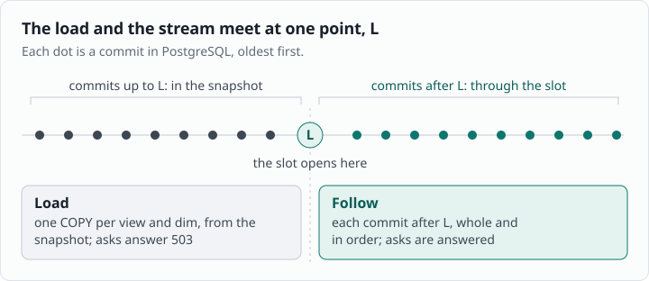
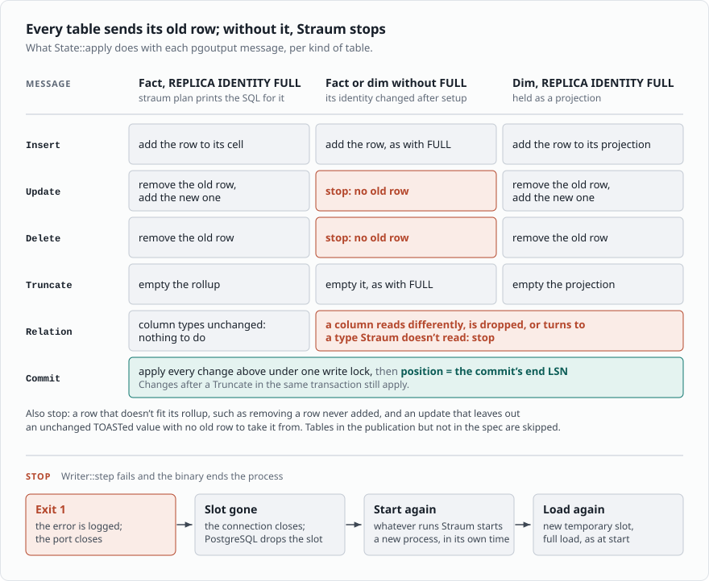
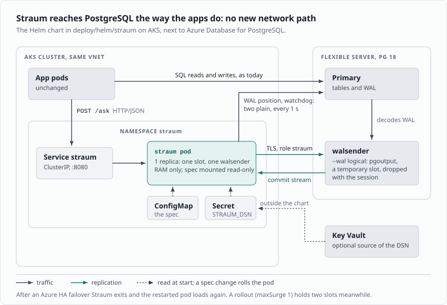

# Straum and PostgreSQL (2026-11-12)

How Straum uses PostgreSQL, what PostgreSQL guarantees it, what managed
services allow, and the first target, AKS next to Azure Database for
PostgreSQL Flexible Server 18. The design itself is
`docs/src/how-it-works.md`; `docs/adr/` holds the decisions this
follows; the guide says how to set PostgreSQL up and run Straum. Tags
as in README.md (R, U, I). PostgreSQL paths are relative to the root
of [upstream PostgreSQL](https://github.com/postgres/postgres/tree/0f3b42ce806),
`src/backend` unless stated; the replication tree was read on
2026-11-08 and the load-bearing citations re-read by hand that day.
Revised through 2026-11-21, when every citation of §1 to §6 was read
again at that commit and against Straum at `76862d3`.

Everything the logical stream needs ships in stock PostgreSQL 17 and
newer and works on Azure: pgoutput, temporary logical slots, a slot's
snapshot exported to a plain connection, SQL on a replication connection.
`--wal physical` needs none of those. It reads the WAL `replica` writes
(ADR-0008).

## 1. Start and initial load

The spec is known at start, so one slot and one snapshot serve every
table:

- Each dim, then each fact table, loads with one `COPY (SELECT
  <columns> FROM <table>) TO STDOUT (FORMAT binary)`
  (`load::copy_sql`). A table two views read is copied once, with every
  column either reads (`load::tables`, since 2026-11-22; before, once
  for each view), and Straum groups the fact rows and projects the dim
  rows itself (`crates/straum-pg/src/load.rs`). No output functions run, and
  nothing from the spec runs there. A reader thread decodes batches of
  8192 rows, four in flight beside the one being read and the one
  being added, so a load holds about 1.2 MB per column copied besides
  the store. This is the built-in tablesync's pattern
  (`replication/logical/tablesync.c:1413-1486`, R), one slot for every
  table instead of one per table.
- SQL and replication commands share one connection in logical
  walsender mode (`doc/src/sgml/protocol.sgml:2186-2190`, R), simple
  query protocol only (`:2194-2195`, R). Straum makes the slot there,
  and runs the setup check there when the slot is refused. Loads come
  back as binary `COPY` on a plain connection; pgoutput v1 sends the
  stream's values as text, which Straum reads under the `DateStyle =
  ISO` and `TimeZone = UTC` it sets at startup
  (`crates/straum-pg/src/value.rs`).
- The slot is made first, and the catalog checks run in its snapshot,
  so they see the tables as the load does. When PostgreSQL refuses the
  slot, as below PostgreSQL 19 at `wal_level = replica`, where its
  error names no fix, Straum runs the checks then and reports what they
  find (`crates/straum-pg/src/source.rs`,
  `crates/straum-pg/src/catalog/mod.rs`).
- The slot is made with `SNAPSHOT 'export'`, and its reply names the
  snapshot after the consistent point. A plain connection begins a
  REPEATABLE READ, read-only transaction and takes it up with `SET
  TRANSACTION SNAPSHOT` before the slot's connection sends
  `START_REPLICATION`. On PostgreSQL 17, 18 and 19 on 2026-11-23,
  through Straum's own client, the imported snapshot kept its rows after
  `START_REPLICATION`, the stream carried a commit made in between
  exactly once, and an import after `START_REPLICATION` failed with
  `snapshot "<name>" does not exist` (42704). Creating the slot waits
  for the transactions open at that moment
  (`replication/logical/snapbuild.c:1301-1306`, `:1479-1500`, R). The
  load sees the state at L, and the stream starts with the first commit
  after L; the stream thread reads it while the tables load.
- `TEMPORARY`: "Temporary slots are not saved to disk and are
  automatically dropped on error or when the session has finished"
  (`protocol.sgml:2371-2374`, R).
- The slot reserves the data xmin beside the catalog xmin while its
  snapshot is made (`replication/logical/logical.c:491-511`, R), and
  the snapshot transaction holds the data xmin while the load runs
  (`snapbuild.c:525-530`, R), which holds back vacuum for the whole
  database; the slot keeps the catalog xmin for as long as it lives.
  The transaction also holds a lock on every table it read, which
  blocks `ALTER TABLE`. Straum commits it right after the last load.
  Reading only the spec's columns, in binary, keeps it
  short: the taxi month, 2,964,624 trips, loads in 2.0 s.

## 2. Apply

Old values (`access/heap/heapam.c:9347-9443`, R): under the default
identity an UPDATE carries old values only when a key column changed or
holds an out-of-line value, and then only the key columns; a DELETE
carries only the key. Only
REPLICA IDENTITY FULL sends the whole old row, toasted values inlined,
as an `O` tuple (`replication/logical/proto.c:468-476`, `:546-551`,
R). So:

- Facts need the old row to take it out of its cell, so every fact
  table has REPLICA IDENTITY FULL; Straum checks it at every start.
  FULL writes the old row to WAL on UPDATE and DELETE only, so a table
  that only gets inserts pays nothing for it. An UPDATE or DELETE that
  still comes without the old row, as after the identity is changed
  back, stops Straum, and the next start reports the missing FULL.
- Dims are in the stream like facts, with FULL (ADR-0007). A dim row's
  change applies to its projection in the same commit as the fact rows
  beside it; a dim row not held stops Straum, as a fact row that
  doesn't fit does.
- An unchanged TOASTed value is sent as `u`, not its bytes
  (`proto.c:815-823`, R); the old `O` tuple always has it. Straum takes
  it from the old row; without one, it stops.
- Truncate has its own message (`protocol.sgml:7195-7248`, R). It
  empties the table in place: changes before it in the transaction are
  gone, changes after it apply.

Commit boundaries. A commit's LSN is the end of its commit record, so
"up to `at`" means the commits that end at or before it. A transaction
is decoded only if its commit record starts at or past the start point
(`snapbuild.c:305-311`, R), and pgoutput's Commit carries the record's
start, then its end (`proto.c:78-92`, R). Empty transactions emit
nothing (`replication/pgoutput/pgoutput.c:1593-1601`, R). Tested: 2,000
single-row commits racing the slot's creation, three times, and no
commit lost or applied twice
(`the_snapshot_and_the_stream_split_exactly`).

Stopping (ADR-0009): Straum logs the error and exits with 1. Its
connection closes, so PostgreSQL drops the temporary slot. Whatever
runs Straum starts it again, and the new process loads every table
from a new slot and its snapshot. A new slot reserves WAL from the
current insert position (`replication/slot.c:1759-1788`, R). Asks get
no answer until the new process listens, then not ready until its load
ends. Until 2026-11-17 Straum started over inside the process instead.

Schema drift. DDL is not replicated
(`doc/src/sgml/logical-replication.sgml:2351-2361`, R). pgoutput
resets `schema_sent` when a table's relcache entry is invalidated
(`pgoutput.c:2122-2128`, R), so it sends a Relation message before the
next change to an altered table. Straum compares the columns it reads
with those it loaded: a column that reads differently, such as
`numeric(10, 2)` turned `numeric(12, 3)`, stops Straum, and the next
start loads it as it now is. A column dropped, or turned to a type
Straum doesn't read, stops it too, and the setup check on the next
start names it. The stream says nothing of a table altered but not
written to, so about once a second Straum also reads each followed
column's type, the `xmin` of its catalog row and the table's file, and
`ALTER COLUMN .. TYPE` stops it with no write to the table
(`crates/straum-pg/src/catalog/followed.rs`). Table rewrites are not
decoded as DML: the heap `ALTER TABLE` writes anew is skipped
(`replication/logical/reorderbuffer.c:2371-2376`, R), and the TOAST
rows of a `REPACK` rewrite are marked not to be decoded
(`access/heap/rewriteheap.c:623-628`,
`replication/logical/decode.c:934-939`, R).

Large transactions. `streaming` is off, so changes arrive after commit;
a transaction over `logical_decoding_work_mem` (64 MB,
`utils/misc/guc_parameters.dat:1938-1946`, R) spills to the primary's
disk (`replication/logical/reorderbuffer.c:4033-4107`, R),
and decoding is one sequential loop (`walsender.c:3729-3745`, R), so a
big commit delays every later commit on the slot (I). Rollups change
at Commit, so an ask never sees half a transaction.

Keepalives and acks. The stream thread answers keepalives
(`protocol.sgml:2729-2768`, R) with a standby status update whose
flush position moves the slot (`walsender.c:2652-2658`, R);
`confirmed_flush` only moves forward (`logical.c:1930-1931`, R). WAL
release is not tied to it directly: `restart_lsn` follows the oldest
transaction still open in the reorder buffer (`logical.c:1956-1965`,
`snapbuild.c:1252-1269`, R), so one long-open transaction anywhere in
the database pins WAL however current the acks are (I).

## 3. Freshness

Straum reports `as_of` and the applied LSN (ADR-0005). Commit order is
not visibility order: the commit record is inserted before the
transaction leaves the procarray, with no lock spanning both
(`access/transam/xact.c:1488`, `:2446`; `storage/ipc/procarray.c:680-686`;
`snapbuild.c:478-484`, R). So a stream prefix up to L need not equal
any primary snapshot, but every transaction visible to a snapshot has
its commit record before any WAL written after the snapshot (I).

Ways to a barrier, none built:

- `pg_logical_emit_message(false, prefix, nonce, flush => true)`
  returns an LSN and forces a flush (`replication/logical/message.c:78-79`,
  R); it is callable by any role
  (`replication/logical/logicalfuncs.c:371-382`, R). Straum
  waits until it has applied past that LSN, then answers. Everything
  visible to the caller's snapshot is applied; the caller's own open
  transaction and older REPEATABLE READ snapshots are not covered (I).
- `WAIT FOR LSN` (PostgreSQL 19) waits for a standby's replay, write
  or flush or for the primary's flush (`commands/wait.c:77-84`, R). It
  is woken by local WAL flushes on a primary
  (`access/transam/xlog.c:682`, `:3009`, `:3198`), on a standby by the
  walreceiver and by replay (`replication/walreceiver.c:1074`, `:1119`;
  `access/transam/xlogrecovery.c:1804-1809`), and when recovery ends
  (`xlog.c:6949-6951`), never by a walsender (`walsender.c` has no
  waker, R), so it can't track a logical consumer.
- Straum as a synchronous standby with `remote_apply`
  (`logical-replication.sgml:242-246`; `walsender.c:1604`, R) would
  make every visible transaction queryable, at the cost of commit
  latency, a stall per big transaction, and a Straum outage blocking
  writes unless `synchronous_standby_names` uses an ANY quorum. Azure,
  Cloud SQL and AlloyDB don't let a customer set it (§7), and Straum's
  setup check has since refused a `synchronous_standby_names` that
  could name it (`docs/src/postgresql.md`).

## 4. Setup

`straum plan` prints the SQL a table owner runs once
(`docs/src/postgresql.md`). Why it is shaped so:

- `CREATE PUBLICATION` needs CREATE on the database
  (`commands/publicationcmds.c:856`, R); `FOR TABLE` needs ownership of
  each table (`:2051-2054`, R); `FOR ALL TABLES` and `FOR TABLES IN
  SCHEMA` need superuser (`:861-867`, `:963-966`, R), which most
  managed services don't give (§7; Crunchy Bridge does). Replication
  slots need the REPLICATION attribute
  (`replication/slot.c:1700-1707`, R).
- The replica identity is checked when an UPDATE or DELETE runs on the
  primary, not at `CREATE PUBLICATION` (`executor/execReplication.c:1049-1151`,
  R): a published table without a replica identity fails the app's
  writes with "cannot update table ... because it does not have a
  replica identity and publishes updates". A wrong publication breaks
  the app, not only Straum. FULL on every spec table avoids it, and
  `straum run` checks `relreplident` on every start.
- The spec names every column Straum reads, so the publication could
  list only those columns. A column list must cover the replica
  identity, and REPLICA IDENTITY FULL allows none
  (`publicationcmds.c:404`, R). Without a list every column leaves the
  database, and column privileges and RLS don't apply to the stream
  (I). Open point.
- Row filters run in the walsender under a historic snapshot
  (`pgoutput.c:1590`; `publicationcmds.c:571-585`, R), and an UPDATE
  crossing one arrives as INSERT or DELETE (`pgoutput.c:1441-1469`, R).
  Not used; a view's `WHERE` is applied in Straum instead.
- Setup lives in the catalog and survives Straum restarts, PostgreSQL
  restarts and failover. Straum rechecks it on every start.

## 5. RAM only, slots and WAL

Nothing to persist, and the temporary slot is what makes that safe: a
crashed, OOM-killed or deleted pod leaves no slot behind, so it can't
fill the server's disk. The costs:

- **Every start is a full load**, one binary `COPY` per dim and per
  fact table under one snapshot. A warm start from a snapshot file would need
  a persistent
  slot to resume from, which brings the WAL risk back. Not built.
- **The load pins xmin** for the whole database while it runs (§1).
- **No slot failover.** "cannot enable failover for a temporary
  replication slot" (`replication/slot.c:411-420`, R). Failover slots
  need `sync_replication_slots`, `hot_standby_feedback` and a synced,
  persistent slot (`doc/src/sgml/logicaldecoding.sgml:415-427`,
  `:486-497`, R); none of that is needed. An HA failover drops the
  connection, Straum stops, and the next start loads again.
- **Lag still holds WAL while connected.** `max_slot_wal_keep_size`
  defaults to unlimited (`utils/misc/guc_parameters.dat:2136-2143`, R)
  and Azure fixes it at `-1` (§7). Straum reads the WAL held for its
  slot every second and stops past `--max-retained-wal` (4Gi).
- **Each replica is a slot plus a walsender**, and each walsender reads
  and decodes all WAL itself (`walsender.c:3729-3745`, R), so N slots
  cost about N times the decode (I). Default is one replica.

## 6. `wal_level` and the cost on the primary

PostgreSQL 17 is the floor (jb, 2026-11-15). CI tests 17, 18 and 19.

- PostgreSQL 17 and 18 with `wal_level = logical`: pgoutput and a
  temporary slot. With `replica`, Straum refuses to start and says to
  set `logical` and restart; its setup check runs when the slot fails,
  since a logical slot fails with "logical decoding requires
  \"wal_level\" >= \"logical\""
  (`replication/logical/logical.c:121-123` as of `67c20979ce7^`, R),
  which names no fix.
- PostgreSQL 19 and later, `logical` or `replica`: under `replica`,
  PostgreSQL turns logical decoding on while a logical slot exists and
  off lazily after the last one goes (`67c20979ce7`,
  `replication/logical/logicalctl.c:5-38`, R). The start check reads
  `server_version_num` to tell. On 19 a temporary slot whose snapshot
  the load uses works under `replica` (`follows_at_replica_from_19`).
- `wal_level = logical` logs more, most with REPLICA IDENTITY FULL
  (`doc/src/sgml/config.sgml:3295-3301`, R): same-page UPDATE
  compression is off for logically logged tables
  (`heapam.c:9079-9084`, R) and new tuple data is kept beside full-page
  images (`heapam.c:2147`, R). How much at the real write rate is open.

One code path covers those `wal_level` cases. `--wal physical`
(ADR-0008) is the other path: it reads the WAL `replica` writes, so
no restart is required. Azure Flexible Server defaults to `replica`
(R, §7); whether it hands out the physical stream is untested (§8).

## 7. Managed PostgreSQL

Web research 2026-11-08; jb's constraint: Straum must work with only
what a customer can do alone (console, parameters, SQL). The guide's
[setup page](../docs/src/postgresql.md) has the parameter for RDS and
Aurora, Cloud SQL, AlloyDB and Neon. Every page cited below was read
again on 2026-11-21, and what had changed since is marked.

- **Ingest is covered** on RDS, Aurora, Cloud SQL, AlloyDB, Azure
  Flexible Server, Supabase, Neon, Crunchy Bridge, Snowflake Postgres,
  Databricks Lakebase, Aiven and PlanetScale, usually by one static
  parameter and a restart, and on DigitalOcean Standard (U). Not on
  Heroku's classic tiers; unclear on Tiger Cloud, DigitalOcean Advanced
  and ClickHouse Managed Postgres (U).
- **Bounded WAL is partial.** `max_slot_wal_keep_size` is a parameter
  on RDS and Aurora, read-only `-1` on Azure, settable on Cloud SQL
  between 100 GiB and 10 TiB
  ([flags](https://docs.cloud.google.com/sql/docs/postgres/flags)),
  absent on AlloyDB. Hence `--max-retained-wal` in Straum.
- **Slot survival is weak** and irrelevant to a temporary slot. A major
  upgrade deletes logical slots on Cloud SQL, wants them dropped first
  on AlloyDB, on Supabase
  ([upgrading](https://supabase.com/docs/guides/platform/upgrading))
  and, from a source below 17, on Aurora, and does not recover them on
  Aiven. Neon and Lakebase remove slots inactive about 40 hours. On
  PlanetScale a slot made without `failover = true` "will not survive
  a switchover or failover on its own". "Slot gone, load again" is
  Straum's normal path anyway.
- **Connections.** Use the direct endpoint, never the provider's
  pooler. Most default to 10 slots and 10 WAL senders; RDS from 16 has
  35 senders, Aurora 20 slots
  ([parameters](https://docs.aws.amazon.com/AmazonRDS/latest/AuroraUserGuide/AuroraPostgreSQL.Reference.ParameterGroups.html)),
  AlloyDB 50 of each. They are shared with the provider's own HA and
  CDC; Azure HA uses 4 of each.
- **No custom code anywhere.** No provider was found that loads
  customer C code (U);
  [pg_tle](https://github.com/aws/pg_tle/blob/main/docs/04_hooks.md)
  exposes only `passcheck` and `clientauth` hooks;
  [PL/Rust](https://docs.aws.amazon.com/AmazonRDS/latest/UserGuide/PostgreSQL.Concepts.General.Using.PL_Rust.html)
  left RDS at 18. That is why Straum needs no extension.
- **`synchronous_standby_names`** is read-only on Azure
  ([parameter](https://learn.microsoft.com/en-us/azure/postgresql/parameters/parameters-replication-master-server))
  and absent from the Cloud SQL and AlloyDB flag lists, so the
  sync-standby barrier of §3 is not an option there.
- **Versions.** PostgreSQL 18 is GA on every major service. 19 is GA on
  none; on 2026-11-21 Azure had 19.0 in preview, in one region
  ([versions](https://learn.microsoft.com/en-us/azure/postgresql/configure-maintain/concepts-supported-versions)).

Provider notes with the sources:

- **AWS.** `rds.logical_replication=1`, static, reboot; slots need
  `rds_replication` ([RDS](https://docs.aws.amazon.com/AmazonRDS/latest/UserGuide/PostgreSQL.Concepts.General.FeatureSupport.LogicalReplication.html)).
  Aurora takes the same parameter and a reboot of the writer
  ([Aurora](https://docs.aws.amazon.com/AmazonRDS/latest/AuroraUserGuide/AuroraPostgreSQL.Replication.Logical.Configure.html)).
  `max_slot_wal_keep_size` is a parameter, and `max_wal_senders`
  defaults to 35 from version 16 ([RDS](https://docs.aws.amazon.com/AmazonRDS/latest/UserGuide/USER_PostgreSQL.Replication.ReadReplicas.Mechanisms-versions.html)).
  An Aurora major upgrade from a source below 17 "can't proceed" with
  logical slots; from 17 they "can be retained through the upgrade"
  ([doc](https://docs.aws.amazon.com/AmazonRDS/latest/AuroraUserGuide/USER_UpgradeDBInstance.PostgreSQL.MajorVersion.html),
  as read on 2026-11-21; the note of 2026-11-08 had every slot
  dropped).
- **Google Cloud.** `cloudsql.logical_decoding=on` with a restart; the
  user needs the REPLICATION attribute, and `cloudsqlsuperuser` only
  for pglogical
  ([doc](https://docs.cloud.google.com/sql/docs/postgres/replication/configure-logical-replication)).
  AlloyDB: `alloydb.logical_decoding`, and 50 slots and 50 WAL senders
  by default ([flags](https://docs.cloud.google.com/alloydb/docs/reference/database-flags)).
  A major upgrade deletes all logical slots on Cloud SQL
  ([Cloud SQL](https://docs.cloud.google.com/sql/docs/postgres/upgrade-major-db-version-inplace))
  and wants them dropped first on AlloyDB
  ([AlloyDB](https://docs.cloud.google.com/alloydb/docs/upgrade-db-inplace-major-version)).
- **Azure Flexible Server.** `wal_level` defaults to `replica` and is
  static ([WAL settings](https://learn.microsoft.com/en-us/azure/postgresql/parameters/parameters-write-ahead-log-settings)).
  Set `logical`, restart, then
  `ALTER ROLE <admin> WITH REPLICATION` ([logical](https://learn.microsoft.com/en-us/azure/postgresql/configure-maintain/concepts-logical)).
  `max_slot_wal_keep_size` read-only `-1`; `max_replication_slots` and
  `max_wal_senders` static, HA uses 4 of each ([params](https://learn.microsoft.com/en-us/azure/postgresql/parameters/parameters-replication-sending-servers)).
  Unused slots are dropped past an unpublished storage threshold
  ([limits](https://learn.microsoft.com/en-us/azure/postgresql/configure-maintain/concepts-limits)).
  `pg_ivm` is allowed in `shared_preload_libraries` ([preload](https://learn.microsoft.com/en-us/azure/postgresql/parameters/parameters-client-connection-defaults-shared-library-preloading)).
- **Others.** Supabase: `postgres` connects for replication and can
  make a role `WITH REPLICATION` (I, from the page's example), direct
  connection only ([doc](https://supabase.com/docs/guides/database/postgres/setup-replication-external)).
  Neon: enabling is irreversible and restarts every compute, 10 slots,
  stalled slots dropped ([doc](https://neon.com/docs/guides/logical-replication-neon)).
  Crunchy Bridge: `logical` by default with a real superuser
  ([doc](https://docs.crunchybridge.com/how-to/logical-replication)).
  Snowflake Postgres: `snowflake_admin` makes publications and slots
  ([doc](https://docs.snowflake.com/en/user-guide/snowflake-postgres/postgres-logical-replication)).
  Aiven: `avnadmin` has REPLICATION
  ([tasks](https://github.com/aiven/aiven-docs/blob/main/docs/products/postgresql/concepts/dba-tasks-pg.md));
  slots don't survive major upgrades
  ([doc](https://github.com/aiven/aiven-docs/blob/main/docs/products/postgresql/concepts/upgrade-failover.md)).
  PlanetScale: slots need `failover=true` ([doc](https://planetscale.com/docs/postgres/integrations/logical-cdc)).
  Heroku: only the Advanced tier publishes
  ([doc](https://devcenter.heroku.com/articles/logical-replication-on-heroku-postgres-advanced),
  [tiers](https://devcenter.heroku.com/articles/heroku-postgres-advanced)).
  Databricks Lakebase: 10 slots and 10 WAL senders, and a slot inactive
  about 40 hours is removed
  ([doc](https://docs.databricks.com/aws/en/oltp/projects/logical-replication-manage)).

Tests still to run on live instances: `CREATE PUBLICATION ... FOR
TABLE` as a plain table owner on Cloud SQL and RDS; slot behaviour
across HA failover on Aurora, AlloyDB, Cloud SQL and RDS Multi-AZ.

## 8. The first target: AKS and Flexible Server

jb, 2026-11-08: ship Straum as a Helm chart into the same Kubernetes
cluster as the apps, with PostgreSQL 18 on Azure Flexible Server
outside it. Assumed: pods and the server share a VNet, apps already
reach PostgreSQL, `wal_level` is Azure's default `replica` (R, §7), Query
Store or `pg_stat_statements` is on so the heavy aggregates can be
found from data, secrets come from Key Vault through the Secrets Store
CSI driver, and some teams deploy plain manifests, so the chart must
render cleanly with `helm template`.

Every path already exists in the cluster: Straum reaches PostgreSQL the
way the apps do, and apps reach Straum in-cluster. The chart is
described in `docs/src/deploy.md`; the choices made for Azure are a
Deployment with no PVC, one replica by default, and liveness on the
process only, since failing it on lag would turn a slow catch-up into
a restart loop. The chart reads the DSN from a Secret and mounts no
CSI volume, and the driver syncs a Secret only while a pod mounts its
volume
([driver](https://secrets-store-csi-driver.sigs.k8s.io/topics/sync-as-kubernetes-secret)),
so something outside the chart has to make that Secret (I). Setup on
Flexible Server is one restart with `wal_level = logical`, then the
guide's steps. `--wal physical` with no `wal_level` change is not
tried there (U): a Microsoft answer of 2023 had a physical replication
connection refused for want of a `pg_hba.conf` entry, which a customer
can't add
([answer](https://learn.microsoft.com/en-us/answers/questions/1401129/azure-flexible-postgres-setup-up-hot-standby-outsi)).
Slot sync settings aren't needed (§5).

Baseline to beat: `pg_ivm` maintains GROUP BY views with count, sum,
avg, min and max inside PostgreSQL, synchronously on every write, with
no new service. For a handful of fixed aggregates that may be enough;
its cost lands on the write path, and how much at the target write
rate is unknown (U). JOINS.md §2 has why it isn't the answer for many
views.

## Open points

1. Which aggregates the apps need, from Query Store, and whether a
   spec can declare them.
2. Publication column lists from the spec (§4).
3. How long the load pins xmin on the real tables, and how long a
   full load takes after a failover (§1, §5).
4. What REPLICA IDENTITY FULL costs the primary at the real write rate
   (§6).
5. Low collapse: warn in `straum plan`, or leave it to the spec author
   (`docs/src/performance.md`).
6. What clients do while Straum is not ready: retry, or ask PostgreSQL.
7. Long asks delay the writer while they hold the read lock (ADR-0002).
8. `helm template` output committed to the deploy repo, or a
   `HelmDeploy` step?
